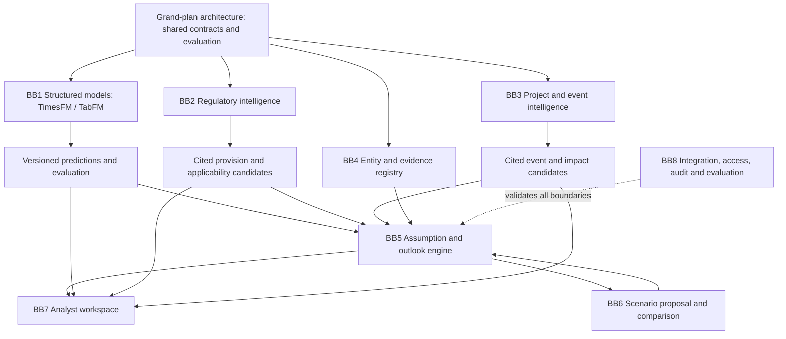

# Building-block composition architecture

2026-10-03. Logical specification, no implemented runtime. The
[grand plan](../work/building-blocks/intent.md) owns delivery organization;
[platform contracts](platform-contracts.md) own common identity/time/access/state invariants.
This document extends those contracts for independent model and text-intelligence development.

Registry ports are shared dependencies for every producer/consumer even where omitted from
the diagram. BB8 validates each block, not just BB5. Diagrams indicate data dependencies,
not mandatory deployment services or automatic acceptance/execution.

## Interchange contracts

All artifacts extend the common envelope with schema version, immutable artifact ID/digest,
producer/version, access scope, source references, created time and information cutoff.
Global dataset/model artifacts may have no case ID; they must declare dataset/task scope.
Linking them into a case creates an immutable case association without rewriting the artifact.
This explicitly extends the original case-bound envelope for reusable building blocks.

| Contract | Producer -> consumers | Required additional fields |
|---|---|---|
| DatasetSnapshot | BB1 via BB4 -> BB1/8 | Source versions/window/query digest, entity and quantity schema, units, raw/final status, missingness, first-availability basis and target/feature roles |
| FeatureSpec | BB1 -> BB1/8 | Transformation version, input revisions, availability rule, lag/window definitions, training-only fitting boundaries, missing-data handling, label maturity rule |
| ModelSpec | BB1 -> BB1/5/7/8 | Backend/model/version, target and task, horizon/resolution, context/training snapshot, transform version, configuration, supported output types, evaluation status |
| PredictionArtifact | BB1 -> BB5/7/8 | ModelSpec ref, forecast origin, input cutoff, entity/region, valid interval/horizon, units, point value or class scores, optional labeled quantiles, input snapshot, evaluation report ref |
| EvaluationReport | Every block -> BB8/7 | Task/dataset/corpus version, baseline, split or annotated-set specification, metrics by declared scope, failures, latency/cost where measured, thresholds fixed before evaluation and limitations |
| DocumentStructure | BB2 -> BB4/7 | Source version, page/section/paragraph/table locators, parser/OCR version, content digests, extraction-quality flags, hierarchy/cross-references |
| ProvisionCandidate | BB2 -> BB4/5/7 | Exact passage refs, issuer/jurisdiction, actor/action/object, conditions/exceptions, publication/effectivity/deadlines with precision, amendment/supersession refs, unresolved fields |
| RegulatoryChangeSet | BB2 -> BB5/7 | Compared source versions, provision additions/removals/changes, supported relationship basis, unresolved precedence and candidate affected entities/assumptions |
| EventCandidate / AssumptionImpactCandidate | BB3 -> BB4/5/7 | Exact support, candidate identity and mapping status, reported versus observed event, asserted time/quantity, source lineage, conflicts, proposed affected assumption/horizon |
| ReviewBundle | BB5 -> BB7 | Evidence pack, candidate refs, separately typed predictions, accepted prior, competing interpretations, unknowns and required reviewer actions |

Provision applicability is a separate reviewed interpretation referencing the candidate and
entity/time context; it is never inferred from parser completion. Predictions have status
experimental, evaluated or approved-for-declared-use with the evaluation/promotion decision;
none is an accepted assumption. A model experiment can succeed technically and fail promotion.

## Ports and composition rules

BB8 validates `PublishArtifact(artifact, expected_schema_version)` and stores permitted immutable
references; BB4 registers source/identity links. `GetArtifact(id, actor)` enforces current access.
`BuildReviewBundle(case, cutoff, actor)` requests authorized artifacts and retains record types.
Use the existing ReviewAssumption, PrepareScenario, CompareOutputs and AcceptOutlook ports
for consequential transitions. A parser/model adapter can publish candidates, not call acceptance.

For shared schemas, record IDs/references and exact time/unit meanings are language-neutral.
Initial interchange is schema-validated manifests plus versioned large-file references; don't
force full numerical arrays into JSON or a graph. The foundation intent selects executable
schema technology and local artifact storage. Private payloads never enter Git via fixtures.
Typed in-process app ports can consume the same artifacts; remote services are optional later.

BB1 may use a separate reproducible compute environment and export artifacts. BB2/3 share
source/locator types while owning their specialized parsing. BB4 owns canonical mapping and
evidence state. BB5 owns accepted beliefs. BB6 owns structural scenario semantics. BB7 owns
presentation, BB8 composition and validation. No block directly writes another block's state.

Numerical forecast origin, target valid time, artifact creation time and input cutoff are
different. Later truth labels are evaluation data, never evidence known at the forecast origin.
Backtests created today are labeled retrospective; model pretraining may carry hindsight even
when supplied context is clean. Regulatory features enter a model only through versioned,
reviewed feature definitions with point-in-time availability; extraction date cannot backdate
what the analyst/model could have known. Compare structured-only and augmented variants on
the same held-out origins before claiming benefit from their integration.

## Cross-block acceptance scenarios

| ID | Composition | Required observation |
|---|---|---|
| BC1 | BB1 dataset -> prediction -> BB7 | Reproducible target/units/origin; UI distinguishes prediction from observed series |
| BC2 | BB2 document -> provision -> BB4 -> BB7 | Exact locator opens original version; exceptions and unknown effectivity remain visible |
| BC3 | BB2 or BB3 -> BB5 -> BB6 | Reviewed entity/assumption mapping required before a scenario delta; no engine execution |
| BC4 | BB1 + BB2 + BB3 -> BB5 | Separate typed evidence/signals; no numerical prediction silently becomes accepted belief |
| BC5 | New document version arrives after prediction origin | Earlier strict dataset/review bundle excludes it; augmented-model replay cannot leak it |
| BC6 | BB1 unavailable or fails evaluation | BB2/3/5 manual analyst journey remains usable; failed model is not promoted |
| BC7 | BB2 amendment/exception unresolved | Relevant applicability and dependent delta blocked; unrelated model benchmark continues |
| BC8 | BB4 mapping/access change | Dependent drafts become stale or inaccessible; immutable historical references preserved safely |
| BC9 | BB1 structured-only vs text-augmented experiment | Same temporal holdout/budget and recorded transformations; measured differences with limits |
| BC10 | All required blocks in a permitted real case | Reviewed outlook with traceable support, optional compatible comparison, and manual-baseline evaluation |

These are planned tests, not executed evidence. Preserve the existing concurrency, approval,
compatibility and recovery checks in the earlier test matrix. Coordinator freezes schemas,
contracts and fixtures first; integrates each block's real producer before declaring its
consumers integrated. An unavailable block is an explicit state, never an invented output.
