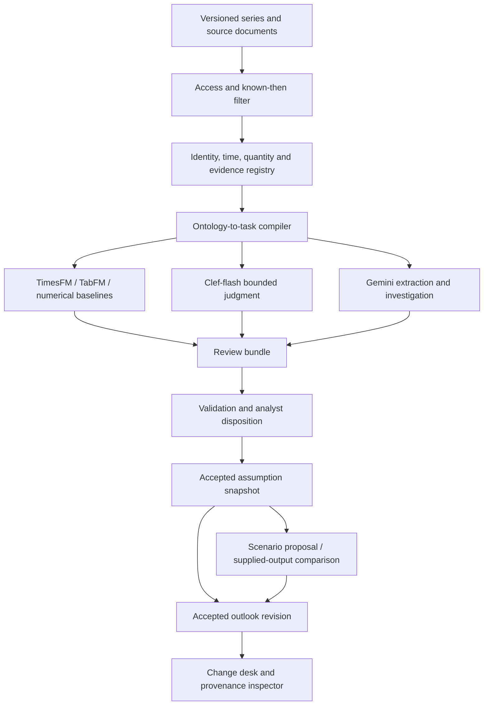

# Decision system v1: architecture of record

Selected 2026-10-04. A bounded modular application, not eight independently deployed services.
Extends existing platform contracts. This specification is definitive about responsibilities;
it is not a claim that the runtime is already implemented.

<!-- strategy-refresh-2026-10-11 -->
> **2026-10-11 note:** the [strategy refresh](../work/strategy-refresh-2026-10-11/strategy.md)
> revises the S1 row below (System One API port; Clef-flash Google-hosted or Gemini structured-output
> emulation; judgment unit is a compiled probe bundle with computed abstention) and adds a BigQuery
> `AI.FORECAST` what-if for reviewed deltas. Other selections stand.

## 1. Runtime and storage decisions

| Concern | v1 selection | Reason / boundary |
|---|---|---|
| Application | Python 3.11+, FastAPI, typed request/response models | Preserve stdlib domain core; SDKs only in adapters |
| Web interface | HTML, CSS and small ES modules, served by the app | Reuse the existing framework-free dashboard; avoid a frontend migration |
| Hosting | Google Cloud Run container | One deployable app and explicit IAM boundary |
| Identity | Firebase Authentication; verify tokens server-side | Server derives actor and case access; client cannot choose roles |
| Semantic store | Firestore Native, append-only revisions plus transactional heads | Small bounded cases; no unbounded graph queries |
| Numeric history | Existing GCS/BigQuery sources, bounded read adapters | No copy of every interval into a graph |
| Large source artifacts | Private, versioned GCS references and content hashes | Preserve original bytes and export policy |
| Generative model | Google-hosted Gemini; preferred smoke-test ID gemini-3.8-flash | Pin the actually working model/SDK/version and source contract |
| Numerical models | Existing TimesFM 2.5 / TabFM adapters; evaluated 3.0 challenger | No silent model swap; retain local baseline |
| S1 | Clef-flash candidate behind portable judgment port | GCP-hosted only after runtime/license/budget test; otherwise labeled replay or Gemini fallback |
| Search | Bounded hybrid text/metadata retrieval + explicit dependency traversal | Graphiti/HippoRAG/learned retrieval are later experiments |
| Secrets/telemetry | Server-only secret management, safe structured logging | Never send credentials or unrestricted case text to logs |

No external model call occurs inside a Firestore transaction. Such transactions may retry [I1].
Prepare and validate candidates outside the transaction; inside it verify expected heads and
append the decision, accepted head change, idempotency record and audit record atomically.

The fallback to Gemini is not described as a Clef run or as System One latency. Hosting all
substantive application state and required Google AI on GCP avoids making a competing cloud
the primary platform. Any optional external S1 service requires permitted data and rule review.

## 2. Logical flow

The branches are independent capabilities. Neither a low event score nor an unavailable model
suppresses relevant evidence. A semantic model cannot accept an assumption or call an execution
adapter. Task compilation is deterministic selection/formatting, not a model claiming authority.

## 3. Domain records

Retain SourceVersion, Passage, SeriesRef, Entity, MappingRevision, Claim, Interpretation,
AssumptionRevision, ReviewDecision, ModelRepresentation, ScenarioProposal, RunArtifact,
Comparison and OutlookRevision from the existing contracts.

Add **DecisionTaskSpec** (question semantics, ontology version, allowed labels, required context,
calibration policy, escalation rules), **CompiledTask** (exact evidence/assumption/mapping revisions,
cutoff, task digest and access scope), **JudgmentArtifact** (model/version, per-option scores,
execution mode, abstention, task reference), and **DependencyImpact** (changed dependency,
reachable dependents, reason and review-needed status).

BeliefSnapshot is an immutable manifest of accepted assumption heads at an audit cutoff.
Do not duplicate their values as a second authority. Every material comparison names the
snapshot, model version, quantities, horizons and compatible background-input digest.

## 4. Four metadata dimensions

- Content kind: observation, reported claim, derivation, prediction, interpretation, assumption,
  scenario input, simulation output, or review decision.
- Review state: unreviewed, proposed, retained, accepted, rejected, deferred, investigating.
- Availability: verified by cutoff, later than cutoff, unknown, denied.
- Execution mode: live inference, stored run, retrospective replay, deterministic, synthetic fixture.

A reviewer can accept an assumption; the source remains a reported claim. A supplied run remains
supplied. The current local preview uses fixtures, not a hosted model or production review state.

## 5. Ontology-to-task compiler

Input: authenticated actor, case, question/task revision, information cutoff and accepted snapshot.
Order: access filter -> availability filter -> reviewed identity -> context/type checks -> relevant
passages/series -> lineage grouping -> bounded task render -> canonical hash.

Return an immutable task with every allowed source reference and explicit omissions. Strict mode
excludes unknown/later availability. Exploratory evidence is separate and cannot silently enter
an accepted known-then result. Never reveal the existence/count of denied records.

A candidate relationship question can return supports/challenges/mixed/unrelated/insufficient.
The event model's target probability and that relationship probability remain separate. Do not
average them. Calibrators bind to task/model/version/region/horizon as applicable.

## 6. API boundary

All write requests have server-authenticated actor context, request ID, idempotency key and
expected revision. Case/tenant ownership is checked on every read and write.

| Endpoint intent | Allowed outcome |
|---|---|
| GET case workspace | Authorized projection with cutoff, modes and gaps |
| POST source registration | Versioned source reference, not factual acceptance |
| POST compile task | Reproducible permitted evidence/task manifest |
| POST candidate extraction/judgment | Validated proposal only |
| POST review decision | Atomic retain/revise/reject/defer/investigate transition |
| POST prepare scenario | Validated input-delta package, no execution |
| POST import/compare outputs | Comparable result or explicit incompatibility |
| POST accept outlook | Revision bound to accepted dependencies |
| GET provenance | Safe source/derivation path, not generated chain-of-thought |

No arbitrary SQL, arbitrary URL fetching, production model edits or shell execution is exposed
as a model tool. No initial HTTP endpoint runs PLEXOS or dispatches an operational action.

## 7. State changes

A candidate is proposed. Revise creates a new assumption revision after expected-head validation.
Retain records a reason and keeps the accepted value. Reject closes the candidate. Defer and
investigate preserve the accepted head and create open work. Stale browser state conflicts.

Changing evidence marks dependent drafts stale; it does not erase accepted history or assert
that every dependent conclusion is false. Reacceptance requires a refreshed dependency snapshot.
An unchanged citation URL with changed bytes is a new source version.

Scenario status: draft/blocked/reviewed/exported. Comparison status: pending/incompatible/comparable.
Export is not run permission. A future execution adapter needs approval bound to an input digest,
expiry, model/adapter and actor, plus idempotency and a run receipt. It is outside v1.

## 8. Numerical integrity

Enforce signed decimal values, units, quantity kind, source time zone, interval alignment, price
status, horizon and aggregation basis. A bag-of-numbers match is not numerical fact validation.
Do not strip negative signs to make an explanation pass. Link each displayed value to its field.

Features must have been available at origin; labels must have matured before the training cutoff.
Generated forecast features for a classifier must be out-of-sample at historical training origins.
Calibrate by actual task and horizon. Display bands only after evaluating their meaning.

Do not infer a joint event probability from marginal quantile forecasts. Do not clip physically
invalid forecasts without reporting the transformation and evaluating it. Do not double allocate
energy and reserve capability. Scenario outputs must match baselines, units, model versions,
regions, horizons and common background inputs before subtraction.

## 9. Data and operational security

Public judge sandbox and private analyst cases are separate namespaces and access policies.
Judge sandbox: permitted/synthetic corpus only, no user-selected arbitrary documents, no access to
private source manifests, no write capability outside its scoped session. Reset is session-local.
Anonymous access may view a safe demonstration; actual review writes require a verified session.
The browser never writes authoritative Firestore records directly. Server IAM and application
checks remain necessary; administrative credentials can bypass client security rules.

Prompt injection is untrusted source content. Extract bounded claims, verify citations, deny
source-provided tool instructions, and allow only named application ports. Escape source text
in the UI. Size-limit inputs; reject unexpected file types; restrict retrieval origins.

Cap request size, model tokens, retries, concurrency, query bytes and daily spend. Budget alerts
are not hard spending limits. Record measured p50/p95 latency and per-case cost before release.
Permission revocation is checked at export/read time, including old evidence manifests.

## 10. Reliability and deployment

Use explicit timeouts, one bounded retry for transient failures, recorded failure states and a
kill switch per adapter. A deterministic no-model path must preserve reading and human review.
Stored artifacts may support reproducible replay but must disclose run time and model version.
Do not call cached material live. Test cold startup and a private-data-free install.

Deploy from a reviewed image digest with service account scope, environment configuration,
health endpoint, safe logs and rollback revision. Select the GCP region only after all services
and data-residency requirements are verified; do not presume model availability from one source.
Authentication failures must not downgrade into private-data access.

## 11. Decision record

Selected now: modular GCP app; Firestore semantic revisions; exact source references; explicit
Python domain core; framework-light UI; Gemini core; portable numerical/S1 adapters; no operational
execution. Deferred: graph database, unrestricted crawling, autonomous tooling, S1 fine-tuning,
research foundation-model training and new regional data acquisition.

See the [ontology profile](ontology-profile-v1.md), [acceptance matrix](../work/hackathon-2026-10-04/acceptance-matrix.json)
and [source register](../research/28-research-grounding-2026-10-04.md) for authority and tests.
