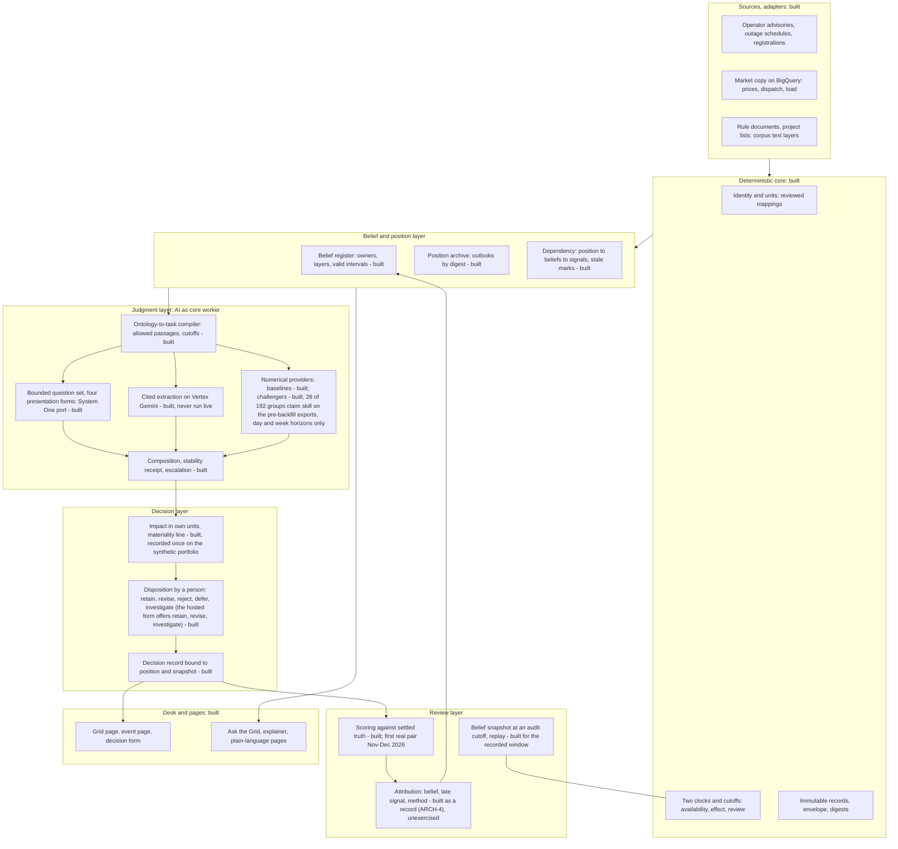

# Meta thesis, technical framework and architecture

2026-10-18: the desk band gained the dock (agent service), the synthetic book, the alerts and journal pages and the teammate's one-year replay; statuses below are as read at e179472.

Written 2026-10-16 by the guardian seat at the owner's request, after the two whiteboards of the same
day ([problem and thesis](../work/thesis-challenge-2026-10-16/problem-and-thesis.md),
[Future of Work case](../competition/ai-builder-cup-2026/future-of-work-case.md)). This page states the
thesis at its most general, the technical framework that carries it, and the architecture as built. It
cites the governing documents rather than replacing them: the
[working paper](../product/working-paper-2026-10-11.md) owns the method, the
[platform contracts](platform-contracts.md) own record ownership and ports, the
[decision system v1](decision-system-v1.md) owns the runtime choices. Every box below carries a status:
**built** (on `main`, merged with a reviewer accept, tested), **running** (a task worktree is live: none at
this reading), **designed** (intent written, no code), **recorded once** (ran once, result stored), **never run
live** (code exists, no live call). Statuses read at `main` e179472 on 2026-10-17, after IMPACT-1 and PRICE-3
merged with reviewer accepts (nine price-outlook tasks done). The
[companion paper](../product/paper-accountable-ai-decisions-2026-10-17.md) (revised 2026-10-17) carries
the same framework for an outside reader: the chain from signal to scored decision, the seven records
and their links, the scoring loop and the governed generative view as figures, with a checked reference
list. It says *belief* where this page says *assumption*; they are one record.

## 1. Meta thesis

The theories this thesis stands on, and where each is instantiated thinly, are on the
[theoretical foundation](theoretical-foundation.md) page.

The problem: who answers for a decision made with AI? AI can now read every signal and draft every
change. People still decide and still answer for the result. An organization that cannot show which
AI judgment it trusted, and why, either holds AI back and loses the work, or uses it blind and takes
decisions nobody can explain or learn from. The same problem stands at three levels: the work moves
from finding information to judging it and answering for it; the business pays in lost work or in
decisions it cannot review; a regulated sector's board and regulator must see who decided what, on
which evidence, when ([meta framing record](../work/meta-framing-2026-10-17/strategy.md); the
business level is a belief with first numbers, not a measured cost).

The mechanism underneath is belief maintenance. An organization holds working beliefs about its world,
reads signals, binds each signal to the belief it touches, revises or retains, and acts on the current
set. AI can now do the reading, binding and drafting at any scale. What it cannot supply is the two things an
organization needs before it will act on an AI-maintained belief set: trust in each judgment, and
traceability of every decision back to the beliefs and signals it rested on. Both are properties of
records, not of models.

Five propositions, each falsifiable:

1. **Beliefs, not information, are the bottleneck.** Decisions go wrong on beliefs that went out of date
   while the information to update them existed. Test: the share of outlook misses attributable to a
   belief that had changed before the cutoff. First number: where the operator's own schedule reflects a
   trip at all, it does so a median 8.5 hours after the advisory (27 matched rows of 148 late ones, typed
   matching; an earlier, looser pass gave 20.7), and 96.6% of 2026 outage advisories have no schedule row
   within six hours, a coverage gap ([VAL-1](../work/validation/outage-lag.md); VAL-1 record, in progress; the
   query runs on the company copy and cannot be re-run from this repository).
2. **Time is a first-class field.** A signal has an availability time and an effect time; a belief has a
   valid interval; a decision has an information cutoff and a review time. Without all of them a past
   decision cannot be replayed, and a replay is the only honest review. Test: any past day's accepted
   belief set is recomputable and leak-free.
3. **Trust is earned per judgment by structure.** Bounded questions, citations to records, cutoff
   discipline, stability across presentation forms, disagreement shown, scoring against settled truth, human
   disposition, immutable records. Test: a user can open each layer; the scorecard shows a bad model as
   bad.
4. **Materiality is measured in the organization's own units.** A signal reaches a decision-maker only
   when it moves the position's impact past a stated line. Test: the share of signals that pass the line,
   and the share of board items that carried their impact.
5. **Review attributes, it does not blame.** A miss is attributed to a belief, a late signal or the
   method. Test: on a scored month, the share of misses with an attribution.

The AI is the core worker of the desk and never the record of it. A model's answer becomes part of the
belief set only through a person's disposition, and the disposition is kept.

## 2. Technical framework: the seven records

The framework is seven record kinds and the invariants between them (the attribution, a record of its own beside the scoring receipt since ARCH-4, is counted with the receipt: the receipt "with attribution" is the receipt plus its attributions). Each is a validated, immutable,
content-addressed record in the common envelope of the [platform contracts](platform-contracts.md)
(`tenant_id`, `case_id`, `record_id`, `revision_id`, `recorded_at`, provenance, permissions). The four
metadata dimensions of the working paper apply to every record: content kind, review state,
availability relative to a cutoff, execution mode (live, stored run, replay, deterministic, synthetic).

| # | Record | Fields that matter | Code | Status |
|---|---|---|---|---|
| 1 | **Signal** (evidence) | source locator, passage spans, `available_at`, `effective_at`, access context, lineage | `src/review/records.py` (evidence kinds), `src/adapters/wesm`, `src/adapters/corpus`, `src/regulatory/lineage.py` | built |
| 2 | **Belief** (assumption) | proposition, family, layer (official, analytical, inferred, exploratory, hypothesis), source locator, `valid_from`, `valid_to`, state (accepted, unverified, contradicted), owner, falsifier | `src/review/records.py` (assumption kind), `src/outlook/register.py` | built (review core and register: 42 rows, 23 thresholds, 14 composer rows, 5 added by the first outlook) |
| 3 | **Position** (outlook, plan, case) | `issued_at`, `information_cutoff`, horizon, target reference, inputs by digest, belief ids, method and model version, values reference | `src/outlook/records.py` OutlookRecord; `src/price/*` for the price target | built |
| 4 | **Impact** | position times the served position (portfolio, budget), in own units, materiality line stated before scoring | `src/price/impact.py` (IMPACT-1) | built; recorded once as a method demonstration on the synthetic portfolio against the pre-backfill exports (12 nodes, a stated line of one million pesos) |
| 5 | **Decision** | disposition (retain, revise, reject, defer, investigate; the hosted form offers retain, revise and investigate); the outlook revision's state (the reviewed belief set) is accepted or open; reason, actor, `decided_at`, position version, belief snapshot at cutoff | `src/review/records.py` (review decision kind), `src/review/repository.py`, Firestore adapter | built and hosted; exercised in smoke tests on copies of the PEDC Unit 2 case; the real case records no analyst disposition (corrected 2026-10-17) |
| 6 | **Scoring receipt** with attribution | `scored_at`, final truth version, metrics per horizon and slice, coverage, attribution to belief or signal or method | `src/outlook/records.py` ScoringReceipt, `src/price/scorecard.py`; `Attribution` record, `OutlookArchive.append_attribution`, `scripts/outlook/attribute.py` (the person-driven write path) | built; attribution built as a record of its own ([ARCH-4](../work/outlook-archive/attribution.md), 2026-10-17) and unexercised: no receipt exists to attribute until the first settled month |
| 7 | **Judgment** (AI) | compiled task context, bounded answers, citations by index into the context, stability receipt, model version, cutoff | `src/judgment/bundle.py`, `src/judgment/systemone.py`, `src/adapters/gemini`, `src/adapters/systemone` | built; the bounded question set ran once live on the PEDC case (two compiles); cited extraction over the rule documents is built and has never run (LIVE-3 deferred) |

Invariants, enforced in code or by test:

- A record is never edited. A change is a new revision with a time; the old one stays readable.
- No model call inside a storage transaction; no model output becomes a belief without a decision record.
- A judgment sees only passages whose `available_at` is at or before the task's cutoff. Citation indices
  refer to that immutable context, so citation membership is proved, not trusted.
- Final and real-time truth never mix in one scored series; gaps and administered periods are marked,
  never filled.
- Identity is a reviewed mapping, never a name match. Units are typed. Digests travel with inputs.
- `synthetic` is a field, carried truthfully; a real case cannot hold a synthetic artifact.
- No new record kind without a reviewed intent. Impact's intent is the IMPACT-1 brief; attribution's intent is written and independently reviewed ([ARCH-4 intent](../work/outlook-archive/attribution-intent.md), 2026-10-17) and the record is built the same day ([ARCH-4](../work/outlook-archive/attribution.md)), beside the receipt, never inside it.

## 3. Architecture

Reading the diagram: signals enter through adapters and are normalized by the deterministic core, which
owns identity, time and immutability. The belief register and the position archive are the state of the
organization's knowledge. The compiler turns one signal plus the beliefs it may touch into a bounded task
under the cutoff; the judgment layer answers it in three ways (bounded questions, cited extraction,
numbers) and composes one proposal with a receipt. The decision layer translates the proposal into impact,
applies the materiality line, and records a person's disposition. The review layer scores positions when
the truth settles, attributes misses, and feeds the register. The pages show all of it to people.

### Runtime

| Concern | Choice | Status |
|---|---|---|
| core | Python standard library only; no SDK import in `src/review`, `src/judgment`, `src/regulatory`, `src/outlook`, `src/price` | built |
| storage | Firestore for hosted cases and decisions, in-memory and file repositories for tests and local | built |
| serving | Firebase Hosting in front of Cloud Run; first screen served without the instance | built |
| identity | Firebase anonymous sessions; the user's own copy of a case | built |
| model transport | Vertex AI Gemini behind a signed-permission allowlist, budgets, destination allowlist, receipt sanitation (CORE-10) | built |
| data | BigQuery external tables over the company's market copy; exports de-identified for executor seats | built |
| build method | task graph, worktrees per task, executor model, independent reviewer model, runner that merges on green | built, in daily use |

### One signal through the system

1. An advisory posts at 13:34. The adapter records it with `available_at` 13:34 and its effect time.
2. Identity resolves the unit to the registered resource by reviewed mapping.
3. The review core pairs the signal with the belief it touches; the dependency from positions to
   beliefs and their signals finds every position the belief feeds (built).
4. The compiler builds the task: the advisory passages, the belief, the position's horizon, the cutoff.
5. The judgment layer answers the bounded questions in four presentation forms (option order, option labels and passage order varied; yes/no questions also asked in negated wording; no rephrasing) and composes one proposal with a
   stability receipt and citations.
6. Impact: the proposal's effect on the position, times the served portfolio, in pesos; the materiality
   line decides whether it reaches the board or stays on the desk.
7. A person disposes: retain with a reason, revise, reject, defer or investigate (the hosted form offers
   retain, revise and investigate); the outlook revision's state (the reviewed belief set) is accepted or open. The decision record binds the
   disposition to the position version and the belief snapshot.
8. When the month settles, the scoring receipt scores the position; a person attributes any miss to a belief, a signal or the method in an attribution record beside the receipt (built, unexercised).
9. The register is updated; stale positions are marked, never erased; the next outlook starts from the
   new snapshot.

Steps 1 to 5, 7 and 9 are built; 1, 2, 4 and 5 were exercised on the PEDC Unit 2 case of 21 September
2026, with the belief snapshot at the audit cutoff from the review core; step 7 was exercised in smoke
tests on copies of that case, and the real case records no analyst disposition (corrected 2026-10-17);
3 and 9 were exercised on the first issued outlook. Step 6 is built and recorded once on the synthetic portfolio (IMPACT-1); step 8's receipt is built and
waits for the first settled month. Statuses read at `main` e179472.

## 4. What is generic and what is a plug-in

| Generic (the framework) | Domain plug-in (this instance) |
|---|---|
| the seven record kinds and their invariants | the WESM ontology profile: resources, nodes, regions, billing month |
| two clocks, cutoffs, replay | the posting and effect times of NGCP and PEMC records |
| the belief register with layers and owners | the three families: demand, supply, rules |
| the compiler and the bounded question set contract | the eight questions and their event vocabulary |
| the judgment ports: questions, cited extraction, numbers | Gemini on Vertex; System One; the price baselines |
| impact in own units with a materiality line | pesos on a retail portfolio against settlement prices |
| scoring against settled truth with attribution | final settlement prices on the billing-month clock |
| the desk pages and the plain-language rules | the grid page, the event page, the Ask the Grid pages |
| the build method with records and reviews | the seats, briefs and runner in `scripts/seats` |

A second domain changes the right column only. That is the test of the framework and it has not been
run; it is a hypothesis.

## 5. Where this leaves the earlier architecture pages

The [platform boundaries](README.md) six-boundary table still governs ownership; the seven records map
onto it (signal to Evidence, belief to Research and assumptions, position and impact to Outlook and
Scenario, decision to Workflow, judgment to the compiler). The [decision system v1](decision-system-v1.md)
still governs the runtime. This page adds the meta thesis, the impact and attribution records, and the
status of every box as of 2026-10-16. Nothing here widens the frozen contracts.
