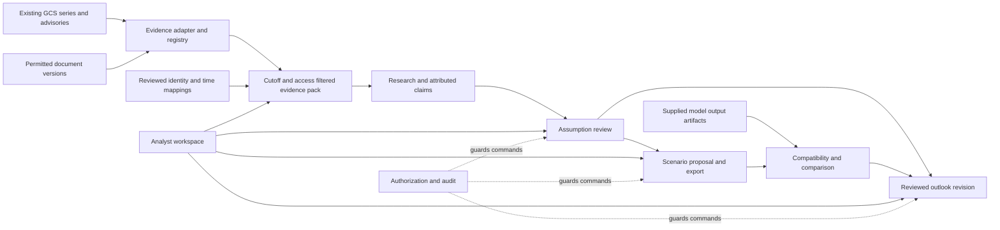

# Platform contracts and integration architecture

2026-10-03. Design specification, not implemented capability. Extends
[platform boundaries](README.md) under the [product strategy](../product/strategy.md).
Delivery and ownership: [capability building blocks](../work/building-blocks/blocks.md).
[Composition contracts](building-blocks.md) extend the common envelope for reusable
dataset/model artifacts and define regulatory/prediction interchange. Earlier technical
boundaries remain internal modules; they are no longer the workstream assignment units.

## Application shape

One modular application owns transactional semantic records. Browser/API, command handlers,
domain records, and infrastructure adapters are separate layers. Modules communicate through
typed application ports and immutable identifiers, never by writing another module's tables.
The first implementation intent must select a language, framework, transactional store,
authentication integration, migration mechanism and local test command together. Those choices
must follow the case's necessary queries; this design does not silently select a vendor.

AI adapters may propose claims, interpretations and scenario deltas through the same ports.
They have no acceptance or execution capability. Evaluation reads frozen snapshots and
authorized artifacts; it cannot mutate the accepted outlook. An execution adapter is absent
from the initial application.

## Common record envelope

Every domain record has an opaque stable `id`, `record_type`, `schema_version`, immutable
`revision_id`, `case_id`, `recorded_at` in UTC, authenticated `created_by` or explicit system
producer, `access_policy_ref`, and optional `supersedes_revision_id`. References bind exact
revision IDs, not mutable latest pointers. Required identity is never filled from prose.
Corrections append revisions. Mutable projections are rebuildable and are not authority.

Times use offset-bearing timestamps normalized to UTC; preserve supplied source zone and
precision. Date-only values remain dates with precision, never fabricated midnight instants.
Intervals are start-inclusive/end-exclusive. Unknown values use null plus `unknown_reason`.
Record event/valid time, publication time, effectivity, first-observed time and recorded time
separately where applicable. A permitted artifact reference includes a version/generation or
content digest; unavailable immutable source identity blocks claims of reproducible retrieval.

Quantities carry decimal value, quantity kind, unit, temporal basis, region and entity type.
Price series also carry currency and price status (including explicit unknown). Reject
implicit MW/MWh, timezone, aggregation or raw/final substitutions. Conversions and aggregate
derivations record input versions, formula, alignment policy and output units.

## Owned records and invariants

| Owner | Records and minimum domain payload | Constraints |
|---|---|---|
| Evidence | SourceVersion: artifact/version, publisher, publication/first-observed times and availability basis, lineage group, access; Passage: source revision, exact locator, content digest; SeriesRef: dataset/version, bounded interval, schema mapping, units, freshness and gaps | Extraction never overwrites source bytes; numerical histories stay in their existing store |
| Identity/time | Entity: type and canonical identifier; MappingRevision: source IDs/types, target IDs/types, cardinality, valid interval, status and reviewer | Plant, unit, resource and modeled aggregate remain distinct; overlapping contradictory mappings are unresolved |
| Research | Claim: subject, predicate, typed object, exact passage/derivation refs, attributed speaker, stated valid time; EventReport: claim refs and source-lineage group; Interpretation: supporting/challenging claim refs and unknowns | Claims are assertions by sources, not accepted facts; copies share lineage, not independent votes |
| Assumptions | AssumptionRevision: previous revision, typed value, scope/horizon, evidence-pack ref, mapping revision, model-representation ref if needed; ReviewDecision: disposition, target revision, reviewer, rationale, expected prior head | Retain/revise/reject/defer/investigate are distinct; only reviewed revisions become accepted |
| Scenario | ModelRepresentation: version, target object/field, unit, allowed values, mapping; ScenarioProposal: baseline digest, explicit deltas, unchanged background digest, horizon, expected output contract, review | Delta cannot target unresolved identity or an unspecified input representation |
| Comparison | RunArtifact: artifact digest, producer, model/config versions, exact input digest, horizon/calendar/resolution, units/metrics and provenance; Comparison: paired artifact revisions, compatibility verdict, differences and derivation | Imported artifact is labeled supplied, not executed here; missing provenance blocks quantitative comparison |
| Outlook | OutlookRevision: previous outlook, review decisions, prior/new accepted positions, cutoff, scenario/comparison refs, unresolved issues, reviewer | Retain is valid; proposal-only outlook explicitly says quantitative consequences uncomputed |
| Workflow | Actor/capability references, AuditEntry, future ExecutionApproval and ExecutionReceipt | Approval, review and receipt are separate types; a nullable record cannot imply authority |

Reviewing a claim's extraction fidelity does not accept the claim as an assumption. Research
and identity owners can propose records; only an authorized analyst may review mappings and
assumptions. A model representation is approved for a specific adapter/model version, not
automatically transferable to another model.

## Cutoff and access contract

`BuildEvidencePack(case_id, cutoff, mode, actor)` returns an immutable manifest of allowed
record revisions, excluded/unknown counts, source freshness, gaps, mapping revisions, and a
digest. First apply access policy, then availability and cutoff checks, then retrieval/ranking.
Counts and diagnostics must not reveal inaccessible content or its existence to unauthorized
actors. Every downstream material assertion references the manifest and exact support.

Strict replay includes only versions with demonstrated availability at or before the cutoff.
Publication alone does not prove historical availability to the workflow. A later system
observation cannot backdate availability without a separately recorded, reviewed availability
basis. Unknown availability is excluded from the known-then answer, with an appropriately
authorized diagnostic. Exploratory mode may display uncertain evidence in a separate labeled
section; it cannot enter a strict replay or accepted known-then claim silently.

Historical source availability and retrospective analyst review are separate. A review made
today may inspect a historical pack but must not appear as a decision made then. Temporal
queries distinguish information cutoff from record/audit cutoff. Revocation is checked at
read/export time even for old manifests; preserve the audit reference while denying content.

## Application ports

All commands receive authenticated actor context, request ID, idempotency key and expected
aggregate revision. The server derives actor identity; payloads cannot choose permissions.
Successful writes return committed revision IDs and audit correlation ID. Reusing an
idempotency key with identical input returns the original result; different input conflicts.

| Port | Input | Output / failure |
|---|---|---|
| RegisterEvidence | Permitted version reference, provenance, access policy, bounded source metadata | Source/series revision or access denied, missing version, unsupported schema |
| ReadSeriesWindow | Series revision, interval, required quantities and cutoff | Bounded typed rows plus coverage/freshness; no silent gap filling |
| ProposeMapping / ReviewMapping | Typed endpoints, validity/cardinality; reviewed candidate revision | Unresolved candidate or reviewed mapping; conflicting mapping blocks acceptance |
| BuildEvidencePack | Case, cutoff, strict/exploratory mode | Frozen manifest as above; empty and partial packs are explicit states |
| ProposeClaims | Pack revision and adapter/manual proposals | Validated attributed claims with exact support; invalid citation rejected |
| ReviewAssumption | Candidate revision, expected accepted head, disposition and rationale | Decision and accepted head change atomically when applicable; stale head conflicts |
| PrepareScenario | Accepted assumption refs, reviewed mapping/model representation, immutable baseline and explicit delta | Proposal/export manifest; blocked with structured reasons if a prerequisite is missing |
| ImportOutputs / CompareOutputs | Supplied artifacts and provenance; baseline/alternative pair | Compatible comparison or enumerated incompatibilities; never invented results |
| AcceptOutlook | Expected outlook head, accepted assumption snapshot, decisions and optional comparison | New immutable reviewed outlook; stale/mismatched dependencies rejected |
| GetCaseWorkspace | Case, actor, chosen cutoff and accepted revision | Projection of evidence, reviews, proposals, outlook and gaps; read-only derived view |

Error envelope: stable `code`, safe message, affected allowed record refs, retryable flag and
correlation ID. Minimum codes: ACCESS_DENIED, MISSING_INPUT, UNKNOWN_AVAILABILITY,
AMBIGUOUS_MAPPING, UNSUPPORTED_SCHEMA, STALE_REVISION, INCOMPATIBLE_OUTPUT,
VALIDATION_FAILED and ADAPTER_UNAVAILABLE. Unauthorized discovery uses the access policy's
non-disclosing not-found behavior. AI timeout preserves analyst/manual work; adapter errors
never advance workflow state.

## State and transaction boundaries

An assumption candidate starts proposed. Revise accepts a new value; retain records a reviewed
no-change decision against the current head; reject terminates the candidate; defer/investigate
leave the accepted head unchanged and record open work. Revisions after review require a new
candidate and decision. Each command writes its decision, head change and audit entry in one
transaction with optimistic concurrency. A stale browser cannot overwrite a newer review.

Scenario states are draft, blocked, reviewed and exported. Export means a package exists,
not permission to run. Comparison states are pending_outputs, incompatible and comparable.
Outlook states are draft and accepted; later corrections append a successor. Accepting an
outlook checks all dependency revisions again in its transaction. The UI exposes stale
dependency state and requires a refreshed review, never silently rebasing a decision.

Future execution requires a separate intent and capability, an approval bound to an exact
proposal/input digest, model/adapter identity, expiry and actor, followed by an idempotent
execution request and verified receipt. Changing inputs invalidates approval. Worker retry
cannot grant permission or create duplicate runs. No initial port dispatches a model job.

## Comparison compatibility

Before subtraction, require identical baseline/background inputs except declared deltas,
compatible model and configuration versions, matching regions/entities, units/currency,
calendar/timezone, interval alignment, horizon, metrics and scenario roles. Provenance must
bind each supplied output to its input snapshot. Missing fields yield incompatible/unknown,
not a warning attached to a numeric difference. An explicit reviewed transformation can
align resolution or units only with preserved derivation and declared information loss.
Conditional scenario differences are not empirical causality or forecast-skill measurements.

## Persistence, retrieval and operational design

Use transaction-capable storage for semantic revisions, references, audit and accepted heads.
Keep large artifacts and series externally versioned; optional retrieval indexes are derived
from authorized evidence and can be rebuilt. No graph database, queue or vector store is a
prerequisite. If later asynchronous processing is selected, publish jobs through a transactional
outbox, use idempotent consumers, and treat notifications as hints rather than authority.

Initially use explicit synchronous application ports and bounded reads. A future background
extraction worker writes proposals only. Structured logs record case/request IDs, durations,
safe error codes and source-version IDs where policy permits; omit source content and secrets.
The runtime intent must set measured request/window limits, cancellation, retry/timeouts,
retention and recovery objectives before a live pilot. Do not invent production SLOs here.

## Contract ownership and change control

Foundation owns shared schemas, errors, migrations and contract fixtures. Domain owners own
payloads and commands. UI and adapters consume the same versioned definitions. Shared changes
require a producer/consumer impact list, compatibility fixture updates and integrator review
before merge. Additive optional fields may preserve a schema version; semantic changes require
a new version and explicit conversion. Unsupported versions fail visibly.

One integrator serializes migrations and shared manifest edits. Consumers build against pinned
contract fixtures until producers are available, then run the same checks against real ports.
Rollback disables the failing adapter/feature and preserves evidence/review history; do not
delete accepted records to make an earlier binary appear compatible. Verify backup restoration
and migration recovery before live use. Proposed code directories are created only with code.
