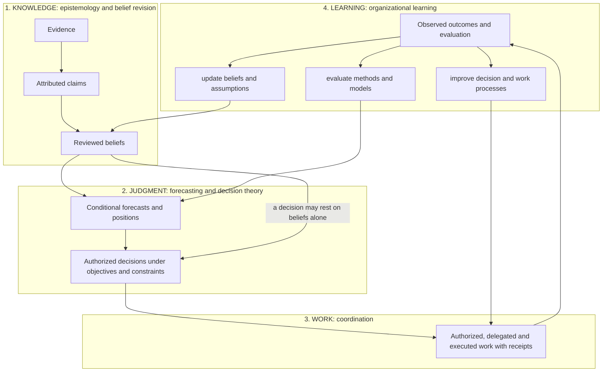

# Theoretical foundation

Written 2026-10-16 by the guardian seat from the owner's ideation of the same evening (a conversation
with ChatGPT, pasted into the session) and the grounding the [product thesis](../product/project-thesis.md)
already holds. This page states which established theories the system stands on, maps each to the
records that instantiate it, and says where the instantiation is thin. It reads with the
[meta thesis and framework](meta-thesis-and-framework.md). Status words are the same as there, five of them: built on
main, running, designed, recorded once, never run live. Independent review 2026-10-17 (GPT reviewer through
Codex; its text is copied unchanged into the dated record [FOUND-1](../work/reviews/FOUND-1.md), 2026-10-18): the four questions and the four layers stand as
the organizing structure; seven findings (five on status claims, two minor) are corrected in this revision,
each marked "corrected 2026-10-17" where it stands. The self-contained statement of the same
foundation, with six figures, the applied results and a checked reference list, is the
[companion paper](../product/paper-accountable-ai-decisions-2026-10-17.md) (revised 2026-10-17). One
term: the paper says *belief* where this page and the registers also say *assumption*; they are the same
record.

## 1. The thesis in one line

AI-native knowledge work is a governed loop in which people and AI turn changing evidence into revisable
beliefs, defensible decisions and measurable organizational learning. InGRID is that loop applied
to electricity-market decisions. The power market is the first application, not the boundary of the
theory. The [framework page](meta-thesis-and-framework.md) states the thesis as "knowledge work is belief
maintenance"; that is the knowledge layer of this loop, and the other three theories are what the loop
adds to it: a decision taken on the beliefs, work coordinated to carry it out, and learning from what
settled.

## 2. The distinction that matters

The concepts the system represents (evidence, claim, belief, forecast, decision, outcome) are not the
theories it stands on. The theories answer four different questions, and each has a research tradition
behind it. Treating them as one would make the product a pile of tools; keeping them apart makes it an
accountable human-AI decision system that can learn.

| Foundation | The question it answers | Established work | What it gives this system |
|---|---|---|---|
| **Epistemology and belief revision** | What do we know, why do we believe it, when should a belief change? | Doyle's truth maintenance system (1979): a belief holds while its justifications hold; AGM belief revision (Alchourrón, Gärdenfors, Makinson 1985): expansion, revision, contraction as the three moves; bitemporal data (Jensen and Snodgrass 1999): valid time and transaction time are different clocks | justified beliefs with sources; the disposition (retain, revise, reject, defer, investigate; the hosted form offers retain, revise and investigate); the outlook revision's state (the reviewed belief set) is accepted or open; the two clocks; the snapshot at a cutoff |
| **Decision theory** | Given uncertainty, objectives and alternatives, what should we do, and what is timely information worth? | Bayesian decision theory and influence diagrams (Howard and Matheson 1984); the value of information (Howard 1966); proper scoring rules (Gneiting and Raftery 2007); the distinction between a forecast's consistency, quality and value (Murphy 1993) | impact in own units as the loss the decision faces; the materiality line as a decision rule; the scorecard, which measures quality in Murphy's sense, not value; the premise test as a timeliness measurement (corrected 2026-10-17: it measures how late the operator's records are, not the value of information; that connection is untested, section 7) |
| **Organizational and coordination theory** | Who does what, with what authority, and how is the work coordinated between people and AI? | coordination theory (Malone and Crowston 1994): coordination is managing dependencies between activities; levels of human-automation interaction (Parasuraman, Sheridan, Wickens 2000); trust in automation and appropriate reliance (Lee and See 2004); automation bias and complacency (Parasuraman and Manzey 2010) | owners of beliefs; the dependency records; the proposal-review-accept authority chain; AI at the level "proposes, human accepts"; the receipt stack against over-trust |
| **Organizational learning** | How do outcomes change beliefs, methods and goals? | Argyris and Schön (1978): single-loop learning corrects the action, double-loop learning changes the governing assumptions and goals | scoring receipts and attribution as the single loop; direction checks that can change what the product is as the double loop |

Provenance runs under all four: PROV-O (W3C 2013) and SOSA/SSN inform the envelope, as the product
thesis already records.

## 3. Conceptual architecture

Four layers of responsibility, not four services, and not a requirement that every decision carries a
numerical forecast. The direct path from reviewed beliefs to decisions in the diagram carries that
rule (corrected 2026-10-17; the first drawing routed every decision through a forecast).

## 4. The core taxonomy, mapped to the records

Six kinds of information carry the theory. The seven records of the
[framework page](meta-thesis-and-framework.md) and the four metadata dimensions of the working paper
(content kind, review state, availability, execution mode) already encode the distinctions; this table
is the mapping, not a new design.

| Concept | Definition | Record in this system | Status |
|---|---|---|---|
| Evidence | recorded observations and source material | Signal: advisory, schedule, registration, document passage, price row, with two clocks | built |
| Claim | an assertion attributed to a source | content kind `reported claim` in the review records; the parsed advisory with its category and passage | built |
| Belief | reviewed organizational understanding, including assumptions and their uncertainty | Belief (assumption) record with layer, valid interval, state, owner | built |
| Forecast | a conditional prediction with defined inputs, methods and horizons | Position (outlook) record: inputs by digest, beliefs by id, method and model version, cutoff, horizon | built |
| Decision | an authorized choice under objectives and constraints | Decision record: disposition, reason, actor, position version, snapshot | built; the hosted decision form was exercised on copies of the real case in smoke tests; the real case itself records no analyst disposition (corrected 2026-10-17; the [case review](../cases/pedc-u2-2026-09-21/review.md) and the [evidence ledger](../work/thesis-challenge-2026-10-16/evidence-ledger.md), section B) |
| Outcome | a subsequently observed result used for evaluation | Scoring receipt against the settled truth; attribution of a miss to a belief, a signal or the method is a record of its own beside the receipt ([intent](../work/outlook-archive/attribution-intent.md), [ARCH-4](../work/outlook-archive/attribution.md)) | scoring built, unexercised on a real month (first pair November to December 2026); attribution built 2026-10-17 and unexercised: no attribution on a real receipt (corrected 2026-10-17, twice) |

AI judgments, impact calculations, scenarios, execution receipts and scoring records support these six
kinds. They are enabling records, not additional foundations.

## 5. Four cross-cutting principles, and the contract that enforces each

| Principle | Question | Enforced by | Status |
|---|---|---|---|
| Provenance | where did this come from? | the record envelope: source locator, passage spans, digests, lineage; citation indices into an immutable task context | built |
| Time | when did it apply, when was it available? | `available_at` and `effective_at` on evidence; `valid_from`, `valid_to` on beliefs; `information_cutoff` and review time on positions and decisions; the snapshot query | built |
| Uncertainty | is this observed, inferred, assumed or predicted? | content kind and belief layer (official, analytical, inferred, exploratory, hypothesis); `synthetic` carried truthfully; no calibrated scores claimed | built |
| Authority | who or what may propose, accept, decide, act? | actor context and state transitions in the review core; AI output cannot grant a role, approve a revision or authorize execution; the signed-permission transport | built |

These are technical contracts, tested, not instructions to a model.

## 6. First application: one outage, through the four layers

A proposed walkthrough, not a record of a completed case (corrected 2026-10-17). The status of each
step follows it in brackets; no case in the repository runs the whole chain.

An operator advisory arrives (evidence). The reader records what the operator reports, with its
category and time (claim) [built; recorded once on the PEDC Unit 2 advisory]. The desk asks whether
the report touches an analyst's accepted availability belief (belief) [built; one live Gemini run on
that case, its disagreement with the case reading unadjudicated]. A numerical model assesses the price
consequence over the horizon (forecast) [uncomputed for this outage; the impact arithmetic exists and
was demonstrated once on a synthetic portfolio against forecast bands, which is not the price effect
of revising this assumption]. The analyst weighs the portfolio exposure and the alternatives, hold,
cover, cut, and records the disposition (decision) [the decision record and the hosted form are built and were exercised in smoke tests; weighing the alternatives with the portfolio exposure is designed; the real case records no analyst disposition]. Any procurement action needs its own
authorization and receipt (work) [out of scope]. When the month settles, observed availability and
final prices score the forecast and the decision is reviewed against what was known (learning)
[scoring built and unexercised; attribution built as a record, unexercised].

Scope boundary: the system supports market intelligence and analyst decisions. It does not perform grid
control, issue dispatch instructions, or execute trades.

## 7. Where the instantiation is thin, stated plainly

- **Decision theory is represented, not computed.** The system records decisions and gives them a loss
  proxy (impact in pesos) and a threshold rule (the materiality line). It does not compute expected
  utility over alternatives or draw influence diagrams. That is a future option, not a claim. What it
  does measure today is latency, not value: the premise test puts a number on how late the operator's
  own records are where they reflect a trip (a median 8.5 hours over 27 matched rows on the typed pass, 20.7 on the first, [VAL-1](../work/validation/outage-lag.md); VAL-1 record, in progress; the query runs on the company copy and cannot be re-run from this repository). The impact record does
  not establish that value either: it computes one portfolio's exposure under one position, not the
  losses of decisions taken with earlier versus later information. That comparison has to run before
  any value-of-information claim (corrected 2026-10-17, second revision).
- **Work execution is out of scope.** The coordination layer covers proposal, review and acceptance.
  Delegated execution with receipts exists only in the build method (seats, briefs, runner), not in the
  product.
- **The learning loop is not built; one input to it is.** Scoring receipts exist and have scored no
  real month; the first real scoring pair is November to December 2026. Attribution of a miss to a
  belief, a signal or the method is built as a record of its own beside the receipt
  ([intent](../work/outlook-archive/attribution-intent.md), [ARCH-4](../work/outlook-archive/attribution.md), 2026-10-17) with a person-driven
  write path, and no real receipt exists to attribute, so no learning step consumes a score today
  (corrected 2026-10-17). Single-loop learning will have a number when the first pair scores and its
  first attribution when a person writes one. Double-loop learning is visible today
  only at the project level: the direction checks that can turn the desk into an archive.
- **No case runs the whole chain.** The real case has a recorded advisory, a recorded AI judgment and
  no analyst disposition; its consequences are uncomputed. The cited extraction of rules from the
  market documents is built and has never run live. The [evidence ledger](../work/thesis-challenge-2026-10-16/evidence-ledger.md)
  (2026-10-16) is the dated record of these gaps; later records that close one are named there before
  this page changes (corrected 2026-10-17).
- **Human coordination is unvalidated.** Roles (analyst, desk, board) are designed within one company.
  No second role has used the system; cross-company reuse is out of scope.
- **The innovation hypothesis has one measured comparison, and it tied, under conditions that weaken
  it.** The eight-question bundle tied a single question on its own test (22 of 28 each) in a scripted
  replay with no model call, on labels the executor wrote; on the held-out split the single question
  won, 8 of 10 to 7 of 10; the stability receipt showed every flip rate 0 and was unidentified; the one
  live run's disagreement with the case reading is unadjudicated (corrected 2026-10-17; ledger sections
  A and C). The hypothesis that governed integration beats
  conventional workflows and simpler AI-assisted alternatives stands to be tested by experiment 3 in the
  [strategy record](../work/thesis-challenge-2026-10-16/strategy.md), section F.

## 8. Future of Work proposition, restated on this foundation

Conventional enterprise software stores information and gives people tools to operate. The system
proposed here additionally lets AI take part in bounded knowledge work: interpret evidence, propose
belief revisions, prepare analyses, support decisions. People and AI coordinate through explicit roles
and authority; their work produces reviewable records; later outcomes give a basis for improvement.

The innovation hypothesis is not that AI can maintain beliefs or make predictions. Those have
established foundations above. It is that integrating them into governed organizational workflows
improves decision quality, accountability and productivity. That hypothesis must be, and has not yet
been, evaluated against a conventional workflow and a simpler AI-assisted alternative.

Architectural principle: build one coherent system for accountable human-AI decision work; treat
electricity-market intelligence as its first domain implementation; treat individual models, algorithms
and interfaces as replaceable components.

## 9. Causation, challenged (2026-10-17)

Added 2026-10-17 by the guardian seat at the owner's request, after three analyst answers written
outside the system ranked the factors behind a price by role ("main cause", "cause behind the rules")
with web sources and caveats. Status: selected design; the plan that builds it is the
[platform lanes record](../work/platform-epics-2026-10-17/strategy.md), section 2. Nothing below is built.

**The position on record.** The companion paper's section 2.3 ends: a factor present at a time is
listed and ranked by how unusual it was, never named as the cause; attribution is a statement about the
organization's own beliefs, not a causal claim about the market. The
[ontology profile](ontology-profile-v1.md) forbids a `causes` edge and says a mechanism is a hypothesis
with support and alternatives.

**What is right in it, and stays.** A record cannot prove that an outage caused a price. A co-movement
at the time is not a cause. And the review of a decision must ask about the organization's beliefs,
not about the market, or review turns into blame.

**Where it is too narrow.** It conflates three questions that the four foundations above keep apart.
"What moved the market on the day?" is the analyst's and the board's question (desk questions Q1 and
Q11); its honest answer is an explanation, a chain of causal claims graded by their evidence with the
alternatives ruled out. "Which of our beliefs moved our result, and did we know in time?" is the risk
manager's question (Q12); its answer is the attribution the paper defines. "What would have happened
under other conditions?" is the risk analyst's; its answer is a counterfactual from a method with its
delta recorded. Refusing the first question does not make the system more honest; it moves the answer
outside the system, where it has no record, no times and no owner. The accountability thesis of this
page applies to causal explanations with more force, not less: they are the claims a board remembers.

**The refined position.** A causal explanation is a set of claims, not a fact. Each claim is a record,
the profile's Claim with the fields it already requires, whose predicate is a causal role between two
subjects: main cause, contributing cause, cause behind another cause, enabling condition such as a rule,
or ruled out. A claim is valid only with an evidence grade from a fixed rule, in this order of strength:
a mechanism stated by a market rule or a physical constraint; temporal order and availability (the cause
was knowable before the effect); co-movement against a baseline; a counterfactual check where a method
allows one; testimony of an authority; independent corroboration, with copies of one release counted
once. It carries the records it rests on, the alternatives considered and ruled out, and the actor and
time: proposed by the model under a receipt, accepted or edited by a named person. This is Toulmin's
(1958) model of an argument (claim, grounds, warrant, qualifier, rebuttal) applied to one causal link,
graded in the tradition of Hill (1965), and placed on Pearl's (2009) ladder: the driver card stands on
the first rung, association; a mechanism from the rules or a counterfactual from a method reaches the
second; only a recorded counterfactual reaches the third. An explanation assembled this way is an
inference to the best explanation (Lipton 2004), and the grade says which rung each link stands on.

**What changes in the records.** The profile moves to v2 with one relation family, `causalClaim`,
carrying those fields; a claim without a grade, evidence and an actor is invalid and the closed-list
check refuses it. There is still no bare `causes` edge. Chains are paths through accepted claims,
queryable and replayable at a cutoff. The explanation is the seventh record kind, AI judgment under
receipts, applied to causal claims, as the generated view is its application to presentation. The
paper's section 2.3 and Table 7 follow when the first slice of the plan is built.

**What would show this wrong.** If analysts accept causal claims without reading their grades, or if
accepted chains on a scored month contradict the attribution more often than they agree, the roles
narrow to "present at the time" and this page returns to the position on record.

## 10. References

Checked against publisher and repository records on 2026-10-17, together with the reference list of
the [companion paper](../product/paper-accountable-ai-decisions-2026-10-17.md); the two lists use the
same forms. Pearl (1988) was removed because no sentence on this page cites it.

- Doyle, J. (1979). A truth maintenance system. *Artificial Intelligence* 12(3), 231–272.
- Alchourrón, C. E., Gärdenfors, P., Makinson, D. (1985). On the logic of theory change: partial meet
  contraction and revision functions. *Journal of Symbolic Logic* 50(2), 510–530.
- Jensen, C. S., Snodgrass, R. T. (1999). Temporal data management. *IEEE Transactions on Knowledge and
  Data Engineering* 11(1), 36–44.
- Howard, R. A. (1966). Information value theory. *IEEE Transactions on Systems Science and Cybernetics*
  SSC-2(1), 22–26.
- Howard, R. A., Matheson, J. E. (2005). Influence diagrams. *Decision Analysis* 2(3), 127–143 (reprint
  of the 1984 chapter in *Readings on the Principles and Applications of Decision Analysis*, Strategic
  Decisions Group).
- Gneiting, T., Raftery, A. E. (2007). Strictly proper scoring rules, prediction, and estimation.
  *Journal of the American Statistical Association* 102(477), 359–378.
- Murphy, A. H. (1993). What is a good forecast? An essay on the nature of goodness in weather
  forecasting. *Weather and Forecasting* 8(2), 281–293.
- Malone, T. W., Crowston, K. (1994). The interdisciplinary study of coordination. *ACM Computing
  Surveys* 26(1), 87–119.
- Parasuraman, R., Sheridan, T. B., Wickens, C. D. (2000). A model for types and levels of human
  interaction with automation. *IEEE Transactions on Systems, Man, and Cybernetics, Part A* 30(3), 286–297.
- Lee, J. D., See, K. A. (2004). Trust in automation: designing for appropriate reliance. *Human Factors*
  46(1), 50–80.
- Parasuraman, R., Manzey, D. H. (2010). Complacency and bias in human use of automation: an
  attentional integration. *Human Factors* 52(3), 381–410.
- Argyris, C., Schön, D. A. (1978). *Organizational Learning: A Theory of Action Perspective*. Reading,
  MA: Addison-Wesley.
- W3C (2013). PROV-DM: The PROV Data Model, and PROV-O: The PROV Ontology. W3C Recommendations, 30 April
  2013. https://www.w3.org/TR/prov-dm/ and https://www.w3.org/TR/prov-o/
- W3C (2017). Semantic Sensor Network Ontology (SSN and SOSA). W3C Recommendation, 19 October 2017.
  https://www.w3.org/TR/vocab-ssn/ (added 2026-10-18 for POLISH-2; title and date checked on the W3C page that day)

Added 2026-10-17 with section 9:

- Hill, A. B. (1965). The environment and disease: association or causation? *Proceedings of the Royal
  Society of Medicine* 58(5), 295–300.
- Lipton, P. (2004). *Inference to the Best Explanation*, 2nd ed. London: Routledge.
- Pearl, J. (2009). *Causality: Models, Reasoning, and Inference*, 2nd ed. Cambridge: Cambridge University
  Press.
- Toulmin, S. E. (1958). *The Uses of Argument*. Cambridge: Cambridge University Press.

Status: a conceptual synthesis. It does not assert that the full decision, execution and learning loop
is implemented or empirically validated in InGRID; section 7 says what is.
