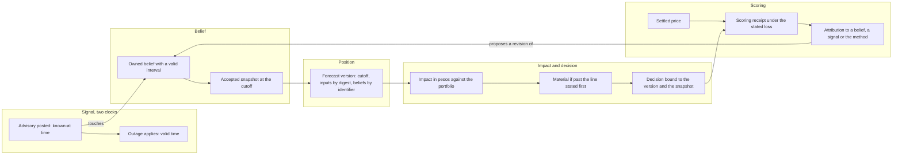
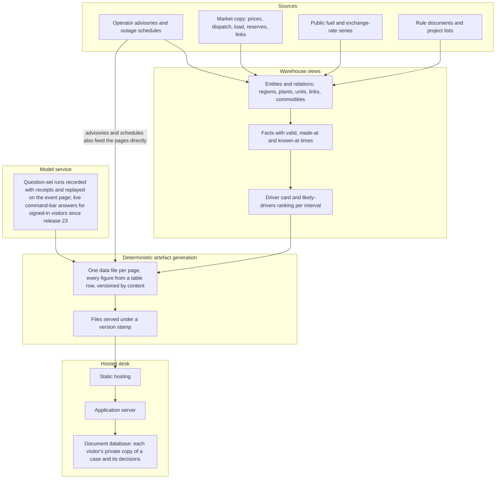
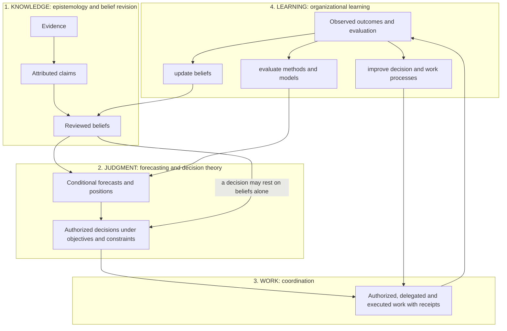
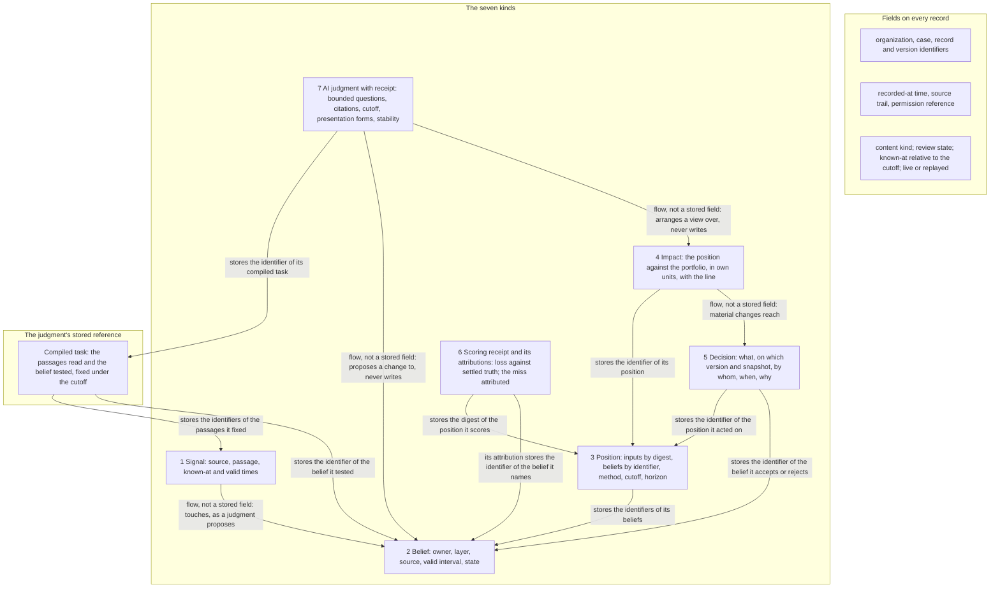
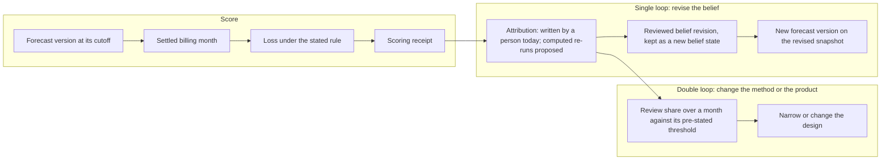

# InGRID: Interpretable Grid Reasoning for Informed Decisions

*Accountable human–AI decision work, with a prototype for an electricity retailer in the Philippine wholesale electricity market*

**Sam Matuba** (author). Prototype codebase: Sam Matuba and Ericka Formanes. Feedback gathering, as the user representative: Jayden Cacayan.

Version of 19 October 2026 (InGRID release 25).

## Abstract

We describe the design and first prototype, InGRID, of a decision desk for an electricity retailer in the Philippine Wholesale Electricity Spot Market, built so that every decision taken with AI assistance can later be traced to the evidence, the beliefs, the method and the person behind it. The paper reports what the prototype demonstrates and measures today, and states the hypotheses it does not yet test. InGRID runs as a hosted review desk at https://ingrid-desk.web.app: its grid pages replay recorded market data to 14 October 2026, its event page shows the recorded model judgment on one real outage at two cutoffs, and since release 23 a signed-in analyst can put a question to the desk's assistant, Ingrid, which a Gemini model answers live over the records with its retrieval steps shown. On the market's own data, outage schedules matched to the system operator's advisories by event type, plant and unit appeared a median 8.5 hours after the advisory (27 matched rows of 148 late ones); 96.6% of 1,275 generator outage advisories in 2026 have no schedule row for the same plant within six hours of an outage start, a coverage gap rather than a measured delay. Two simple price challengers beat three baselines in 28 of 192 series–horizon–slice groups under a pre-stated gate, 27 at the day horizon; at the month horizon, where contracting decisions sit, 27 origins per series make a claim impossible under the gate, so no skill is claimed there. A deterministic warehouse query lists, for any price interval, the conditions present in six families with the time each was knowable, and ranks them by how unusual each was, labelled as evidence and never as cause; two cases are worked in full. A hosted language model answered a compiled set of eight bounded questions on one real outage under two information cutoffs, cited its passages, gave the same answers in four presentation forms of each question, and disagreed once with a rule-based reading; the disagreement is kept. We name the frameworks and models used, including TimesFM, TabFM, gradient-boosted classifiers and Gemini, and the theoretical role each fills. From the measurements we state a design hypothesis: that the value of AI in decision work is bounded by traceability and trust, that traceability is a property of records written at the time, and that trust must be earned by structure and then measured. We derive requirements from twelve stakeholder-supplied user stories and twelve desk questions, grade forty-four market factors by what is a record today, specify seven record kinds with one time contract, and specify a governed generative interface in which a model arranges record-backed components under a validator that rejects any figure not quoted from a record. No month has been scored, no analyst has used the prototype in their work, and no effect on work has been measured. We report these gaps as results and give the experiments, with numerical thresholds, that would refute or narrow the design.

## 1. Introduction

### 1.1 The question

Who answers for a decision made with AI?

Organizations decide on beliefs about their world: what capacity exists, what a counterparty will do,
which rule is in force, what a price will be. Large language models change who can do the reading. A
model can read operator notices, filings and price data at a scale no desk can match, and draft a
change to the plan for each. Organizations are now deciding whether, and how, to let it.

When that happens, the scarce thing is no longer reading. It is the answer to a different question:
what did the organization believe on the day, on which evidence, who accepted it, and why? When an AI
read the evidence and proposed the belief, that answer becomes harder to give, not easier. Field
studies report that AI assistance raises output on many tasks [Brynjolfsson et al. 2025] and can lower
quality on tasks just outside the model's competence [Dell'Acqua et al. 2026]. An organization that
cannot tell the two apart after the fact cannot learn which reliance was appropriate [Lee and See 2004].

### 1.2 The design hypothesis

We work from one hypothesis, stated here so that the paper can be read against it:

**The value of AI in decision work is bounded by two properties, traceability and trust. Traceability
is a property of records: it exists when every decision, belief, forecast and AI answer is written at
the time, carries its times, and cannot be changed later. Trust is a property of people's reliance on
the system, which structure can earn but only measurement can confirm.**

A better model does not, by itself, let a board see who decided what on which evidence. A record
written at the time does. This paper demonstrates the record half: a schema, an implementation, and
measurements of the latencies that make time fields necessary. The trust half is not measured here;
Section 12 states how it would be. The claim therefore has two statuses: the traceability properties
are demonstrated on the prototype, and the bound on value is a hypothesis.

The problem has three levels, each with a different reader (Table 1).

*Table 1. Three levels of the problem and their evidence status in this paper.*

| Level | The problem | Evidence status |
|---|---|---|
| People (the work) | AI moves the human job from finding and reading information to judging it and answering for it. | framing; no measure of the effect on analysts yet |
| Organization (the business) | Without trust, AI is held back; without traceability, it is used blind. Both cost: in lost work, or in decisions nobody can explain, review or learn from. | hypothesis; the timeliness measurements of Section 7.2 show why time fields are needed |
| Sector (the social stake) | In an essential, regulated sector, a board and a regulator must be able to see who decided what, on which evidence, and when. | the readers named by the operating company; not yet observed |

### 1.3 What we build and what we report

We design an AI-assisted decision desk and build its first prototype for one retailer in one market.
The prototype is **InGRID** (Interpretable Grid Reasoning for Informed Decisions): a review desk that
records each step from evidence to claim to assumption to decision against a grid ontology, so that
every decision can be answered for. Its assistant persona, Ingrid, proposes a position and shows her
working; the person accepts, changes or rejects it, and the record says which.
The research object is the record structure that makes a decision answerable, and the research
question is whether that structure can be built and operated on real market data at the latencies the
data imposes. At the time of writing (19 October 2026, release 25), the compiled question set has run on one
real case under two cutoffs and once on a synthetic case; those runs are the measured results. A second
model path, the live command-bar answer with its retrieval steps, has served signed-in visitors since
release 23 and is not measured here. No analyst has used the desk in their work. The record kinds are implemented and
tested; the step that scores an issued forecast against settled prices is implemented and waits for
the first settled month.

### 1.4 Contributions

1. **A problem statement** for AI-assisted decision work framed as accountability rather than
   capability, with one time contract and five falsifiable propositions (Section 2).
2. **A prototype on a real market**, with its data, its architecture, its hosted desk, two fully worked cases of the
   driver card, the alert record, the recorded judgment, and the status of every record kind
   (Section 3).
3. **A methods-and-models account**: each framework and model used, the record it produces, the
   theory it instantiates and its measured result (Section 4).
4. **Candidate requirements** from twelve stakeholder-supplied user stories, translated into twelve
   desk questions with the parts every answer must show (Section 5), and a watch list of forty-four
   market factors graded by what is a record today (Section 6, Appendix B).
5. **Graded preliminary measurements**, including negative and null results and the numbers the
   hypothesis depends on that do not yet exist (Sections 7 and 8).
6. **A framework of seven record kinds** and their invariants, grounded in four established
   theories (Section 9), and **a specified governed generative interface** in which a model arranges
   record-backed components under a validator (Section 10).
7. **An evaluation plan** with a numerical threshold that would refute or narrow each claim
   (Section 12).

### 1.5 Scope and terms

The prototype supports market intelligence and analyst decisions. It is not a causal model of the
market, a trading system or a grid control system. We claim no forecast skill beyond the groups
reported and no effect on productivity. Every portfolio-impact figure in pesos comes from a synthetic
portfolio and demonstrates a method; the price and error figures are real. We say **belief**
throughout for a proposition a forecast rests on; the prototype's own register files call the same
record an *assumption*. **InGRID** names the prototype as a whole, and **Ingrid** its assistant persona,
which proposes and never decides. Evidence grades are defined in Section 7.1 and used in every table.

## 2. Problem formulation

### 2.1 One time contract

Every record in the design carries the time fields of Table 2. The same names are used in every
section.

*Table 2. Time fields. A fact is eligible for a replay at cutoff t when known-at ≤ t under the mode in
force; "assumed" mode admits facts whose known-at rests on a named assumption, "strict" mode admits
evidenced known-at only, "hindsight" admits everything.*

| Field | Meaning | Example on an outage advisory |
|---|---|---|
| valid (effect) time | when the condition holds in the world | the outage interval [start, end) |
| made-at | when the source produced the item | the advisory's posting time |
| known-at, with basis | the earliest time this workflow could have read it; the basis is *evidenced* (a receipt of first availability) or one of three named assumptions | evidenced by the posting time |
| recorded-at | when the prototype's tables stored it (the transaction time of bitemporal databases) | the ingestion run |
| review time | when a person accepted a mapping, a belief or a decision | the analyst's acceptance |
| cutoff | the time a forecast, judgment or replay is computed "as of" | 13:39:37 on the event day |

Where the data carries no receipt of first availability, the known-at field is an *assumed bound*,
not an observed earliest availability, and the fact names the assumption it rests on. The three
assumptions, as implemented in the warehouse: **A-RT**, a real-time market value is treated as
available at the end of the five-minute interval it describes; **A-RUN**, a projected outage-schedule
record is treated as available at the time of the first daily snapshot in which the record appears,
because the schedule files carry no run timestamp (so the bound can be later than the true
availability, never earlier); **A-FUEL**, a public fuel or exchange-rate value is treated as available
after a fixed lag per publisher: two days after the period for the daily oil series, one day for the
daily exchange rates, and the fifteenth of the following month for the monthly coal and LNG series.
An *evidenced* known-at, by contrast, is a time the source itself stamps: the posting time of an
operator message, or the time of our own pull of a public series. The two fields are stored
separately and a replay in strict mode reads only the evidenced one.

### 2.2 Objects

A **signal** $s$ is an item of evidence with its known-at time $t^{k}_s$ and its valid time
$t^{v}_s$. A **belief** $b$ is a proposition with an owner, a provenance layer (official, analytical,
inferred, exploratory, hypothesis), a source, a valid interval
$[v^{\mathrm{from}}_b, v^{\mathrm{to}}_b)$ and an epistemic state (accepted, unverified, contradicted). The **accepted
snapshot** at cutoff $t$ is

$$B(t) = \{\, b : \mathrm{state}_b(t) = \text{accepted},\ v^{\mathrm{from}}_b \le t < v^{\mathrm{to}}_b \,\},$$

computed only from records whose recorded-at time is before $t$, or, for evidence collected after the
fact, whose known-at time is before $t$ and is so marked.

A **position**, here a price forecast, is a version $P_v = f_{m}(B(t^{c}_v), X_v)$ with cutoff
$t^{c}_v$, inputs $X_v$ fixed by content digest, beliefs fixed by identifier, and a method $m$ with its
version. Versions are superseded, never edited.

The **impact** of a position on a portfolio with uncovered volume $q_h$ in hour $h$ and contract price
$c$ is

$$I_v = \sum_{h \in H} q_h\,(\hat p_{v,h} - c),$$

kept as a band over the forecast quantiles, with its sign. A change is **material** when
$|I_{v'} - I_v| \ge \tau$, where the line $\tau$ is stated before any change is scored.

A **decision** records what was decided, on which position version and snapshot, by whom, when, and
why. A **scoring receipt** compares $P_v$ with the settled truth $y$ under a stated loss $L(P_v, y)$.

*Figure 1. The chain from a signal to a scored decision. Read left to right: a signal with two clocks
touches an owned belief; the accepted snapshot at the cutoff fixes a forecast version; the version is
priced against the portfolio and crosses, or does not cross, a line stated first; the decision binds
the version; the settled price scores it and the miss is attributed back to a belief, which can only
change through a reviewed revision. Arrows into the position, decision and receipt are identifiers
stored in the target record; the two "touches" and "proposes" arrows are proposals that a person
reviews.*

### 2.3 Attribution: what is implemented and what is proposed

**Implemented.** An attribution is a record written by a person beside a scoring receipt. It names
the receipt and the forecast version by digest, states a cause of one of three kinds (a belief by
identifier, a signal by source and times, or the method), gives a statement, and may give a share in
[0, 1]. Nothing in the prototype computes an attribution.

**Proposed.** Let $K$ be the set of accepted beliefs that changed between the version used, $v$, and a
later version $v'$. For $k \in K$, let $P_v^{(k)}$ be the forecast re-run with belief $k$ alone set to
its later value. The computed attribution of the miss to $k$ is

$$A_k = L(P_v, y) - L(P_v^{(k)}, y).$$

A **miss** is a scored version whose loss exceeds a threshold stated with the loss (for this
prototype, the best baseline's loss on the same month). A miss is **avoidably attributable** to $k$
if $A_k > 0$ and the later value of $k$ was knowable, under the time contract, before the cutoff
$t^{c}_v$; a belief learned only after the cutoff explains the miss but does not make it avoidable.
Two measures follow and must not be confused. **Attribution coverage** is the share of scored misses
that carry a person-written attribution; it needs only the implemented record and a settled month.
The **avoidable-miss share** is the number of avoidably attributable misses over the number of scored
misses in a month; it needs the computed $A_k$ and a join from the belief's later value to the time
that value became knowable, neither of which is implemented. A person's optional share field
establishes neither the counterfactual improvement nor the knowability. One-at-a-time re-runs are a
first-order approximation; interacting belief changes would
need a joint re-run, which we do not propose here. This is a statement about the organization's own
beliefs, not a causal claim about the market. The same discipline governs the desk's reading of the
market: a factor present at a time is listed and ranked by how unusual it was, never named as the
cause (Section 3.4).

### 2.4 Five propositions

*Table 3. The five propositions and their tests.*

| Proposition | Statement | Test |
|---|---|---|
| Beliefs are the bottleneck | Decisions go wrong on beliefs that went out of date while the evidence to update them was knowable. | the review share on scored months; the lag between a signal and the official record |
| Time is a first-class field | Without the fields of Table 2 a past decision cannot be replayed, and a replay is the only honest review. | any past day's accepted snapshot can be recomputed without later information |
| Trust is earned by structure | Bounded questions, citations, cutoff discipline, stability across presentation forms, disagreement shown, scoring against settled truth, a person's decision and immutable records earn appropriate reliance. | a reader can open every layer; the scorecard shows a weak method as weak; reliance measured against correctness |
| Materiality is measured in the organization's own units | A signal should reach a decision-maker only when it moves the impact past a stated line. | the share of changes that pass the line; the share of board items that carried their impact |
| Review attributes, it does not blame | A miss is attributed to a belief, a late signal or the method. | the share of misses with an attribution on a scored month |

## 3. The domain and the prototype

### 3.1 Why this market

An electricity retailer in the Philippine wholesale market buys power at nodal spot prices and sells
it to customers, partly under fixed-price contracts. Its board must decide what to contract, what to
leave exposed and when to act. The market was created by the Electric Power Industry Reform Act of
2001 [Republic of the Philippines 2001] and runs under rules the energy department promulgated in 2002
and has amended since [DOE 2002; DOE 2016]. A reserve market was declared by circular in 2023 [DOE
2023] and commenced full commercial operations on 26 January 2024 under a department advisory [IEMOP
2024]. The regulator approves the price determination methodology. The two market operators applied in
January 2023 for its extension to reserves; the regulator granted interim relief to adopt and implement
the proposed methodology in an order of 24 August 2023, and issued further orders on its
implementation in 2024, among them a suspension of part of the settlement manual on 25 March 2024 and a
partial-settlement directive on 9 May 2024 [ERC 2023; NGCP 2024]. The orders were not retrieved from the
regulator's own site; the chronology is read from the transmission operator's customer bulletin, which
quotes them. The regulator also sets administered prices when the market is suspended, as it did from
26 March 2026 under a national energy emergency [ERC 2026a; ERC 2026b].
The information a retailer needs exists but arrives scattered: operator advisories, outage schedules,
registrations, project lists, rule changes, administered-pricing notices and the price series. The
evidence is public and time-stamped, the rules come from a regulator, and the truth settles every
billing month, so every forecast can be scored. Most demonstrations of AI at work cannot be scored;
this one can.

### 3.2 Data and availability

The operating company's copy of the market data holds 80 source families (3,357 files, about 40.0 GB)
and, since a backfill on 17 October 2026, ends on 14 October 2026: five-minute intervals to 23:55 that
day and operator advisories to 15 October. Final regional settlement prices run from billing month July
2021 to September 2026. Final nodal settlement prices, as exported before the backfill, cover 59 billing
months, with the number of nodes growing from 887 to 1,214. A billing month runs from the 26th to the 25th; prices are five-minute, in pesos per MWh;
timestamps are local times whose zone is not recorded. Administered pricing covers all of billing
month April 2026, the month of the regulator's market suspension and modified administered price [ERC
2026a], and part of five other months; the meaning of the pricing flags in the data is inferred, not
confirmed. A curated fuel table holds 8,365 rows of public series: a coal driver (Australian thermal
coal, monthly), an LNG driver (the Japan import average, monthly, labelled as not the spot marker) and
background series for crude oil and exchange rates.

*Data availability.* The market data is the operating company's licensed copy of the market
operator's publications. A signed permission record of 13 October 2026, extended on 14 October 2026,
covers its use in this work and the public display of regional prices, demand, reserves, dispatch
and advisory text on the prototype. The bulk copy, the company's portfolio and the plant-name alias
table are not redistributable and are held outside the code. Synthetic substitutes exist for every
record kind so that the code and tests run without them, and every synthetic record is labelled as
such.

### 3.3 Architecture

*Figure 2. The prototype. Sources flow into typed warehouse views that carry the time fields of
Table 2 on every fact; a deterministic step writes one data file per page so that every figure shown
is a row in a table, and the files are versioned by content; the hosted desk serves those files and
keeps each visitor's decisions in a private copy of the case; the question-set runs are recorded with
receipts and replayed on the event page, and the command bar calls the model live only for a signed-in
visitor, over the records, with its steps shown.*

The warehouse layer is the market's shared vocabulary made queryable: 2,178 entities (three regions,
323 plants, 549 generating units, 1,288 market resources, two inter-island links, four commodities and
nine series references) and 3,543 relations drawn from a closed list of six (located in, part of,
represents, uses fuel, connects, refers to). The list is a schema constraint: a new relation requires
a new schema version. A *causes* relation is not in the list. Every fact carries its valid time, its
made-at time where the source states one, and its known-at time with its basis.

### 3.4 Applied result 1: the driver card, two worked cases

For a region and a time, the **driver card** lists the conditions present in six families, demand
(D), supply (S), price (P), outages (O), fuel (F) and rules, each fact with its value, unit, source and
known-at time, in one of the three modes of Table 2. Operator messages name plants in free text. A
message is linked to a plant (not a unit) only through an *accepted alias*: either a manually reviewed
entry, or one accepted by a deterministic rule batch that admits a plant's own node or prefix code, a
word or word pair of the registered facility name, or initials of three or more characters, and
rejects a token that is only a word of the company name, names a plant absent from the registration
list, names another plant in the region, or appears in a message stating more than 1.1 times the
plant's registered capacity. Of 1,608 aliases, 1,332 were accepted (covering 40,129 mentions) and 276
left uncertain; an uncertain match is listed as *unconfirmed* and never counted.

A **ranking** orders the demand, supply, outage and fuel families. For demand, supply and outages the
indicator is compared with the same region at the same clock hour on the 28 days before the time (the
time itself excluded), using only facts the mode admits; the score is the fraction of those reference
values below the indicator, counting ties as one half. The indicators are: demand, the regional
requirement in MW; supply, the larger score among the reserve shortfall in MW, the import share of
requirement and the number of congested inter-island links; outages, the larger score among two
indicators: the scheduled-out capacity in MW, summed over the schedule records visible in the mode (in
the assumed and strict modes, records not yet superseded at the cutoff; in hindsight, the latest
revision), one row per resource with the four projection runs collapsed to the largest capacity, and
the derated capacity in MW named in operator messages linked through accepted aliases, taking the
total in the latest such message posted in the six hours ending at the interval's end. A family with
no visible fact scores "no data" rather than zero; a region with no visible schedule record at all
scores "no data" for scheduled outages. Fuel is scored differently: its driver series (coal and LNG)
are compared against their own full history, because fuel is a slow-moving cost level and not an
intra-day move, and whenever any non-fuel family scores 0.8 or more, fuel is placed after every scored
non-fuel family whatever its own score (in the second worked case this puts demand at 0.426 ahead of
fuel at 0.507). A family's score is
its strongest indicator; ties between families fall to family order. The price is shown as context and not scored; rules flags are
listed present or absent, never scored. The ranking's heading is fixed: *likely drivers, ranked by how
unusual each was against the last 28 days at this hour; evidence, not proof*.

*Table 4. Two worked cases of the card in assumed mode. For demand, supply and outages the score is the
position of the family's strongest indicator in its 28-day same-hour reference distribution, and the
value in brackets is the indicator against its 28-day median; for fuel the score is the position of the
driver series in its own full history.*

| | Case 1: Visayas, 21 September 2026, 13:40 | Case 2: Visayas, 25 June 2026, 09:10 |
|---|---|---|
| Price | 29,919 PHP/MWh, band "very high" | 32,000 PHP/MWh, the offer cap |
| Event | the operator reports "PEDC U2 tripped at 1334H" (Panay Energy Development Corporation unit 2, registered 83.7 MW); no projected schedule holds a row for it | PEDC unit 3 (150 MW) is out in three projected schedules, first seen 09:40 and 10:00 |
| Rank 1 | S 0.777 (import share 0.105 against 0.066) | O 0.854 (derated capacity 607 MW against 584) |
| Rank 2 | D 0.771 (demand 2,502 MW against 2,382) | S 0.577 (import share 0.169 against 0.157) |
| Rank 3 | F 0.473 (coal, cost baseline) | D 0.426 |
| Rank 4 | O 0.119 (21 MW scheduled out against 33) | F 0.507, placed after O because O scores 0.8 or more |
| In hindsight mode | unchanged | O first at 0.961: the 150 MW outage, against 0 in the reference |
| In strict mode | every family "no data"; severity unrated; 2 facts shown, 61 withheld | not recorded |
| Confidence line | Low: 2 of 41 facts evidence-known, 39 assumption-known (A-RT 30, A-RUN 8, A-FUEL 1); 23 withheld; 0 unconfirmed | Medium: 18 of 47 evidence-known, 29 assumption-known (A-RT 28, A-FUEL 1); 4 withheld; 1 unconfirmed listed |
| Severity line | High: price band very high; reserves healthy; no alert; top score 0.78 | High: price band extreme; reserves healthy; yellow alert; top score 0.85 |

Case 2 shows what the time contract buys. In hindsight the 150 MW outage dominates; at the time, the
schedule rows that record it did not yet exist, so the assumed-mode card ranks the outage family first
on a smaller derating signal; the strict-mode card for case 2 was not recorded. A desk that reads only
the hindsight card would overstate what was knowable. Case 1's strict-mode result, "no data" in every
family, is the honest statement that almost nothing about that interval carried a receipt of first
availability; it is a measurement of the data, not of the market.

### 3.5 Applied result 2: the alert record

When the price in a region crosses a threshold an authenticated user has set, the desk writes one alert
with five fields: the price and threshold; a severity line as in Table 4; the ranked likely drivers
under the fixed heading; a relationship trail, which is the chain of entities and facts the ranking
rests on (for case 1: the unit's trip message, its plant, the region; the import share over the
congested inter-island link; the demand against its median; the price); and a list of what to check
next (the unit's return time in later messages and the schedule; the link's congestion in the next
intervals; demand against its median). If the user has entered a portfolio, the alert carries the
impact of that interval on the uncovered volume, labelled with the portfolio version and effective
date; otherwise it says "Not available: no portfolio entered". Portfolio values are held in a private
store under the user's sign-in and never enter the public data files. The alert for case 1 was run
and recorded; no live alert has been sent to a user.

### 3.6 Applied result 3: the recorded judgment

On case 1, the trip of PEDC unit 2 (Panay Energy Development Corporation, Visayas) reported at 13:34
on 21 September 2026 and its return at 15:07, the compiled question set of Section 9.3 ran twice on a
hosted Gemini model under two cutoffs, once after the trip advisory and once after the return advisory
(Section 7.5; the passages, questions, thresholds and rules are in Appendix C). Both runs
cited their passages and were stable across the four presentation forms of Section 9.3. At the return cutoff the model's composed
label disagrees with a rule-based reading of the same passages. The disagreement is recorded on the
event page and not yet adjudicated by an analyst.

### 3.7 Status of each record kind

*Table 5. Status of each record kind in the prototype, in the evidence grades of Section 7.1.*

| Record | Grade | What exists |
|---|---|---|
| Signal | demonstrated | readers for advisories and the capacity register, with known-at and valid times on every row; 12,840 outage events; 115,364 operator mentions, of which 40,129 are linked to a plant through 1,332 accepted aliases (Section 3.4) |
| Belief | demonstrated | a register of 42 beliefs (Section 7.4) |
| Position | demonstrated | two versions of a November 2026 system price forecast (Section 7.4), unscored |
| Impact | demonstrated on synthetic data | the materiality run of Section 7.4; the alert record computes impact on a user's own portfolio |
| Decision | implemented | the decision record and form, exercised on copies of case 1 in tests; no analyst decision on the real case |
| Scoring receipt | implemented | validated against the version's horizon; waits for the first settled month |
| Attribution | implemented | the person-written record of Section 2.3; three on test data, none on real data |
| AI judgment | demonstrated | two runs on case 1 (Section 7.5) |
| Driver card and ranking | demonstrated | six cards, four rankings and three severity lines over the two cases of Table 4, each checked against hand queries on the source tables |
| Generated view | specified | Section 10 |

**State of the prototype on 19 October 2026 (release 25).** One build covering 18 October 2025 to 14
October 2026 is live at https://ingrid-desk.web.app and at https://grid-nowcast.web.app, behind a
sign-in screen (docs/status.md; docs/START-HERE.md). The pages are the grid page, the event page,
outlooks, register, models, plants, notices, alerts, book, journal, the explainer and this paper. The event
page shows the recorded judgment of Section 3.6 and makes no live model call
(docs/work/grid-desk/live-run-2026-10-14.md). A command bar on every page searches the site and
takes questions; since release 23 it answers a signed-in visitor live on Vertex AI, labelled "live", and
since release 25 it shows the steps as the model works; an anonymous visitor gets an answer composed from
the records (docs/work/PROGRESS.md, rows "Batch release 23" and "Batch release 25"). The alert record was
run and recorded; no live alert has been sent. The rules corpus holds 30 documents with their clauses;
no live extraction call has been made (docs/status.md). The data used is the company copy to 14 October
2026 under the signed permission record of Section 3.2; it never enters Git or the export.

## 4. Methods and models

The prototype uses several frameworks and models. Each fills one role in the framework of Section 9,
produces one record kind, and is held to one theory. None of them is the record; the record is what a
person can later open. Table 6 lists them.

*Table 6. Frameworks and models, their roles and their measured results.*

| Framework or model | What it is | Role; record produced | Theory it instantiates | Measured result; grade |
|---|---|---|---|---|
| Three price baselines: persistence, same hour last week, seasonal mean by billing month | deterministic rules on the settled price series | the bar every forecast must clear; positions | forecast quality judged against simple benchmarks under a proper loss [Murphy 1993; Gneiting and Raftery 2007]; strong simple benchmarks in electricity prices [Weron 2014; Lago et al. 2021] | mean absolute error per region and horizon (Table 10); measured |
| Ridge regression and histogram gradient-boosted trees on fourteen features | standard-library implementations, fixed hyperparameters, blocked walk-forward with embargo | challengers; positions | as above, with a pre-stated skill gate | 28 of 192 groups claim skill, 27 at the day horizon (Table 11); measured |
| TimesFM 2.5 through the warehouse's forecast function | a pretrained time-series foundation model, zero shot, 2,048-step context, 36-step horizon on five-minute reserve shortfall | a candidate signal: onset of reserve shortfall from a forecast | the same bar: a foundation model is a challenger, not an oracle | AUC 0.69 to 0.78 for onset within one and three hours; below the hour-of-day baseline (0.85 to 0.89); measured, negative |
| TabFM through the warehouse's predict function | a pretrained tabular foundation model given 2,000 labelled context rows and 17 features, no training step | a candidate signal: onset probability | as above | AUC 0.947 (Visayas) and 0.967 (Mindanao) on 744 September origins; tied with the locally trained model (+0.004, +0.006, intervals span zero); above hour-of-day (+0.058, +0.098, intervals exclude zero); one run, uncalibrated; measured |
| Locally trained histogram gradient-boosting classifiers for reserve-shortfall onset | 17 inputs (shortfall now and lagged, import share, demand, price, reserve price, resources out, hour, weekday), 200 rounds, depth 4; three variants were evaluated: (a) a single time-ordered split (train to July 2026, validate August, test September, three-hour embargo, class weights balanced, one seed); (b) a rolling-origin variant retrained each month on all earlier data, unweighted, whose probability is shown on the desk in four bands (low, moderate, high, very high); (c) the three-hour-horizon rolling variant used for the lead-time test | the onset-probability signal (one hour and three hours ahead) | a signal's probability is an event probability and is never mixed with a semantic judgment score (invariant, Section 9.5) | (a) September test AUC 0.914 (Visayas) and 0.950 (Mindanao) against an hour-of-day climatology of 0.87 and 0.82 on the same split; (b) 0.943 and 0.961 on the 744 September origins shared with the foundation-model tests, rolling AUC 0.91 to 0.99 in four of five months; (c) at a flag threshold of the top 5% of scores, June to September, Visayas: flagged before the operator's own notice on 7 of 71 alert days, and flagged 20 of 49 days without an alert; measured |
| Deterministic warehouse driver card and ranking | SQL table functions over the typed facts; no model | the conditions present at a time, ranked by unusualness; signals | the time contract of Table 2; attribution without causation | two cases checked against hand queries (Table 4); demonstrated |
| Hosted Gemini model (gemini-3.8-flash) under the compiled question set; for the recorded runs the request pinned the model's thinking budget to zero, so no extended reasoning was used, and the transport rejects any other thinking configuration | a language model answering eight bounded questions over cited passages, each in four presentation forms (option order, option labels and passage order varied; the yes/no questions also asked in negated wording; no rephrasing), as structured JSON | the AI worker: proposes which belief a signal touches and in which direction; the AI judgment record | trust in automation earned by bounded questions, citations, stability and a person's decision [Lee and See 2004; Parasuraman and Manzey 2010]; belief revision as proposal, never as write [Doyle 1979; Alchourrón, Gärdenfors and Makinson 1985] | two runs on one case, both cited and stable, one disagreement with the rule-based reading (Section 7.5); demonstrated |
| Rule-based composition of the eight answers | fourteen fixed rules over the modal answer of each question (Appendix C) | turns answers into one label and a stability receipt | a transparent comparator for the model | on 28 compiled tasks with author-written labels, 22 of 28 for both the compiled set and a single question (Section 8); measured on test data |
| Clef-Flash (an open-weights model, 8-bit quantized GGUF file of 9.66 GB) served by llama-server in a container | a locally served language model, smoke-tested on one structured request, natively and in a cold and a warm container | a hosting alternative for the judgment role | the worker is replaceable; the record is not | three byte-identical answers to one request across the three runs; never served to the desk; demonstrated on a smoke test only |
| Governed generative view planner | a language model choosing components from a fixed catalogue under a validator | arranges a view; produces an AI judgment record with a receipt | the same bounded-worker principle applied to presentation | none; specified |

Three roles follow from the table. Forecasting models produce positions and must beat the baselines
under a proper loss before any claim; the foundation models are challengers on the same footing and
one of them lost. Classifiers produce signals whose probability is an event probability, kept apart
from any semantic score. The language model proposes belief changes and arranges views; it never
writes a belief, a decision or a figure. Vendor products appear where a reader needs the name to
reproduce the work; nothing in the framework depends on the vendor.

## 5. Requirements from target users

### 5.1 Twelve stakeholder-supplied user stories

The operating company supplied twelve user stories, written by one of its market staff for traders,
portfolio managers and risk staff and relayed to us without an elicitation protocol. They are
candidate requirements, not the result of a user study. The stories describe outcomes and rarely
mention AI; their shared demand is decisions the users can trace and defend. Table 7 maps each story
to the records that serve it and to a verdict: **adopt** (the design serves it as stated), **reframe**
(the design serves it in a narrower form) or **defer** (outside the current design, with the reason).

*Table 7. User stories as candidate requirements.*

| # | Role | Story (abridged) | Verdict | What serves it | Grade |
|---|---|---|---|---|---|
| 1 | Trader | One dashboard for prices, demand, available capacity and grid condition | reframe | a situational page with demand, price, flows, reserve and the operator's notices, replaying recorded days to 14 October 2026 | demonstrated on a replay; no live feed |
| 2 | Trader | An alert when price passes a threshold, with the driving factor | reframe | the alert record: the ranking of likely drivers as evidence, and attribution to an owned belief | demonstrated on case 1 |
| 3 | Trader | Outages, capacity reductions and grid constraints that may move price | adopt | signal records from operator advisories, linked to the availability beliefs they touch | demonstrated |
| 4 | Portfolio manager | Trace a market event through grid condition and prices to the affected part of the portfolio | adopt | event → belief → forecast version → impact | demonstrated to the belief; impact on a synthetic portfolio; customer and contract records absent |
| 5 | Portfolio manager | Explain why an alert fired, to validate the risk before acting | adopt | the five alert fields; the cited AI judgment with its stability receipt | demonstrated |
| 6 | Portfolio manager | Ask natural-language questions across market and portfolio | defer the capability; specify the form | governed generative views (Section 10) | specified |
| 7 | Risk analyst | Discover indirect relationships between events and positions | defer | none; would need relations that are not yet records | absent |
| 8 | Trader | Identify the volume exposed to the market | adopt | uncovered volume by node and hour | demonstrated on synthetic data |
| 9 | Portfolio manager | Estimate the financial impact of prices on unhedged volume, to rank risks by effect on gross profit | adopt | the impact record with the materiality line | demonstrated on synthetic data |
| 10 | Portfolio manager | Find the events, customers, contracts and intervals behind a fall in profit | reframe | the scoring receipt with a person-written attribution to a belief, a signal or the method | implemented |
| 11 | Risk analyst | Simulate price, demand and supply scenarios (marked optional by the author) | defer | a scenario input to the forecast method with a recorded delta; not specified further | absent |
| 12 | Risk manager | Trace every material alert and financial estimate to its source data, relationships, calculation logic and model version | adopt | the record framework itself | implemented for every kind; no complete real trace yet |

Two reframings matter. Stories 2 and 10 ask for a "driving factor" and "root causes". The design
answers with two records: the ranking of what was unusual at the time, labelled evidence and not
proof, and the attribution of a miss to the organization's own beliefs. It does not claim what moved
the market; that would need a causal model of the market, which is outside scope. Story 12 is the
bridge between the users and the headline question: a risk manager who can trace every alert to its
sources, logic and model version can answer for a decision made with AI.

### 5.2 Twelve desk questions and their mandatory parts

The desk's unit of work is the question a person asks. Each kind has parts every answer must show, so
that an answer cannot omit the uncomfortable part; the rule governs fixed pages today and generated
views in Section 10. Kinds 1 to 7 are answered by the warehouse views; 8 to 12 by the desk's pages
and records.

*Table 8. Desk questions, the stories they serve and the parts every answer must show.*

| Kind | Question | Stories | Mandatory parts | Grade |
|---|---|---|---|---|
| Q1 | Why is the price what it is at this time and place? | 2, 5 | the cutoff and mode; one block per family or "no data"; unconfirmed matches listed, not counted; withheld counts by reason; the ranking under its fixed heading | demonstrated (Table 4); the event page carries the card as a panel fed by a per-case data file, which the current public release ships as an empty placeholder, so the card is implemented but not yet shown |
| Q2 | Which units were out here, and since when did we know? | 3 | each outage with its known-at time and basis; schedule row or "no record" | demonstrated |
| Q3 | What did the operator say, and how much earlier than the schedule? | 3 | the message with its time; the schedule row or "no record"; unlinked mentions counted | demonstrated; the lag measured (Section 7.2) |
| Q4 | Was the region importing, and was a link congested? | 3 | flow and flag per link; "limit: no 2026 record" | demonstrated |
| Q5 | Was the price administered or mitigated, and which rules were in force? | 12 | the flags with "meaning inferred"; rule clauses placed at the cutoff or "none placed" | flags demonstrated; clause placement absent |
| Q6 | Which fuel prices bear on the units at the margin? | 2 | the driver series with its own-history percentile | demonstrated in the warehouse; the public export reduces the fuel family to a count ("fuel context available") and shows neither the series, the values nor any unit's fuel, because fuel type and technology are internal under the data licence |
| Q7 | What changes if I use only what was known then? | 12 | the same answer in assumed or strict mode; the facts removed, counted | demonstrated (Table 4) |
| Q8 | What is happening now? | 1 | demand, price, flows, reserve, the operator feed, the replay clock | demonstrated on a replay |
| Q9 | Which belief does this event touch, and what does the model say under the cutoff? | 3, 5 | the advisory with its time; the belief by identifier; the judgment with its stability receipt; any unresolved disagreement; the decision form | demonstrated on case 1 |
| Q10 | What is my exposure, and what is this price band worth against it? | 4, 8, 9 | the portfolio version and effective date, or "Not available"; every synthetic label; the materiality line; the formula named | demonstrated on synthetic data |
| Q11 | Why did this alert fire? | 2, 5 | the five alert fields; the ranking under its heading; the trail; what to check; the impact or "Not available" | demonstrated on case 1 |
| Q12 | How did this forecast version do, and which of our beliefs moved it? | 10 | the version identifiers and cutoffs; the loss; each attribution row with who wrote it; attribution coverage; the avoidable-miss share marked "not computed" until the re-runs exist | the receipt and the written attribution are implemented and wait for a settled month; the avoidable-miss share is proposed, not implemented |
| deferred | What if prices, demand or supply were different? (11) · Which indirect relationships tie this event to my positions? (7) · A free question across market and portfolio (6) | 6, 7, 11 | the answer is "insufficient", with the missing record named | the form is the generated view; the capability waits on customer and contract records |

The role flows are chains of kinds: a trader's morning is Q8, then Q1 on anything unusual, then Q2 to
Q4; an alert is Q11, then Q1, then Q10; a portfolio manager's event is Q9, then Q10, then a decision; a
risk manager's trace is Q7 applied to any answer plus its receipt; a risk analyst's month end is Q12.

## 6. The watch list: market factors graded by what is a record

The same staff member listed forty-four factors in ten groups that the desk watches: supply
fundamentals, demand fundamentals, the fuel market, renewable energy, reserve margins, weather,
transmission, policy and regulation, market structure, and external and macroeconomic conditions.
Appendix B grades every factor. On this desk a factor is never a cause. It enters as a signal, a
condition present at a time with the time it was known, or as a belief the forecast rests on. One
rule governs the list: **a factor that is not a record cannot appear in an answer**; the answer says
"no record".

The grades separate three things that are often run together. *Data availability*: **record** (a
curated table with a reader and a counted row set), **in store, unread** (a source table the company
holds that no reader yet parses), **public source, not pulled**, **documents, not tabulated**, or
**absent**. *Validity*: whether the quantity has an agreed definition; a factor is **derivable** when
the records exist but the definition is not yet fixed. *Scope*: **excluded** marks a factor the study
leaves out on purpose, with the reason. Table 9 summarizes by family; the per-factor grades are in
Appendix B.

*Table 9. The watch list by family (summary of Appendix B).*

| Family | Factors watched | What is a record today | Summary grade |
|---|---|---|---|
| Supply | available capacity; generation mix; plant outages; new capacity; the operator's weekly availability report; renewable output; reservoir levels | outage events, advisories and mentions; registered capacity and first dispatch; unit schedules | outages a record; available capacity, mix and renewable output derivable from unit schedules (the unit's fuel is licence-restricted in public); weekly report and reservoir levels not pulled |
| Demand | actual demand; peak; growth; weather-driven consumption; holidays; news of suspension, brownout or earthquake | regional requirement per interval over 64 billing months; operator notices of suspension and alerts | actual demand a record; peak and growth derivable; weather and holidays not pulled; seismic bulletins and press absent |
| Fuel | LNG, coal and oil markers | the Japan LNG import average and Australian thermal coal as driver series; crude oil as background | record; no spot LNG marker, so labelled as a proxy |
| Reserves | plants in reserve by category; available operating reserve; adequacy or shortage; demand against capacity | reserve shortfall and labels from March 2026; reserve prices from June 2024 | shortage a record; reserve schedules and registered reserve capacity in store, unread |
| Transmission | congestion; line outages; constraints; inter-island transfer limits | link flows and congestion flags; link limits to December 2022 | flows a record; congested lines and security limits in store, unread; the 2026 transfer limit absent |
| Rules and policy | market intervention; regulator decisions; department policy; rule changes; price caps; renewable programme; reserve procurement | administered, mitigated and secondary-cap flags per interval (meanings inferred); the cap and floor as observed thresholds | flags a record; the rule documents are held but no clause has been placed at a cutoff |
| Market structure | offers and bids; generator concentration | generation and reserve offers, self-nominations and the merit order, in store | excluded: bids would reopen a causal reading of the market that the design refuses, and generator concentration needs an ownership map that does not exist |
| Weather | temperature, humidity, rainfall, drought, typhoon | none | public source, not pulled |
| External | exchange rates; geopolitics; fuel import disruptions; macroeconomic developments | reference exchange rates crossed to pesos per dollar, background only | rates a record; geopolitics, import disruptions and macroeconomic events absent, admissible only as a dated note with a source and no figure |

The reading: the desk can already show the outage, fuel, rules-flag and link families and actual
demand; the supply quantities a trader names first are derivable but undefined, and some values are
licence-restricted in public; reserve detail is in store but unread; weather and holidays have no
record, so the 28-day same-hour reference used by the ranking treats a holiday like any other day.
Where the list is thin, an answer says so rather than fill the gap with prose.

## 7. Preliminary measurements

### 7.1 Evidence grades

Every figure and status in this paper carries one grade. **Measured**: scored against labels or
outcomes. **Demonstrated**: run on real data with a receipt, not scored against an outcome. **Implemented**:
code and tests, exercised on test data only. **Specified**: a design with no run. **Absent**: no
record.

### 7.2 Signal timeliness (measured)

When the system operator posts an outage advisory, how long until its own outage schedule, the record
a planner would use as a belief, shows the outage?

*Protocol.* The 2026 outage schedule rows (475 distinct rows covering 174 generating resources) were
split into rows first seen before their outage started and rows first seen after (148 late rows). Each
late row was matched to an outage advisory of the same event type (trip, forced or planned outage),
the same plant and, where the row names a unit, the same unit, within six hours either way of the
outage start. An earlier pass matched on free-text tokens and admitted unit mismatches; it found 39
matches and a median lag of 20.7 hours. The typed pass reported here found 27.

*Result.* For the 27 matched late rows the schedule first showed the outage a **median 8.5 hours
(508 minutes) after the advisory**, 20.6 days at the 90th percentile, more than a day later in 12 of
27, and never before the advisory. Of 1,275 generator outage advisories in 2026, **1,232 (96.6%)
have no schedule row for the same plant within six hours of any outage start.** This second number is
a coverage gap: it counts advisories the schedule does not reflect at all under the matching rule, and
says nothing about how late the reflected ones were. Of the 121 unmatched late rows, 43 belong to
plants with no outage advisory at all in 2026, and 76 of the remaining 78 are marked planned, so the
schedule and the advisory feed largely describe different populations: planned outages that the
schedule carries and the operator does not announce, and trips that the operator announces and the
schedule rarely records. Case 1's trip has no schedule row at all. Measured from the outage start
instead of the advisory, the late rows first appear a median 48 hours later.

*Milestones.* The energy department's committed-projects list "as of July 2026" shows a 350 MW coal
unit with testing targeted for February 2026 and commercial operation for August 2026, status
"ongoing testing and commissioning". The market data shows the same unit registered at 315 MW on 16
May 2026, dispatching above zero from 18 May, and dispatched in 8,927 of 8,928 five-minute intervals of
the September 2026 billing month. The two sources do not contradict each other: dispatch during
testing is consistent with a testing status. They do show that a planner who reads only the list
would not know the unit was already delivering energy, and that whether test dispatch counts as
available supply is a belief that needs an owner. We draw no latency claim from this comparison; a
milestone slip would need two editions of the list, and the department's page keeps only the latest.

*Reading.* The schedule lags the advisory by hours where it reflects it, and does not reflect most
trips. These are measurements of latency and coverage, not of value: they do not show that any
decision lost money because of the lag.

### 7.3 Price forecast: baselines and challengers (measured)

*Protocol.* Three baselines were scored on 16 series (four regional load-weighted prices and twelve
de-identified load nodes of the retailer's sample) at day, week and month horizons, with an information
cutoff 24 hours before each forecast origin and no filled gaps. Administered-pricing months form their
own slice; months with mixed pricing are excluded. Two challengers, a ridge regression (alpha 100 on
standardized features) and a histogram gradient-boosted regressor (40 trees, depth 3, learning rate
0.08, 16 bins, seed 0), use fourteen features computed only from rows that ended before the origin's
cutoff: six circular calendar encodings of the target hour, a weekend flag, the same clock hour one
week earlier and how many weeks back it was read, the means of the last 24 and 168 hours, their
normalized difference, and the means of that clock hour over the last 7 and 28 days. A feature whose
window is too sparse is refused and the origin is recorded as unserved; nothing is imputed. The
challengers were fitted in six blocked walk-forward folds with a one-day embargo; the first fold's
history is withheld, so 317 day, 305 week and 10 month origins per regional series are unserved and the
challenger is compared with the baseline on the common origins only (for Luzon day, 1,246 of 1,254).
The six folds begin, for the regional series, at 11 July 2022, 13 February 2023, 16 September 2023,
18 April 2024, 19 January 2025 and 22 August 2025; the models of a fold are fitted once on the settled
days before it and forecast only that fold's origins. The 10 to 90% band is a fan of the challenger's
own signed residuals on earlier settled windows, admitted only once their window ended at least one
embargo before the origin. A group is a series × horizon × slice × challenger, 192 in all. A group
claims skill only if all six rules hold: it beats the best of the three baselines (the one with the
lowest mean absolute error on the common origins) on both mean absolute and root mean squared error; the gain's 95% interval from a
week-block bootstrap (1,000 resamples of whole weeks of origins) excludes zero; the gain is positive in
at least two thirds of the folds that hold scored origins; the band covers between 60% and 99% of
outcomes overall and at least 55% in two thirds of the folds, where a fold counts toward calibration
only if it holds at least 60 origins and insufficient evidence counts as failure; the common origins
keep at least 95% of the record's scored origins; and the group is not on the administered slice. The
calibration rule has a structural consequence stated here so the reader does not misread the month
results: the month horizon has 27 origins per series in total, so no month fold reaches 60 origins and
no month group can pass the gate whatever its forecasting quality.

*Table 10. Mean absolute error of the three baselines on the market slice, pesos per MWh (persistence
/ same hour last week / seasonal mean by billing month), on each series' full origin set. Origins per
regional series: day 1,254, week 1,211, month 27. Bold marks the best baseline.*

| Region | Day | Week | Month |
|---|---|---|---|
| Luzon | 1828.8 / **1795.6** / 2558.4 | 1723.0 / **1188.4** / 2260.0 | 1300.6 / **1026.1** / 2032.6 |
| Visayas | 2540.4 / **2164.4** / 2986.1 | 2429.5 / **1433.2** / 2560.7 | 2713.4 / **1623.2** / 2389.8 |
| Mindanao | **2108.8** / 2197.7 / 3891.1 | 1984.6 / **1505.4** / 3707.0 | 2020.4 / **1314.4** / 3294.3 |
| System | 1784.0 / **1691.7** / 2388.4 | 1666.9 / **1137.0** / 2129.2 | 1412.0 / **1046.7** / 1777.5 |

*Table 11. The challengers on the regional day horizon, market slice, common origins (n = 1,246).
"Basis" is the better baseline's mean absolute error on the same origins; the gain is basis minus
challenger; the interval is the week-block bootstrap 95% interval of the gain.*

| Region | Challenger | MAE | Basis | Gain | 95% interval | Folds positive | Outcome |
|---|---|---|---|---|---|---|---|
| Luzon | ridge | 1398.2 | 1789.2 | +390.9 | [+291.8, +486.9] | 6/6 | claim |
| Luzon | boosted trees | 1362.4 | 1789.2 | +426.8 | [+326.1, +528.3] | 6/6 | claim |
| Visayas | ridge | 1743.6 | 2158.4 | +414.8 | [+300.1, +534.4] | 5/6 | claim |
| Visayas | boosted trees | 1853.4 | 2158.4 | +305.0 | [+121.9, +470.7] | 5/6 | claim |
| Mindanao | ridge | 1739.1 | 2112.5 | +373.4 | [+219.4, +524.8] | 6/6 | claim |
| Mindanao | boosted trees | 2318.4 | 2112.5 | −205.9 | [−441.4, +15.7] | 3/6 | baseline wins |
| System | ridge | 1323.2 | 1683.9 | +360.8 | [+264.3, +457.1] | 5/6 | claim |
| System | boosted trees | 1268.8 | 1683.9 | +415.1 | [+315.0, +511.5] | 6/6 | claim |

*Result.* **28 of 192 groups claim skill: 27 at the day horizon (7 of 8 regional, 20 of 24 nodal) and
one at the week horizon (one node, boosted trees, gain +136.0 with a lower bound of +19.6); none on
the administered slice; and none at the month horizon, where the gate cannot be passed.** At the week
horizon the regional gains that exist (up to +59.7) sit inside the bootstrap interval. At the month
horizon seven of eight regional groups have a positive point gain (ridge: +45.4 Luzon, +172.6 Visayas,
+23.8 Mindanao, +90.7 system; boosted trees: +68.0, +32.4, −175.5, +82.3 pesos per MWh), every
bootstrap interval spans zero (for example Visayas ridge [−205.7, +527.2]), fold gains change sign, and
no fold is calibration-eligible. A later data backfill of the exports left the claim count at 28.

*Reading.* The scorecard shows weak methods as weak, as the electricity-price forecasting literature
says a fair test must [Weron 2014; Lago et al. 2021]. Skill is established at the day horizon and, for
one node, the week horizon. At the month horizon, where a retailer's contracting decisions sit, three
things are true at once and must be kept apart: the observed gains are mostly positive, their
statistical uncertainty is too wide to exclude zero on 27 origins, and the pre-stated gate makes a
claim structurally impossible with so few origins. We therefore say that no month-horizon claim is
possible under this gate, not that the horizon has no skill; either way, decisions there will rest on
beliefs rather than on a demonstrated model.

### 7.4 Beliefs, forecast versions and materiality (demonstrated; impact on synthetic data)

*The belief register* holds 42 beliefs. By provenance layer: 9 are fixed by an official document or
the frozen method definition, 14 are analytical (measured from the data), 5 are inferred (an
unconfirmed meaning), 9 are exploratory design choices and 5 are the price and rule beliefs the
forecast versions rest on. By epistemic state: 2 are accepted by a person, 40 are unverified. By
deployment: 26 are in force in the prototype's code (23 numeric thresholds and the 3 price beliefs),
14 (the composition rules of Section 9.3) have been exercised only on synthetic test cases, and 2 (the rule
beliefs) are accepted. No threshold has been confirmed as an official market constant; the price cap
and floor, for example, are the observed extremes of one month.

*Forecast versions.* Two versions of a system price forecast for billing month November 2026 (26
October to 25 November 2026) were issued, on 16 and 17 October 2026, with cutoffs 25 August and 25
September 2026, from the seasonal baseline; both rest on the five price and rule beliefs by identifier
and on their input digests. They will be scored when the market operator's final settlement prices for
that month are published, expected in December 2026. Between the two versions none of the five beliefs
changed.

*Materiality.* The impact formula of Section 2.2 was run on a synthetic portfolio of twelve nodes with
invented volumes and contract prices, against the baseline bands. The materiality line was fixed at
1,000,000 pesos per change before any input was read, and the procedure refuses to classify a change
without a stated line. A change is the movement of the band median between consecutive forecast
origins of one series. **19,468 of 82,080 changes (23.7%) are material, in 12 of 12 nodes**: day 7,083
of 45,828; week 12,282 of 36,144; month 103 of 108. These are movements of the forecast, not changes of
an accepted belief; the stronger test, that a change to an accepted belief moves the impact past the
line at least once in a scored month, cannot run until a belief changes.

*Reading.* The line filters: three changes in four would not reach a decision-maker. Whether the line
is right is a business question a synthetic portfolio cannot answer.

### 7.5 AI judgment on a real case (demonstrated)

One experiment, two inference runs, four presentation forms of each question in each run. On 14 October 2026 the compiled question set
of Section 9.3 ran on a hosted Gemini model (gemini-3.8-flash, thinking budget pinned to zero, JSON
output) on case 1, the trip of PEDC unit 2 in the Visayas on 21 September 2026 at 13:34: once at the
cutoff after the trip advisory (13:39:37; one passage; 9,743 tokens in, 1,784 out, 11.1 s) and once
after the return advisory (15:55:56; four passages; 11,609 in, 1,776 out, 11.9 s). The passages, the
atomic answers, the request digests and the composition rules are in Appendix C. The belief under test is the unit's available capacity of
83.7 MW, read from the operator's registered-capacity list; the list gives a registered value, not an
observation on the event day, which is why the belief is a hypothesis to test rather than a fact.
Both runs composed **challenges** by the rule "outage or later" (event read as a forced outage, time
relation "same") and were stable across the four presentation forms. At the return cutoff a rule-based reading of
the same four passages, which reads the set by its latest statement ("re-online at 1507H"), composes
**supports** by the rule "availability confirmed"; the model read the event for the set as a forced
outage. **The disagreement is recorded and not yet adjudicated.** No analyst decision exists at either
cutoff: the case fixture commits none and leaves the decision to the person reviewing the case.

## 8. Negative and null results

**Compiled judgment versus a single question (measured on test data).** Twenty-five test pairs, each
a set of passages paired with a belief and a frozen expected label, were written by the authors; three
pairs compile at two cutoffs, giving 28 compiled tasks, 18 in a calibration split and 10 in a test
split. Each task was answered with no model call by a scripted replay of the frozen answers, under four
conditions. The eight-question compiled set and a single direct question both scored 22 of 28. On the
test split the single question scored 8 of 10 and the compiled set 7 of 10. The compiled set abstained
four times, once correctly; at matched coverage, the 24 tasks every condition answers, its selective
accuracy was 21 of 24 against 19 of 24. Every answer was stable across presentation forms, so the stability
receipt's predictive value cannot be identified from this set. Thresholds were not tuned.

**Reserve-shortfall onset models (measured).** On the single time-ordered split the locally trained
one-hour classifier reached a September test AUC of 0.914 (Visayas) and 0.950 (Mindanao) against an
hour-of-day climatology of 0.87 and 0.82, on one seed. In a separate test, the rolling three-hour
variant **does not warn earlier than the operator**: flagging the top 5% of its scores over June to
September in the Visayas, it flagged 43 of 71 alert days before the alert started, with a median lead
of three hours, but only 7 of them before the operator's own notice (which precedes an alert by a
median 9.5 hours), and it flagged 20 of 49 days without an announced alert, most of them real reserve
deficiencies the operator did not announce. The tabular foundation model tied it; the
time-series foundation model, zero shot, was not competitive (Table 6).

**Month-horizon price skill.** No claim under this gate (Section 7.3): with 27 origins per series the
calibration rule cannot be met, so the observed month gains are reported without a skill claim.

*Table 12. Numbers the hypothesis depends on that do not yet exist.*

| Missing number | Status |
|---|---|
| How often out-of-date beliefs, rather than method error, cause costly misses | absent; needs the company's past forecast inputs |
| Any effect on analysts: time, missed issues, rework, reliance against correctness | absent |
| Live-model accuracy on a labelled set | two runs, one disagreement not yet adjudicated |
| An advantage of the compiled judgment over a single question | tie; the test split favours the single question |
| The predictive value of the stability receipt | cannot be identified yet |
| One real case traced from evidence to belief to decision to consequence | none complete; case 1 has no analyst decision |
| One rule change placed at a cutoff on real records | zero |
| One computed consequence of a changed belief | zero |
| A scored month and its review share | none; the first is November 2026, scored in December 2026 |
| The official status of the 23 thresholds | inferred |
| Generalization across market regimes | one test month and two regions for the onset models |
| A generated view, run and scored | specified |

## 9. Framework

### 9.1 Four layers of responsibility

*Figure 3. Four layers of responsibility, not four services. Read from the bottom: evidence becomes
attributed claims and reviewed beliefs; beliefs feed forecasts and decisions, and a decision may rest
on beliefs alone; decisions become work with receipts; outcomes feed three kinds of learning back into
beliefs, methods and processes. The layers are a conceptual map; the stored records are those of
Figure 4.*

### 9.2 Seven record kinds

*Figure 4. The seven record kinds and how they link. Every record carries the fields in the top box.
One convention holds for every solid arrow: it points from the record that stores a reference to the
record the reference names. A position stores its belief identifiers; an impact stores its position
identifier; a decision stores the position it acted on and the belief it accepts or rejects; a scoring
receipt stores the digest of the position it scores, and its attribution stores the identifier of the
belief it names; an AI judgment stores only the identifier of the compiled task it answered, and the
task in turn stores the passages and the belief it fixed, so the judgment's references to a signal and
a belief are indirect and are drawn through the task. Arrows labelled "flow" are not stored fields: a signal
touches a belief only as a judgment proposes it, an impact reaches a decision only when it crosses the
materiality line, and the judgment's proposal and its arrangement of a view are flows. The AI judgment
proposes and arranges; it never writes into a belief, a decision or a figure.*

Every record is validated, immutable and addressed by its content. Each kind rests on one tradition:
the signal on bitemporal data, whose valid time is our valid time and whose transaction time is our
recorded-at time [Jensen and Snodgrass 1999; Snodgrass 2000], and whose source trail follows the
entity, activity and agent model of provenance [W3C 2013]; the belief on truth maintenance and belief
revision; the position on forecasting; the impact on decision theory; the decision on coordination and
authority; the scoring receipt on proper scoring and single-loop learning; the AI judgment on trust in
automation. Known-at is our own field: it is neither valid nor transaction time, and it carries its
basis because the sources rarely state when they became available.

### 9.3 The AI as worker, never as the record

The model reads signals under the cutoff and proposes, for each, which belief it touches, what the
change would be and why, with citations. It never decides. Its answer enters the belief set only
through a person's recorded decision, which is kept. AI output cannot grant a role, approve a change
or authorize execution; these are state transitions enforced in code and tested, not instructions to
a model.

*The compiled question set.* For a passage set and a belief, the model answers eight bounded
questions, each with a closed option set: (1) *identity*, which reviewed entity the passage refers to,
or "cannot tell"; (2) *event*, which of planned outage, forced outage, return to service, derating,
grid alert, testing, commercial operation or other; (3) *time relation* of the stated time to the
belief's time, before, same, after or not stated; (4) *conditional*, whether the statement is
conditional, planned or subject to clearance; (5) *lineage*, whether the passage repeats an earlier
source already in context; (6) *observation*, whether it reports something that happened rather than a
target; (7) *sufficiency*, whether the passages suffice to decide; (8) *direction*, whether, taken
alone, it supports, challenges or leaves the belief unchanged. Each question is rendered in four
**presentation forms** inside one request: the canonical form; a form that permutes the option order
(for a yes/no question, a negated wording whose answer is un-negated before composition); a form that
replaces the option labels with bracketed numbers, applied to the four choice questions only, so that
for the four yes/no questions this form is identical to the canonical one; and a form that reverses the
order of the passages. The question text is the same in every form except the negated yes/no form. The
forms test sensitivity to presentation order, option labelling and negation, not to rephrasing. The
count of distinct presentations depends on the task: with two or more passages a choice question has
four and a yes/no question three; with a single passage the reversed-order form equals the canonical
one, so a choice question has three and a yes/no question two. The recorded run at the trip cutoff
(Section 7.5) read one passage, so its yes/no questions were tested on two distinct presentations and
its choice questions on three; the run at the return cutoff read four passages and had the full count.
The answer to a question is the modal top option across the forms; for a yes/no
question each form's top is "yes" when its un-negated probability is at least 0.5, and an even split
resolves to "no". The *flip rate* is the share of forms whose top differs from the mode, and the
*polarity gap* is the absolute difference between the un-negated yes probabilities of the canonical
and the negated form. A question with a flip rate above 0.25 or a polarity gap above 0.3 is unstable,
and the set composes "insufficient" before any rule reads it. The numeric thresholds the rules name
(sufficiency 0.6, conditional 0.5, lineage 0.5) are compared against the modal answer read as 1.0 for
"yes" and 0.0 for "no", never against a probability, so each is in effect a test of the modal answer;
all five values are untuned initial settings recorded in every receipt. Fourteen fixed rules, evaluated
in the order given in Appendix C, then compose one label from the modal answers: supports, challenges,
mixed, unrelated or insufficient. Among them: an unknown identity or an insufficient set
composes insufficient; an entity other than the belief's composes unrelated; a grid alert names no
unit and composes unrelated; testing on an availability belief composes challenges; an outage,
derating or a later time composes challenges; a confirmed return or commercial operation at the same
time composes supports; an earlier observation composes supports, or mixed when the direction answer
disagrees; a conditional statement composes mixed; a time not stated composes mixed or insufficient;
and a set no rule matches composes insufficient. The rule-based comparator in Section 7.5 applies the
same fourteen rules to answers written by a person from the passages' latest statement.

### 9.4 The scoring and attribution loop

*Figure 5. Scoring and attribution. A version is scored against the settled month under a loss stated
in advance; a person attributes the miss to a belief, a late signal or the method (computed one-at-a-
time re-runs are proposed, not implemented); an accepted attribution leads to a reviewed revision of
the belief and a new forecast version, never to an edit of the old version (single loop); the review
share over a month, against its pre-stated threshold, feeds a check that can change the method or the
product itself (double loop). Nothing in the loop names a cause in the market.*

### 9.5 Invariants

- Observations, attributed claims, accepted beliefs and simulation results are separate records.
- Nothing is read before its known-at time, by a person or by a model.
- Unknown identity, time or approval stays unknown; an ambiguous mapping cannot change a belief.
- Proposal, analyst review, execution approval and execution receipt are distinct.
- A semantic judgment score is never an event probability, and the two are never averaged.
- A justified decision not to change is a success: a decision is judged by what was known, not by its
  outcome [Howard and Abbas 2016].
- A change to an accepted belief marks the positions that used it, without erasing them.

## 10. Governed generative views (specified)

The users ask to explore: to trace an event to the portfolio, to ask why an alert fired, to put a
question in their own words (stories 4, 5, 6 and 10). A fixed dashboard answers the questions its
designer foresaw. A generative interface lets a model compose the view that fits the question; the
capability is now in research systems [Cao, Jiang and Xia 2025; Leviathan et al. 2026] and in a
consumer assistant [Ropek 2026]. Two motivations drive our design and both are hypotheses to test:
that a composed view lets a person explore faster than a fixed page, and that a composed view invites
more reliance than its content deserves, as automation-bias research would predict for any polished
automated output [Parasuraman and Manzey 2010]. Everything in this section has the grade *specified*: a contract without a run.

```mermaid
flowchart LR
    subgraph ASK[Ask]
        Q1[Question in the person's words] --> Q2[Four wordings of the question]
    end
    subgraph PLAN[Plan]
        M1[Manifest of what exists: component ids, record ids, labels, states; no values] --> M2[Model returns a component plan and the parts left out] --> M3[Validator: catalogue only, mandatory parts present, no numeral outside a quoted record field]
    end
    subgraph FILL[Fill]
        F1[Catalogue queries under the cutoff and mode] --> F2[Record-backed parts, every figure from a row]
    end
    subgraph SHOW[Show and keep]
        V1[Skeleton first: titles and the parts left out] --> V2[Filled view with a stability badge] --> V3[Receipt: question, plan, queries, record digests, cutoff, model version] --> V4[Saved in the person's case copy; replayable]
    end
    Q2 --> M1
    M3 --> F1
    F2 --> V1
```

*Figure 6. A governed generative view. The model sees a manifest of what exists, never the numbers;
it returns a plan over a fixed catalogue; a validator rejects anything outside the catalogue or missing
a mandatory part; the catalogue's own queries fill the parts; the person sees the skeleton and the
omissions before any figure, then the view, its stability across the four wordings and its receipt. Unlike
the judgment's presentation forms (Section 9.3), these are rephrasings of the question, and they are a
specification, not a measured property.*

**The catalogue.** A component is a deterministic, record-backed part with a fixed query: a signal
card (an advisory with its times and the units it names), a timeline of what the operator reported
after an event, a chart of demand, price, flows and reserve around a time, a rules-flags card, a belief
card, a forecast-versions card, an impact band, a judgment card with its stability receipt, a decision
form and history, a finding (a rule's own one-sentence reason for a threshold crossing), a driver-card
family block with the mode switch, the likely-drivers ranking, the alert record, an exposure table by
hour and contract, a data-provenance badge (dataset, row count, licence) and the receipt itself. Each
component declares its identifier, the query it may call, the argument schema (record identifiers, a
region, a time, a cutoff, a mode: never a free value), the record kinds it reads, the mandatory parts
it satisfies and whether it may be shown without sign-in.

Six rules govern the design.

1. **The model arranges; the records fill.** The model chooses and orders components from the
   catalogue. A deterministic query fills every figure. The model's output contains no figure.
2. **The model plans over a manifest, never over values.** For a case, a deterministic step lists
   what exists: component identifiers, record identifiers, finding identifiers, the ranking's labels,
   data states, the cutoff and mode. The validator rejects any component or query outside the
   catalogue, any argument outside the manifest, and any numeral in the model's text that is not a
   record field quoted by identifier. A model can still emit an unsupported figure; the validator
   refuses the plan that contains it, and the refusal is recorded.
3. **Every view is an AI judgment with a receipt.** A generated view is record kind 7 applied to
   presentation. Its receipt holds the question and its wordings, the plan, the parts considered and
   left out with reasons, the queries, the record identifiers and digests, the cutoff and mode, the
   model version and whether the plan held across wordings. A view is saved in the person's private
   copy of the case and can be replayed; sharing it with other users requires the person to be
   signed in and is recorded as a decision.
4. **Mandatory parts counter omission.** Blocking invented figures does not stop a model from leaving
   out an uncomfortable part. Each question kind in Table 8 has parts every view must show; the
   validator refuses a plan without them.
5. **Connecting text quotes, it does not compute.** The model's text between components carries no
   numerals except record fields quoted by identifier.
6. **"Insufficient" is an answer.** A question whose honest answer needs a relation that is not a
   record returns "insufficient" with the missing record named. The supported query scope is the
   catalogue; the design does not grow into free querying of the warehouse.

Two effects are hypotheses: that the stability badge lowers inappropriate reliance, and that a view
built this way is auditable enough to serve story 12. Section 12 specifies the experiment that would
test the design against a fixed dashboard and the narrowing that follows if it loses.

## 11. Background and related work

**AI and the content of work.** Large language models are exposed to a large share of occupational
tasks [Eloundou et al. 2024]. Controlled and field studies report productivity gains for writing [Noy
and Zhang 2023] and customer support [Brynjolfsson et al. 2025], concentrated among less experienced
workers, and a "jagged frontier" in consulting work, where AI helps inside the model's competence and
hurts outside it [Dell'Acqua et al. 2026]. These studies measure the output and quality of tasks. They
do not measure whether an organization can later reconstruct and review a decision taken with AI.

**Reliance and trust.** Levels of automation separate who proposes from who decides [Parasuraman,
Sheridan and Wickens 2000]. Trust should match reliability; misuse and disuse are both failures [Lee and
See 2004]. Automation bias and complacency are attentional effects that structure, not exhortation,
must counter [Parasuraman and Manzey 2010]. Human–AI teams often fail to outperform the better of the
two alone, and explanations raise acceptance of advice whether or not it is right [Bansal et al. 2021].

**Generative interfaces.** Research systems generate interfaces from a task model the model builds from
the prompt [Cao, Jiang and Xia 2025] or from the prompt directly, where raters preferred generated
interfaces to text when generation time was ignored [Leviathan et al. 2026], and a consumer assistant
began answering with charts, forms and maps in October 2026 [Ropek 2026]. These systems let the model
write the interface and its content. Section 10 keeps the model's choice of layout and removes its
authorship of any figure.

**Accountability.** Accountability is a relation in which an actor must explain and justify conduct to
a forum that can question and judge [Bovens 2007]. Computing systems blur it through many hands, bugs
and the computer as scapegoat [Nissenbaum 1996]. Internal audit frameworks call for documentation
produced during development, not after it [Raji et al. 2020]. Regulation now requires automatic
record-keeping and effective human oversight for high-risk AI systems [European Union 2024, Articles
12 and 14], and risk-management guidance names accountability and transparency as core properties
[NIST 2023]. These sources say that records and oversight are required. We propose which records, with
which time fields, make a decision answerable.

**Belief, time and lineage.** A truth maintenance system keeps a belief while its justifications hold
[Doyle 1979]. Belief revision names expansion, revision and contraction as the moves on a belief set
[Alchourrón, Gärdenfors and Makinson 1985]. Bitemporal data separates valid time from transaction
time [Jensen and Snodgrass 1999; Snodgrass 2000]. The provenance data model gives a vocabulary for the
lineage of entities, activities and agents [W3C 2013].

**Decisions, forecasts and their value.** Decision analysis prices information by what it changes in
the decision [Howard 1966; Howard and Matheson 2005] and judges a decision apart from its outcome
[Howard and Abbas 2016]. A forecast's consistency, quality and value are different properties [Murphy
1993]; proper scoring rules measure quality honestly [Gneiting and Raftery 2007]. Electricity price
forecasting has strong simple benchmarks that new methods rarely beat when tested fairly [Weron 2014;
Lago et al. 2021].

**Organizational learning.** Single-loop learning corrects an action; double-loop learning changes the
governing assumptions and goals [Argyris and Schön 1978]. A scoring receipt with attribution feeds the
single loop; a pre-specified check that can change what the product is feeds the double loop.

**Position of this work.** The four traditions answer four questions: what do we know and when should
it change; what should we do and what is timely information worth; who may propose, accept and act;
how do outcomes change beliefs and methods. Most AI-at-work systems instantiate one of them. We argue
that answering for a decision needs all four at once, joined by one time contract, and that the join is
a record schema.

## 12. Evaluation plan

Each experiment names the number it produces and the pre-stated result that would refute or narrow a
proposition.

*Table 13. Experiments, numbers and refutation thresholds.*

| Experiment | Number produced | Refutes or narrows if |
|---|---|---|
| Schedule lag after advisories (done, Section 7.2) | lag distribution of matched rows; share of advisories with no schedule row | a median under one hour with coverage above 90%: outages would not produce out-of-date beliefs, and proposition 1 would narrow to rules and milestones |
| Out-of-date inputs in the company's own past forecast runs | count of inputs whose later value was knowable at run time, over five runs | zero in five: proposition 1 fails for this company; the belief register stands, the desk does not |
| Blind relabelling of the 25 test pairs and the two real compiles by an analyst, adjudicated by a second person; then a manual arm on case 1 | agreement with the authors' labels; compiled set against single question on the new labels; missed issues and time | fewer than 20 of 28 agreements voids the tie of Section 8; a manual arm equal to the desk on missed issues makes the AI a convenience |
| Settlement basis: is the price series used here a retailer's true exposure? | yes, no, or the governing clause | no: every price figure is blocked until the right series exists |
| One live extraction of rule changes from the 30 market documents, placed at a cutoff | share of citations that are verbatim and correctly placed | under 90%: extraction is not ready and Q5 stays "none placed" |
| Walkthrough of the event page and a mock generated view with a trader and a portfolio manager | stories 1 to 6 confirmed, reframed or rejected by the users | the users reject the attribution reframing of "driving factor": the ranking carries story 2 alone |
| Generated view against a fixed dashboard on the same case, two users per arm, missed issues pre-listed | missed issues, time, confidence against correctness; presence of mandatory parts; plan stability across wordings | more missed issues in the generated arm, or any mandatory part omitted in any wording, or the plan changing in more than one of four wordings on more than a quarter of questions: the design narrows to "the model proposes a layout, the person picks from the catalogue" |
| First scored month (November 2026, scored December 2026) with person-written attributions | attribution coverage with a Wilson 95% interval; the avoidable-miss share only once the computed re-runs and the knowability join exist | coverage with an upper bound below 0.2: attribution is not being done and proposition 5 fails in practice; an avoidable-miss share with an upper bound below 0.2, when computable: proposition 1 fails, and the product narrows to the forecast archive and the scorecard |
| Reliance against correctness, once users exist | agreement rate with the model's label when it is right and when it is wrong, with and without the stability badge | no difference with the badge: the stability hypothesis of Section 10 fails |

The relabelling experiment, the first scored month and the reliance measurement carry the claims about
work and trust. Until they run, every sentence about value or trust in this paper is a hypothesis.

## 13. Discussion

### 13.1 What the evidence supports

The records exist and are enforced in code: time fields on every signal and belief, versions that
cannot be edited, a materiality line that must be stated first, a decision record bound to a version,
and a scorecard that shows weak methods as weak. The operator's own schedule lags its advisories by
hours where it reflects them and does not reflect most trips. The conditions present at any price
interval can be listed with the time each was knowable and ranked as evidence without a causal claim,
and the two worked cases show the hindsight, assumed and strict answers diverging. AI judgment can be
structured so that every answer is cited, bounded and open to inspection, and a disagreement with a
rule-based reading is kept, not hidden.

### 13.2 What it does not yet support

It does not show that decisions improve, that analysts work faster, that out-of-date beliefs cause the
costly misses, that any user relies on the system appropriately, or that a board or regulator can use
the records. Answering for a decision is so far a design property, demonstrated on parts of the chain,
never on one complete case.

### 13.3 Why records first

Two observations support the ordering before any user study. First, the one place where the model and
the rule-based reading disagree is exactly where a record matters: without the cutoff, the passages and
the presentation forms, the disagreement could not be stated, let alone settled. Second, the most
decision-relevant horizon has no demonstrated forecast skill: no claim is possible under the gate with
the origins available. An organization will decide there on beliefs, so its beliefs need owners and
times before any model is added.

### 13.4 What the users change

The stories pull toward exploration and speed: one dashboard, alerts, questions in plain language. They
also pull toward causes ("driving factor", "root causes") that a record cannot honestly supply. The
design keeps the first through governed generative views and translates the second into a ranking of
what was unusual, labelled as evidence, and an attribution to the organization's own beliefs. Whether
users accept that translation is an open question for the walkthrough in Table 13.

### 13.5 Generality

The problem formulation (Section 2), the record kinds (Section 9) and the generative-view rules
(Section 10) name no electricity quantity except in their examples; the price and portfolio in Section 2
are one instance of a position and an impact. A budget, a capacity plan, a credit book or a care
pathway has beliefs, versions, an impact in its own units, decisions and a later truth. What transfers
is the time contract, the seven kinds and the invariants. What does not transfer without a settlement
clock is proposition 5's test, the scored month; a domain without a clear later truth keeps
propositions 1 to 4 testable and loses the review share.

## 14. Limitations and threats to validity

- **Author-written labels.** The compiled-judgment comparison uses labels written by the authors; the
  relabelling experiment exists to replace them.
- **Two inference runs.** Two model calls on one case cannot estimate accuracy.
- **Synthetic portfolio.** Every portfolio-impact figure demonstrates a method; the 1,000,000-peso line
  is a policy of the demonstration, not the company's.
- **Data.** Timestamps lack a recorded zone; pricing flags are inferred; three nodal months are
  missing; the projected schedules carry no run time, so their known-at times rest on assumption
  A-RUN; the fuel series rest on A-FUEL.
- **Settlement basis.** Whether the price series is a retailer's true exposure is open.
- **No users yet.** The requirements are stakeholder-supplied candidates, not observed use.
- **Self-evaluation.** The prototype and its evaluations come from the same team. Each change was
  reviewed by a reviewer who did not write it, but there is no external replication, and no evaluator
  was blind to the hypothesis.
- **Selection.** Case 1 was chosen because it was visible in the data, and case 2 by a stated rule
  (the highest-priced Visayas interval since March 2026 whose schedule rows arrived after the
  interval); neither is a sample.

## 15. Ethical, authority and data boundaries

The prototype supports market intelligence and analyst decisions; it performs no grid control, issues
no dispatch instruction and executes no trade. Market data is used under the signed permission record
of Section 3.2. The public site replays recorded data; its event page shows a recorded judgment, and its command bar
calls a model live only for a signed-in visitor, over the records, with its steps shown. AI output cannot
grant a role or approve a change. The design aims to make human responsibility clearer, not to move it
to a model: the person who accepts a belief or takes a decision is named in the record.

## 16. Conclusion

When AI does the reading, the scarce thing is the answer to "who decided what, on which evidence, and
when". We built a decision desk, InGRID, on a real market and measured what it can show today: an operator's
schedule that lags its own advisories by hours where it reflects them and misses most trips, simple
forecasts that are hard to beat beyond a day and untestable at the month horizon with the origins in
hand, a card that lists the conditions present at any price
with the time each was knowable and shows how the answer changes with what was known, a recorded
AI judgment whose one disagreement is kept, and a live question path for signed-in analysts that shows
its steps. We named each model used and the role it fills. From these
we framed AI-assisted decision work as an accountability problem to be designed before deployment,
translated stakeholder-supplied stories into desk questions with mandatory parts, graded the factors
the desk watches by what is a record, specified seven record kinds under one time contract and a
governed form of generative interface, and reported what is measured and what is missing. The decisive
tests, an analyst's blind relabelling, a generated view against a fixed dashboard, the first scored
month and a measurement of reliance, are specified with the thresholds that would refute us.

## References

Scholarly and official entries were checked against publisher, repository or issuing-body records on
17 October 2026. Two entries carry a note where a detail could not be confirmed.

- Alchourrón, C. E., Gärdenfors, P., Makinson, D. (1985). On the logic of theory change: partial meet
  contraction and revision functions. *Journal of Symbolic Logic* 50(2), 510–530.
- Argyris, C., Schön, D. A. (1978). *Organizational Learning: A Theory of Action Perspective*. Reading,
  MA: Addison-Wesley.
- Bansal, G., Wu, T., Zhou, J., Fok, R., Nushi, B., Kamar, E., Ribeiro, M. T., Weld, D. S. (2021). Does
  the whole exceed its parts? The effect of AI explanations on complementary team performance.
  *Proceedings of the CHI Conference on Human Factors in Computing Systems (CHI '21)*. ACM.
- Bovens, M. (2007). Analysing and assessing accountability: a conceptual framework. *European Law
  Journal* 13(4), 447–468.
- Brynjolfsson, E., Li, D., Raymond, L. (2025). Generative AI at work. *Quarterly Journal of Economics*
  140, 889–942. https://doi.org/10.1093/qje/qjae044
- Cao, Y., Jiang, P., Xia, H. (2025). Generative and malleable user interfaces with generative and
  evolving task-driven data model. *Proceedings of the CHI Conference on Human Factors in Computing
  Systems (CHI '25)*, article 686. ACM. https://doi.org/10.1145/3706598.3713285
- Dell'Acqua, F., McFowland, E., Mollick, E. R., Lifshitz-Assaf, H., Kellogg, K. C., Rajendran, S.,
  Krayer, L., Candelon, F., Lakhani, K. R. (2026). Navigating the jagged technological frontier: field
  experimental evidence of the effects of AI on knowledge worker productivity and quality.
  *Organization Science* 37(2), 403–423. https://doi.org/10.1287/orsc.2025.21838
- DOE, Department of Energy, Republic of the Philippines (2002). Department Circular No. DC2002-06-003,
  Wholesale Electricity Spot Market Rules, 28 June 2002.
- DOE (2016). Department Circular No. DC2016-10-0014, amendments to the WESM Rules for the enhancements
  of WESM design and operations, 14 October 2016.
- DOE (2023). Department Circular No. DC2023-09-0026, declaring the launch of full commercial
  operations of the Reserve Market.
- Doyle, J. (1979). A truth maintenance system. *Artificial Intelligence* 12(3), 231–272.
- Eloundou, T., Manning, S., Mishkin, P., Rock, D. L. (2024). GPTs are GPTs: labor market impact
  potential of LLMs. *Science* 384(6702), 1306–1308. https://doi.org/10.1126/science.adj0998
- ERC, Energy Regulatory Commission, Republic of the Philippines (2023). Order of 24 August 2023, ERC
  Case No. 2023-002 RC, granting the Philippine Electricity Market Corporation and the Independent
  Electricity Market Operator of the Philippines interim relief to adopt and implement the proposed
  Price Determination Methodology for the co-optimized energy and reserve market in the WESM. Not
  retrieved from the commission's site; date and content as quoted in NGCP (2024).
- ERC (2026a). Resolution No. 10, Series of 2026, prescribing the Modified Administered Price for the
  pricing and settlement of spot energy and reserve transactions during the market suspension that
  began 26 March 2026; issued 1 April 2026. The commission's copy (issuance 48001) refused automated
  retrieval; the substance is read from the market operator's notice and press reports and the entry is
  used here only for the fact that an administered price was prescribed.
- ERC (2026b). Resolution No. 14, Series of 2026, clarificatory guidelines on the implementation of
  Resolution No. 10, Series of 2026; listed on the commission's resolutions page; text not retrieved.
- European Union (2024). Regulation (EU) 2024/1689 of 13 June 2024 laying down harmonised rules on
  artificial intelligence (Artificial Intelligence Act), Articles 12 and 14. *Official Journal of the
  European Union* L, 12 July 2024.
- Gneiting, T., Raftery, A. E. (2007). Strictly proper scoring rules, prediction, and estimation.
  *Journal of the American Statistical Association* 102(477), 359–378.
- Howard, R. A. (1966). Information value theory. *IEEE Transactions on Systems Science and
  Cybernetics* SSC-2(1), 22–26.
- Howard, R. A., Matheson, J. E. (2005). Influence diagrams. *Decision Analysis* 2(3), 127–143
  (reprint of the 1984 chapter in *Readings on the Principles and Applications of Decision Analysis*,
  Strategic Decisions Group).
- Howard, R. A., Abbas, A. E. (2016). *Foundations of Decision Analysis*. Pearson.
- IEMOP, Independent Electricity Market Operator of the Philippines (2024). IEMOP commences the full
  commercial operations of the Reserve Market, 25 January 2024 (commencement 26 January 2024 under DOE
  Advisory 2024-01-001-SEC).
  https://www.iemop.ph/news/iemop-commences-the-full-commercial-operations-of-reserve-market/
- Jensen, C. S., Snodgrass, R. T. (1999). Temporal data management. *IEEE Transactions on Knowledge and
  Data Engineering* 11(1), 36–44.
- Lago, J., Marcjasz, G., De Schutter, B., Weron, R. (2021). Forecasting day-ahead electricity prices: a
  review of state-of-the-art algorithms, best practices and an open-access benchmark. *Applied Energy*
  293, 116983.
- Lee, J. D., See, K. A. (2004). Trust in automation: designing for appropriate reliance. *Human
  Factors* 46(1), 50–80.
- Leviathan, Y., Valevski, D., Kalman, M., Lumen, D., Segalis, E., Molad, E., Pasternak, S., Natchu,
  V., Nygaard, V., Venkatachary, S., Manyika, J., Matias, Y. (2026). Generative UI: LLMs are effective
  UI generators. arXiv:2604.09577 [cs.HC]. Technical report, not peer reviewed.
- Murphy, A. H. (1993). What is a good forecast? An essay on the nature of goodness in weather
  forecasting. *Weather and Forecasting* 8(2), 281–293.
- NGCP, National Grid Corporation of the Philippines (2024). Customer Bulletin 2024-30, 22 May 2024:
  Rules on the Price Determination Methodology for the implementation of the co-optimized energy and
  reserve market in the WESM, quoting the ERC orders of 24 August 2023, 13 February 2024, 25 March 2024
  and 9 May 2024 in ERC Case No. 2023-002 RC.
  https://www.ngcp.ph/Attachment-Uploads/Customer%20Bulletin%20No-2024-05-28-09-38-33.%202024-30%20ERC%20Order%202023-002RC.pdf
- Nissenbaum, H. (1996). Accountability in a computerized society. *Science and Engineering Ethics*
  2(1), 25–42.
- NIST (2023). Artificial Intelligence Risk Management Framework (AI RMF 1.0). NIST AI 100-1, January
  2023.
- Noy, S., Zhang, W. (2023). Experimental evidence on the productivity effects of generative artificial
  intelligence. *Science* 381(6654), 187–192.
- Parasuraman, R., Manzey, D. H. (2010). Complacency and bias in human use of automation: an
  attentional integration. *Human Factors* 52(3), 381–410.
- Parasuraman, R., Sheridan, T. B., Wickens, C. D. (2000). A model for types and levels of human
  interaction with automation. *IEEE Transactions on Systems, Man, and Cybernetics, Part A* 30(3),
  286–297.
- Raji, I. D., Smart, A., White, R. N., Mitchell, M., Gebru, T., Hutchinson, B., Smith-Loud, J.,
  Theron, D., Barnes, P. (2020). Closing the AI accountability gap: defining an end-to-end framework for
  internal algorithmic auditing. *Proceedings of the Conference on Fairness, Accountability, and
  Transparency (FAT\* '20)*. ACM.
- Republic of the Philippines (2001). Republic Act No. 9136, Electric Power Industry Reform Act of 2001,
  sections 30 and 37.
- Ropek, L. (2026). ChatGPT is getting a lot more visual, with the launch of a new interface.
  *TechCrunch*, 7 October 2026 (news report of a product launch).
  https://techcrunch.com/2026/10/07/chatgpt-is-getting-a-lot-more-visual-with-the-launch-of-a-new-interface/
- Snodgrass, R. T. (2000). *Developing Time-Oriented Database Applications in SQL*. Morgan Kaufmann.
- W3C (2013). PROV-DM: The PROV Data Model, and PROV-O: The PROV Ontology. W3C Recommendations of 30
  April 2013. https://www.w3.org/TR/prov-dm/ and https://www.w3.org/TR/prov-o/
- Weron, R. (2014). Electricity price forecasting: a review of the state-of-the-art with a look into the
  future. *International Journal of Forecasting* 30(4), 1030–1081.

## Appendix A. Evidence for each proposition

| Proposition | Strongest evidence today | Grade |
|---|---|---|
| Beliefs are the bottleneck | matched schedule rows lag the advisory by a median 8.5 hours (27 rows); 96.6% of outage advisories have no schedule row within six hours (coverage); a unit in testing on the official list was already dispatching | latency and coverage measured; how often a late belief costs money is absent |
| Time is a first-class field | the time fields of Table 2 on every signal and belief; the accepted-snapshot query reproduced on test cutoff pairs; the two worked cards diverge between hindsight, assumed and strict modes (Table 4) | implemented; demonstrated on two cases |
| Trust is earned by structure | a cited, bounded, stable judgment on one case; a scorecard that shows weak methods as weak; a disagreement kept; a ranking labelled evidence, not proof | demonstrated; reliance not measured |
| Materiality in the organization's own units | 19,468 of 82,080 forecast changes material at a line stated first, on a synthetic portfolio; the alert record carries impact only with a user's own portfolio | demonstrated on synthetic data |
| Review attributes, it does not blame | the person-written attribution record, validated against its receipt and version on test data; the computed attribution proposed | implemented; no real attribution yet |

## Appendix B. The forty-four factors, graded

Availability grades: *record*, *in store, unread*, *public source, not pulled*, *documents, not
tabulated*, *absent*. *Derivable* marks a quantity whose inputs are records but whose definition is not
agreed. *Excluded* marks a deliberate scope decision. *Public restriction* marks a value the licence
keeps off the public site.

| # | Factor | Family | What the desk holds | Grade |
|---|---|---|---|---|
| 1 | Available capacity | supply | registered capacity per unit (63 billing months); unit schedules; outage events | derivable: registered less outages, or dependable capacity, needs an owner |
| 2 | Generation mix | supply | unit schedules joined to each unit's fuel | derivable; public restriction on fuel |
| 3 | Plant outages | outages | 12,840 outage events; the operator's advisories; 115,364 mentions, 40,129 of them linked to a plant through 1,332 accepted aliases | record; projected schedules rest on A-RUN |
| 4 | New capacity addition | supply | first dispatch from the registered-capacity list; the department's project lists, read once | record (first dispatch); lists documents, not tabulated |
| 5 | Operator's weekly availability report | supply | none | public source, not pulled |
| 6 | Renewable output | supply | unit schedules by fuel | derivable; public restriction on fuel |
| 7 | Reservoir levels | supply | none | public source, not pulled; needs a reservoir-to-unit map |
| 8 | Actual demand | demand | regional requirement per five-minute interval, 64 billing months; hourly load at twelve de-identified nodes | record |
| 9 | Peak demand | demand | from actual demand | derivable |
| 10 | Demand growth | demand | from 64 billing months | derivable; no official demand forecast held |
| 11 | Weather-driven consumption, typhoons, El Niño, La Niña | demand, external | none | public source, not pulled |
| 12 | Holidays | demand | none | public source, not pulled; the 28-day reference ignores holidays today |
| 13 | News: market suspension, large-area brownout, earthquake | evidence | operator advisories carry suspensions and grid alerts (1,324 parsed alerts) | record for operator notices; seismic bulletins and press absent |
| 14 | JKM for LNG | fuel | the Japan LNG import average, monthly, labelled "not the spot marker" | record, proxy |
| 15 | Newcastle coal | fuel | Australian thermal coal, monthly, with the publication lag applied | record |
| 16 | Brent oil | fuel | Brent, daily, background only | record, background |
| 17 | Renewable seasonal patterns | supply | from 64 months of unit schedules by fuel | derivable; public restriction on fuel |
| 18 | Renewable actual generation and forecast | supply | unit schedules (actual); day-, hour- and week-ahead projected schedules | record (actual); projected in store, unread |
| 19 | Plants in reserve, with category | reserves | registered reserve capacity per unit and product | in store, unread |
| 20 | Available operating reserve | reserves | reserve shortfall and labels from March 2026; reserve schedules per unit | record from March 2026; schedules in store, unread |
| 21 | Reserve adequacy or shortage | reserves | reserve labels; regional reserve prices from June 2024 | record |
| 22 | Demand against available capacity | demand, supply | from factors 1 and 8 | derivable; waits on factor 1 |
| 23 | Temperature | weather | none | public source, not pulled |
| 24 | Humidity | weather | none | public source, not pulled |
| 25 | Rainfall | weather | none | public source, not pulled |
| 26 | Drought | weather | none | public source, not pulled |
| 27 | Typhoon | weather | none | public source, not pulled |
| 28 | Congestion | transmission | the congestion flag on the two inter-island links; congested lines and stations | record (links); lines in store, unread |
| 29 | Transmission outages | transmission | operator advisories where they mention a line | record, partial; not typed as transmission outages |
| 30 | Grid constraints | transmission | security limits per unit | in store, unread |
| 31 | Inter-island transfer limitation | transmission | link flows; link limits to December 2022 only | record (flow); the 2026 limit absent |
| 32 | Market intervention | rules | administered, mitigated and secondary-cap flags per interval; the administered-price file | record (flags, meanings inferred); file in store, unread |
| 33 | Regulator decisions | rules | the regulator's resolutions in the document store; one case assembled from them | documents, not tabulated; no clause placed at a cutoff |
| 34 | Department policy | rules | the department's issuances in the document store | documents, not tabulated |
| 35 | Market rule changes | rules | 30 market documents in the document store; an extraction method implemented, never run live | documents, not tabulated |
| 36 | Price caps | rules | the cap and floor as observed extremes; the cap flags | record; not confirmed as official constants |
| 37 | Renewable energy programme | rules | none | absent |
| 38 | Reserve procurement rules | rules | the reserve-market case assembled from the documents | documents, not tabulated |
| 39 | Offers and bids | market structure | generation offers, reserve offers, self-nominations, the merit order | in store, unread; excluded: reading bids would reopen a causal account of the market |
| 40 | Generator concentration | market structure | none; no ownership map | absent |
| 41 | Foreign exchange | external | reference rates crossed to pesos per dollar, for conversion only | record, proxy, background |
| 42 | Geopolitical developments | external | none | absent; admissible as a dated note with a source and no figure |
| 43 | Fuel import disruptions | external | none | absent; as above |
| 44 | Major economic or industrial developments | external | none | absent; as above |

## Appendix C. The recorded judgment: passages, questions, thresholds and rules

*Case 1 passages.* Four operator messages, posted by the system operator through the market operator's
message service, quoted as published (display permitted under the permission record of Section 3.2).
Two clocks are given for each, both in Manila time: the header clock the message carries, and the
known-at time, which is the instant the message was logged in the market data feed (the evidenced
availability basis of Table 2). The two compile cutoffs, 13:39:37 and 15:55:56, are the known-at
instants of the first and the fourth message, so each run includes the message whose known-at equals
its cutoff and excludes every later one.

| Source | Event time stated | Header clock | Known-at (feed) | Text |
|---|---|---|---|---|
| Advisory V133937 | 13:34 | 13:40 | 13:39:37 | "PEDC U2 Tripped at 1334H (Unplanned Outage)" |
| Advisory V135622 | 13:38 | 13:57 | 13:56:22 | "Visayas Grid Implement MLD at 1338H due to generation deficiency cause by tripping of PEDC U2" (manual load dropping) |
| Advisory V141257 | not stated | 14:13 | 14:12:57 | "System Advisory: Visayas Grid is on YELLOW Alert for the interval hours 1700H-2000H." |
| Advisory V155556 | 15:07 | 15:56 | 15:55:56 | "PEDC Unit 2 re-online at 1507H (Unplanned Outage)" |

The belief under test is the unit's available capacity of 83.7 MW, read from the market operator's
registered-capacity list, whose row for the unit first appears on the trading day of 5 February 2026;
its known-at is taken as the start of that day, Manila time, and is marked approximate because the
list's publication instant is not recorded. The real-time schedule for the day (83.7 MW at 13:30, 0.0
MW from 13:45 to 15:15, 17.5 MW at 15:30 and 30.0 MW at 16:00) has no recorded availability instant,
so it is excluded from every compiled context as "unknown availability" and is listed here only as
corroboration that was not used.

The trip-cutoff run (13:39:37) saw the first advisory only; the return-cutoff run (15:55:56) saw all
four. Request digests, truncated: trip run 512a7faa6554, return run 1ff0b7856a2b. Model
gemini-3.8-flash, one candidate, JSON output under a fixed schema, thinking budget zero, 30-second
timeout, 64 KiB response cap.

*The eight questions, their instruction text and their option sets.* The instruction text below is the
text the request carries, quoted from the question templates; the word "assumption" in the templates is
the prototype's name for a belief. Each question is rendered in four presentation forms inside one
request. Form 0 is the canonical text with the options in canonical order. Form 1 presents the options
in a permuted order fixed by a digest of the task, rotated so that it never equals the canonical order;
for a yes/no question, form 1 instead carries the negated text given in the table and its answer is
un-negated before composition. Form 2 applies to the four choice questions only: it replaces each option
label with a bracketed number ([1], [2], …) and appends "Answer with one bracketed option identifier."
to the instruction; for the four yes/no questions form 2 is rendered identically to form 0, instructions
and criteria alike, so those questions carry at most three distinct presentations and one repeat. Form 3
presents the passages in reversed order; with a single passage it is identical to form 0. In the run at
the trip cutoff, which read one passage, the yes/no questions therefore had two distinct presentations
and two repeats, and the choice questions three distinct presentations and one repeat; in the run at the
return cutoff, which read four passages, the yes/no questions had three and the choice questions four.
The exact rendered requests are the recorded artifacts identified by the
request digests above; the answer to a question is the modal top option across the four forms.

| Question | Instruction text (form 0; form 1 negation for yes/no questions) | Options |
|---|---|---|
| Q1 identity | "Which reviewed candidate entity do the supplied passages refer to?" | one option per candidate in the reviewed mapping; cannot tell |
| Q2 event | "Which event do the supplied passages describe for that entity?" | planned outage; forced outage; return to service; derating; grid alert; testing; commercial operation; other |
| Q3 time | "How does the time stated in the supplied passages relate to the assumed time?" | before; same; after; not stated |
| Q4 conditional | "Are the supplied statements conditional, planned or subject to clearance rather than confirmed?" / negated: "Are the supplied statements unconditional and confirmed?" | yes; no |
| Q5 lineage | "Do the supplied passages repeat an earlier source already present in the context rather than add new information?" / negated: "Do the supplied passages add new information rather than repeat an earlier source already present in the context?" | yes; no |
| Q6 observation | "Do the supplied passages report an observation (something that happened) rather than a target or plan?" / negated: "Do the supplied passages report a target or plan rather than an observation?" | yes; no |
| Q7 sufficiency | "Do the supplied passages suffice to decide whether the assumption is supported or challenged?" / negated: "Are the supplied passages insufficient to decide whether the assumption is supported or challenged?" | yes; no |
| Q8 direction | "Taken alone, do the supplied passages support, challenge or leave unchanged the assumed value?" | supports; challenges; neither |

*Recorded atomic answers, identical for both runs:* Q1 PEDC unit 2; Q2 forced outage; Q3 same; Q4 no;
Q5 no; Q6 yes; Q7 yes; Q8 challenges.

*Thresholds (initial values, untuned; recorded in every receipt).* Flip rate above 0.25 (tau_flip) or
polarity gap above 0.3 (tau_pol) marks a question unstable. The rule thresholds tau_suff 0.6, tau_cond
0.5 and tau_lineage 0.5 are compared against the modal yes/no answer read as 1.0 or 0.0, so "Q7 at or
above tau_suff" means the modal answer to Q7 is yes, and "Q4 below tau_cond" means it is no. A yes/no
form's top is yes when its un-negated probability is at least 0.5; an even split across forms resolves
to no (and, with four forms, is unstable under tau_flip before any rule reads it).

*The fourteen composition rules, in order; the first that matches decides.* "On an availability
belief" means the belief's input field is an availability quantity in the model's representation.

1. Any question unstable: insufficient.
2. Q7 modal answer no (below tau_suff): insufficient.
3. Q1 cannot tell: insufficient.
4. Q1 names an entity other than the belief's: unrelated.
5. Q2 other or grid alert: unrelated.
6. Q5 modal answer yes (at or above tau_lineage): the label of the earlier source's judgment on the same belief; with none recorded, insufficient.
7. Q2 commercial operation or return to service, Q3 same and Q4 no (below tau_cond), on an availability belief: supports.
8. Q2 testing, on an availability belief: challenges.
9. Q2 planned outage, forced outage or derating, or Q3 after, on an availability belief: challenges.
10. Q3 before and Q6 yes, and Q8 is not challenges: supports.
11. Q3 before and Q6 yes, and Q8 challenges: mixed.
12. Q4 yes (at or above tau_cond) with Q3 same or before: mixed.
13. Q3 not stated: mixed when Q8 names a direction, otherwise insufficient.
14. No rule matched: insufficient.

Both model runs composed *challenges* by rule 9. The rule-based comparator applies the same fourteen
rules to answers a person wrote from the passage set's latest statement; at the return cutoff that
statement is the return at 15:07, so the comparator's Q2 is return to service and rule 7 composes
*supports*. The disagreement is therefore about which passage governs the event question for a set,
the latest or the set as a whole, and is recorded for adjudication.
