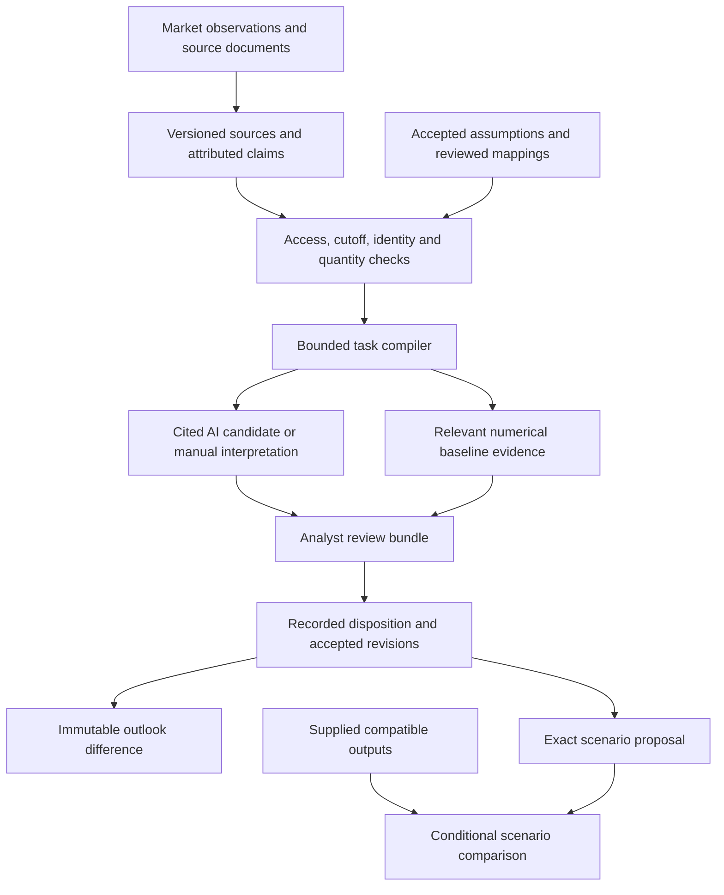

# InGRID project thesis

<!-- working-paper-2026-10-11 -->
> **2026-10-11 update:** the [working paper](working-paper-2026-10-11.md) now owns the conceptual
> framework and method definitions (probe bundle, stability receipt, cutoff pairing, System One
> port, covariate what-if). This thesis is preserved as the earlier explanation; where they differ,
> the paper and the [strategy refresh](../work/strategy-refresh-2026-10-11/strategy.md) govern.

Saved 2026-10-05. This is the human-readable explanation of the project's thesis,
theoretical grounding, architecture and intended contribution. The
[product blueprint](definitive-blueprint-2026-10-04.md) owns scope,
[architecture](../architecture/decision-system-v1.md) owns technical contracts, and
[milestones](../work/milestones.md) own execution. [Status](../status.md) distinguishes
implemented behavior from planned capability.

**Better power-system decisions require keeping forecasts, evidence and accepted
assumptions aligned as the world changes.** InGRID is an analyst workspace for
maintaining that alignment in the Philippine electricity system.

## The problem and the product

A forecast depends on more than a numerical model. It also depends on assumptions:
when a unit returns, when a project commissions, what an advisory means, which asset
a market identifier represents, whether a rule applies, and how demand or available
capacity should be represented. A mathematically sound forecast can still rest on an
outdated or unsupported assumption.

Relevant evidence arrives through market observations, system-operator advisories,
regulatory documents, project reports and other sources. These sources have different
publication times, availability histories, permissions, entity definitions and levels
of certainty. Repeated reporting may reproduce one original claim. A newer document
may describe a different milestone rather than overturn an earlier one.

InGRID asks: **What changed since the last accepted outlook, which assumptions
does it affect, and what should the analyst retain, revise or investigate?**

The central product is an attributable outlook revision: the prior position, exact
evidence, affected assumptions, alternatives considered, human decision and resulting
difference. A justified decision to retain an assumption is a useful result. The first
users are energy analysts and modelers. Grid, market and modeling decisions come first;
contracts and commercial exposure are later extensions.

Consider a fictional unit with an accepted return-to-service assumption of 18:00. A
new advisory says testing may begin at 18:00. Testing and commercial availability are
different events. The system should preserve the words, verify the unit mapping and
show the discrepancy. It may propose an interpretation, but the analyst decides whether
to retain the assumption, revise it, defer or investigate. A reviewed change can become
an exact model-input delta. Its numerical consequences remain uncomputed unless
compatible outputs are supplied.

Here, “nowcast” includes the current state of understanding as of an explicit information
cutoff. Numerical updates may run over minutes or hours; document and project updates
over hours or months; human review follows the decision's needs. Five-minute data
resolution does not establish five-minute freshness or require one cadence for every loop.

## The theoretical grounding

The four theories this grounding rests on (belief revision, decision theory, coordination theory,
organizational learning), with the records that instantiate each and where the instantiation is thin,
are on the [theoretical foundation](../architecture/theoretical-foundation.md) page (2026-10-16).

### Typed domain meaning

An ontology gives the system explicit distinctions between a plant, generating unit,
market resource and modeled aggregate; between installed, dependable and available
capacity; and between testing, commissioning and commercial operation. Competency
questions determine which distinctions the product needs. This follows practical
[ontology-development methods](https://protege.stanford.edu/publications/ontology_development/ontology101-noy-mcguinness.html).

Power-system standards such as the
[Common Information Model](https://www.entsoe.eu/digital/common-information-model/cim-for-grid-models-exchange/)
provide useful vocabulary and representation ideas. The project does not claim complete
CIM implementation or compliance. Its selected [ontology profile](../architecture/ontology-profile-v1.md)
is deliberately bounded by the first analyst journey.

Typed meaning matters because a string match cannot establish that two names refer to
the same unit, or that two capacity numbers measure the same quantity. A reviewed mapping
connects real entities to their model representations, with cardinality, validity and
supporting evidence.

### Provenance and separate authority

The system distinguishes observations, attributed source claims, AI interpretations,
accepted assumptions and simulation results. A source can assert something without
making it true; an AI can interpret it without making it accepted; a simulation can
produce a result without confirming that its assumptions describe reality.

[PROV-O](https://www.w3.org/TR/prov-o/) and
[SOSA/SSN](https://www.w3.org/TR/vocab-ssn/) inform the treatment of provenance,
observations, activities and attribution. These structures explain where a statement
came from and how it was used. They do not certify truth. Exact source versions,
passages, byte hashes, quoted text and transformation lineage make decisions inspectable.

### Temporal knowledge and historical reconstruction

Event time, publication time, first known availability, recording time and review time
answer different questions. A document published yesterday but first available to the
system today cannot silently enter yesterday's information set. A review performed
today cannot be backdated by using an older evidence cutoff.

Temporal-memory research such as [Zep](https://arxiv.org/abs/2501.13956) and
structured-retrieval research such as [HippoRAG 2](https://arxiv.org/abs/2502.14802)
offer patterns worth evaluating. Their published results do not establish forecasting
skill or decision quality for Philippine energy cases. The project's own tests must
measure whether historical snapshots and retrieval preserve the required distinctions.

### Explicit belief revision

Accepted assumptions are revisable commitments. New evidence may support, challenge or
leave them unresolved. The system preserves contradictory claims, prior decisions and
the reasons for changing or retaining a position. A changed dependency makes a draft
stale; it does not rewrite the historical decision that used an earlier version.

This draws on the idea of belief revision without claiming a universal AGM implementation
or a fully Bayesian inference engine. The practical contract is narrower: make the
assumption, evidence, contradiction, revision and unresolved work explicit.

### Unknowns and controlled action

Missing evidence remains unknown. No outage report does not prove availability. An
unknown mapping cannot alter a numerical assumption. Copied reports do not count as
independent corroboration. Unsupported source dates retain their original precision.

Every consequential operation has explicit prerequisites. AI output and source text
cannot grant a role, approve a revision or authorize external execution. Proposal,
analyst review, execution approval and an execution receipt remain distinct records.

## How reasoning becomes a bounded task

The proposed ontology-to-task compiler turns a decision question into a reproducible
task. It binds the case, accepted assumption revisions, reviewed mappings, source
versions, passages, information cutoff, audit cutoff and current access policy. It
selects bounded context, records permitted omissions and produces a deterministic digest.

For the initial evidence-assumption task, the candidate labels are supports, challenges,
mixed, unrelated and insufficient. These are semantic judgments about the supplied
evidence. They are not probabilities that an event will occur. The compiler and validators
control admissibility; models operate inside that context; the analyst controls acceptance.

This makes a result reviewable and repeatable. An analyst can see what was known, what
was excluded, which definitions were used and which exact dependencies would invalidate
the draft. The first implementation also supports manual review with no model available.

## The roles of models and people

| Component | Intended role | Boundary |
|---|---|---|
| TimesFM or another time-series model | Numerical trajectories and baselines | Must be evaluated for the particular horizon, target and information set |
| TabFM and boosted/tabular baselines | Structured predictions, including event or shortfall tasks | Fixture or retrospective scores do not establish general superiority |
| S1/Clef candidate layer | Portable evidence-assumption judgment tasks | Candidate meaning and confidence stay separate from event probability |
| Gemini | Cited claim interpretation, explanation and investigation assistance | Cannot accept assumptions, invent evidence or grant authority |
| Deterministic core | Hashes, access, cutoffs, identity, units, dependency and transaction checks | Validation does not establish source truth |
| Analyst | Review interpretations and accept, retain, reject, defer or investigate | Decision and rationale become attributable history |

The existing numerical research includes reported TabFM/boosted comparisons and
task-specific limitations of tested TimesFM shortfall-onset behavior. These remain
[dated findings](../work/branch-consolidation-2026-10-04/research-dispositions.md), rather
than a claim that one foundation model wins every energy task. Provider documentation
or a release announcement is not a successful project run.

## The technical architecture

The selected architecture separates the domain core from storage, identity, model and
interface adapters. Existing WESM Parquet and system-operator advisories in GCS are inputs;
the project does not need a replacement ingestion program.

The [decision-system design](../architecture/decision-system-v1.md) selects these
application components. Selection does not mean they are already deployed.

| Layer | Selected direction |
|---|---|
| Domain core | Python records and deterministic services; the first connected slice uses Python 3.11+ stdlib |
| API | FastAPI with typed contracts and explicit application ports |
| Hosting | Cloud Run |
| Identity | Server-verified Firebase authentication and explicit case/source permissions |
| Revision storage | Firestore append-only records with atomic accepted-head changes |
| Numerical data | Existing BigQuery/GCS estate and versioned artifact references |
| Original sources | Versioned source artifacts, exact passages and permission bindings |
| Analyst workspace | HTML/CSS/JavaScript interface showing evidence, review and outlook changes |

Review commits compare expected assumption and outlook heads. Idempotency keys bind
the tenant, case, actor and request digest: an identical retry returns its original
receipt; a changed payload or conflicting head fails without partial writes. Immutable
history and atomic pointers prevent one review from silently overwriting another.
The later Firestore adapter must preserve that behavior, including
[transaction retry constraints](https://firebase.google.com/docs/firestore/manage-data/transactions).
External model calls belong outside retryable commit transactions.

The evidence graph and the physical grid graph have different purposes. One represents
claims, assumptions and dependencies; the other represents physical topology and
electrical relationships. Reviewed mappings may connect them. Regional market series
do not supply a missing network model. Physical-grid foundation-model research, including
[GridFM](https://research.ibm.com/blog/gridfm-neural-solver-power-grid), is future context,
not a dependency for the first review workflow or a capability the project has demonstrated.

## Scenarios and the analyst experience

A reviewed assumption change becomes an explicit delta: the exact model/input field,
old and new typed values, units, validity period, entity mapping and source lineage.
Scenario comparison requires compatible outputs: model version, quantities, units,
horizons, regions and background assumptions must match the comparison contract.
Absent or incompatible outputs leave consequences uncomputed.

Such comparisons show conditional model consequences under stated assumptions. They
do not by themselves establish real-world causation, realized savings or avoided emissions.
Operational forecasting and solver execution require a separately authorized adapter.

The [workspace](interface-and-demo-v1.md) is organized around changes, a case, evidence,
review and the outlook difference. It exposes the cutoff, exact source passage, dependency
status, prior and proposed values, and the reason for a disposition. Observed, claimed,
predicted, proposed and accepted meanings remain visible. Live, stored, retrospective
and synthetic modes must be labeled truthfully.

## The innovation and how to test it

The intended contribution combines five ideas in one analyst workflow:

1. Compile decision tasks from explicit domain meaning, accepted state and permitted
   evidence, so their inputs can be reproduced.
2. Turn new evidence into specific review obligations and stale-dependency signals.
3. Connect semantic interpretation to numerical inputs through reviewed, typed mappings.
4. Direct investigation toward consequential unknowns rather than forcing a confident answer.
5. Preserve institutional decision memory: what was known, decided, changed and left open.

This is an application and empirical contribution. The project does not claim to have
invented ontologies, retrieval, time-series foundation models or belief revision.

The central evaluation should compare retrieval with and without the selected ontology
and compiler constraints on matched questions, information cutoffs and evidence budgets.
Measure missed material issues, unsupported revision proposals, identity errors, citation
and cutoff correctness, review time and rework. Use adjudicated analyst cases and retain
counterexamples such as late evidence, ambiguous identity, copied lineage and justified
no-change. Forecast quality requires separate numerical evaluation. Commercial and
sustainability benefits require additional evidence.

Accepted decisions can become reviewed examples for later adaptation, subject to permission
and evaluation. They remain judgments made with a particular information set; they are
not automatically labels of actual event truth. Fine-tuning, cross-asset transfer and
broader physical-grid modeling are later research options.

## What exists and what comes next

The repository contains offline F0 artifact contracts and validation, the synthetic M0
baseline harness, the synthetic native-text R0 parser, numerical research scripts and
static interface prototypes. These are bounded foundations. The R0-to-F0 export adapter
has an intent; it is not implemented. Real-corpus parsing quality and Python 3.11 execution
are not established by the current local Python 3.14 checks.

The connected review core, production identity/storage, live Gemini task, deployed workspace,
real analyst-case validation and scenario-output comparison still need implementation
and evidence. Historical experiments and prototypes are not implicit production dependencies.

The next slice is the ready [H0 offline review case](../work/h0-review-case/intent.md):
register exact evidence; enforce availability and identity; compile a reproducible task;
record a manual review atomically; preserve an immutable outlook difference; prepare a
proposal without executing it. Model and cloud adapters follow as bounded intents.
The [input register](../work/input-register.md) tracks the real-case, mapping, availability,
service and release inputs that later milestones require.
