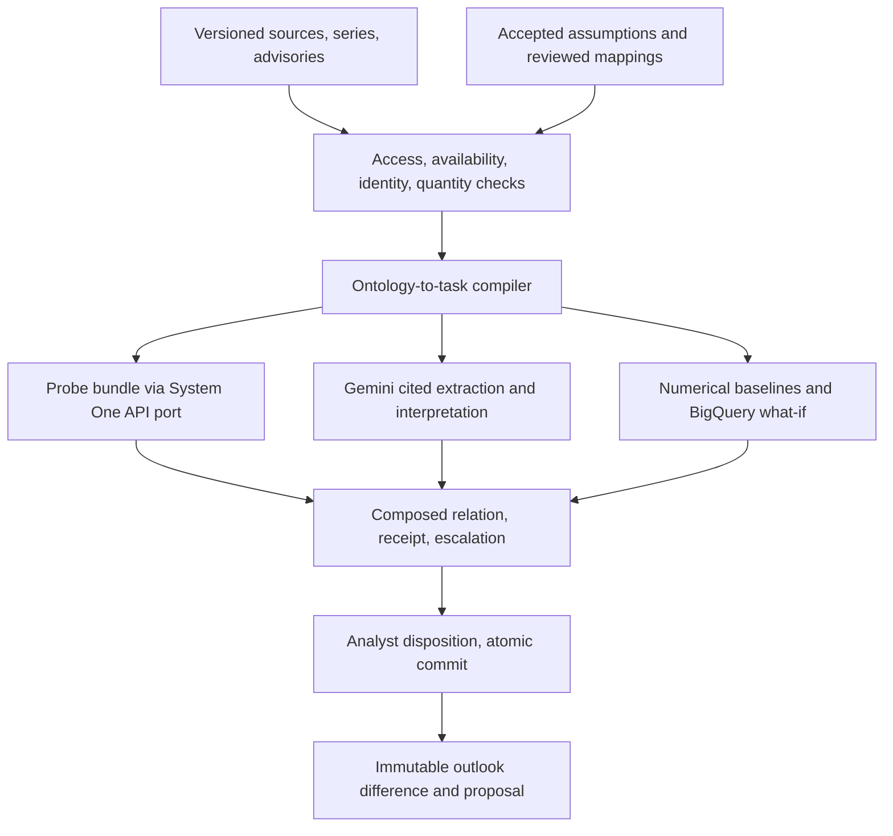

# InGRID: compiled probe bundles for evidence-to-outlook review in power-system analysis

**Working paper v0.1, 2026-10-11. InGRID project team; owner Sam.**

Authority: this paper owns the conceptual framework and the method definitions that the
[2026-10-11 strategy refresh](../work/strategy-refresh-2026-10-11/strategy.md) selected. The
[v1 blueprint](definitive-blueprint-2026-10-04.md) still owns product scope, the
[milestones](../work/milestones.md) own execution order and [status](../status.md) owns what
actually exists. Where this paper and the blueprint differ, the strategy refresh records which
blueprint selections were revised. It supersedes the explanatory role of the earlier
[project thesis](project-thesis.md). Every component below carries a state label; the paper
describes a design and an evaluation plan, not measured capability. Citations are drawn from
the dated research dossiers ([D21](../research/21-system-one-jev.md),
[D22](../research/22-tabular-timeseries-fms.md), [D26](../research/26-google-stack-fit.md),
[D28](../research/28-research-grounding-2026-10-04.md), [D29](../research/29-reference-reinforcements-2026-10-04.md),
[D30](../research/30-decision-models-and-energy-2026-10-11.md)); the reference list repeats
their URLs and retrieval dates.

## Abstract

Power-system outlooks rest on numerical models and on assumptions: when a unit returns, when
a project commissions, what an advisory means, which asset a market identifier denotes. A
forecast can be numerically sound and still inherit a stale assumption. InGRID is a
change-review desk for Philippine grid and market analysts that asks one question: what
changed since the last accepted outlook, which assumptions does it affect, and what should the
analyst retain, revise, defer, reject or investigate? This paper defines the framework and
method. Evidence is registered with exact bytes, passages and five time axes; accepted
assumptions are revisable commitments with immutable history; an ontology-to-task compiler
produces reproducible, permission- and cutoff-bounded tasks. The new contribution is the
*probe bundle*: instead of asking a model for one five-way relation label, the compiler emits
a set of atomic typed questions derived from ontology distinctions, renders each in several
equivalent forms, sends the whole bundle through a portable System One API port, and composes
the relation label in code from the answers, a sufficiency gate and a perturbation-stability
receipt. The same bundle compiled at the information cutoff before and after new evidence
yields the "what changed" signal. A reviewed assumption delta becomes a future-covariate path
for two native BigQuery `AI.FORECAST` calls, giving a directional, explicitly labelled scenario
difference. Gemini performs cited extraction, competing interpretations, review briefs and
escalation. We describe the evaluation design, including five ablations, and state what the
project will not claim. The offline review core, local API and workspace exist; the probe
bundle, live Gemini task, what-if and hosting are designed and not yet built.

## 1. Introduction

Energy analysts maintain outlooks that combine market observations, system-operator
advisories, regulatory documents and project reports with numerical models. These inputs
have different publication times, availability histories, permissions and entity definitions.
Repeated reporting often reproduces one original claim. A newer document may describe a
different milestone rather than overturn an earlier one. In this setting the costly error is
rarely a wrong number; it is a sound calculation performed on an assumption that the world
has already invalidated.

Two developments make a better tool feasible now. First, non-generative *decision models*
(TypeSafe's Jev, Cloudflare's Clef, OpenAI's Decisions API and several open-weight entrants)
return typed option distributions over caller-defined choices at a fraction of the cost of
generative calls, and a shared System One API contract now spans several vendors and local
servers [D21, D30]. Second, a wave of independent audits in September and October 2026 showed
precisely how these models fail: they overstate the probability of their top option, flip
under option order and yes/no polarity changes, are overconfident on events after their
knowledge boundary, and have no abstain primitive [D30]. The same audits found that a targeted
"does the evidence suffice" question discriminates far better than answer confidence [D30].

InGRID turns those findings into a mechanism rather than a caveat. Its contribution
is an application and empirical one. We do not claim to have invented ontologies, retrieval,
time-series foundation models, decision models or belief revision [D28]. We claim a specific,
testable composition:

1. Compile bounded, reproducible decision tasks from explicit domain meaning, accepted state
   and permitted, known-then evidence.
2. Replace the single model judgment with a compiled probe bundle whose relation label is
   composed in code from atomic answers, a sufficiency gate and a stability receipt.
3. Pair bundles across information cutoffs to turn new evidence into specific review
   obligations and stale-dependency signals.
4. Connect semantic interpretation to numerical inputs through reviewed typed mappings, and
   compute a labelled, directional scenario difference natively where a covariate path exists.
5. Preserve institutional decision memory: what was known, decided, changed and left open.

Section 2 states what exists. Sections 3 and 4 give the problem and framework. Section 5
defines the method. Section 6 is the evaluation design. Sections 7 to 9 cover plan, limits
and boundaries.

## 2. State of the work

| Component | State on 2026-10-11 | Evidence |
|---|---|---|
| Exact evidence registry, strict known-then compilation, atomic manual review, immutable outlook history, proposal-only deltas (H0) | Implemented locally, synthetic fixtures | [H0 review](../work/h0-review-case/implementation.md); part of 220 offline tests |
| Local API, server-verified identity, transactional Firestore persistence (H1) | Implemented locally against emulators | [H1 review](../work/h1-api-persistence/review.md); 55 emulator tests |
| Connected analyst workspace, cutoff compilation, history, proposal export (M3) | Implemented locally; AI disabled by default | [M3 workspace](../work/m3-workspace/implementation.md); browser checks |
| Cited judgment boundary and bounded Gemini transport | Implemented locally; no live call has occurred | [M3 judgment](../work/m3-gemini/implementation.md), [transport](../work/m3-live-gemini/implementation.md) |
| F0 artifact contracts, M0 synthetic numerical evaluation, R0 native-text parser | Implemented, bounded | [F0](../work/bb8-contracts/review.md), [M0](../work/bb1-modeling/review.md), [R0](../work/bb2-regulatory/review.md) |
| Recorded TabFM/boosted comparison on regional onset labels | Dated result, not rerun | [Data foundation](../work/data-foundation/timesfm-tabfm.md) |
| Probe bundle: atomic questions, perturbations, composition, receipt, cutoff pairing | Designed, not built | This paper, section 5 |
| System One API port with Clef-flash or Gemini emulation backends | Designed, not built | Section 5.5 |
| BigQuery `AI.FORECAST` covariate what-if | Designed, not run | Section 5.6 |
| Hosted deployment, real permitted case, release artifacts | Not started; inputs open | [Input register](../work/input-register.md) |
| Claim that the bundle beats a single judgment | Hypothesis | Section 6 |

## 3. Problem formulation

**Entities and representations.** The domain has plants, generating units, market resources
and modelled aggregates, with distinct capacity notions (installed, dependable, available)
and distinct milestones (testing, synchronisation, commissioning, commercial operation). A
*reviewed mapping* links a real entity to a model representation with cardinality, validity
period and supporting evidence [ontology profile]. String similarity never establishes identity.

**Assumptions.** An accepted assumption is a typed value bound to a representation and a
validity period, with a revision history. The *belief snapshot* is the set of accepted
assumption heads at an audit cutoff; it is a projection of history, not a second store.

**Evidence.** A source version is immutable bytes with a digest; a passage is an exact quoted
span with its own digest; a claim is attributed to a source and grouped by lineage so that
copies do not count as corroboration. Each record carries five times: event or valid time,
publication time, first availability, recorded time and review time. Date-only data stays a
date. Unknown first availability is excluded from strict known-then context, not backfilled.

**The review question.** Given a case, an accepted assumption revision *a*, a reviewed
mapping *m*, an information cutoff *T* and the set of permitted passages known at *T*, decide
the relation of the evidence to *a* in {supports, challenges, mixed, unrelated,
insufficient}, propose alternatives, and let the analyst record a disposition in {retain,
revise, reject, defer, investigate} with a reason. A justified no-change is a success.

**Invariants.** Semantic judgment scores are not event probabilities. Source text and model
output cannot grant authority, approve a revision or authorise execution. Proposal, analyst
review, execution approval and execution receipt are distinct records. An ambiguous mapping
cannot silently alter a model input. Unknown stays unknown.

## 4. Framework

### 4.1 Layers and authorities



The deterministic core owns hashes, access, cutoffs, identity, units, dependencies and
transactions. Models operate only inside compiled context. The analyst owns acceptance. No
model call occurs inside a retryable storage transaction [D28, architecture].

### 4.2 Metadata dimensions

Every record carries four independent axes: content kind (observation, reported claim,
derivation, prediction, interpretation, assumption, scenario input, simulation output, review
decision); review state (unreviewed, proposed, retained, accepted, rejected, deferred,
investigating); availability (verified by cutoff, later than cutoff, unknown, denied); and
execution mode (live inference, stored run, retrospective replay, deterministic, synthetic
fixture). "Accepted" is not a content kind; it never turns a prediction into an observation.

### 4.3 Two clocks, three loops

Numerical updates run over minutes to hours; document and project updates over hours to
months; human review follows the decision's needs. Five-minute market resolution does not
imply five-minute freshness. Reviewing historical evidence today is never a decision made at
that historical time: information cutoff and review time are always separate.

## 5. Methodology

### 5.1 Ontology-to-task compiler (implemented for single tasks; bundle rendering designed)

Input: authenticated actor, case, task revision, information cutoff, audit cutoff and the
accepted snapshot. Order: access filter, availability filter, reviewed identity, context and
type checks, relevant passages and series, lineage grouping, bounded render, canonical digest.
The compiled task is immutable and lists allowed references and explicit omissions. Strict
mode excludes unknown or later availability. The rendered state excludes access scope,
membership metadata and unrelated case state. Today the renderer emits one prompt for one
five-label judgment [M3 judgment]; the bundle renderer in 5.2 will be a second renderer over
the same compiled task, so task identity and digests are unchanged.

### 5.2 Probe bundle (designed, not built)

For one evidence-assumption pair the compiler will emit the following atomic questions.
Types follow the System One primitives: *choice* (one of named options), *noul* (yes/no
probability), *score* (ordered levels). Criteria are shown abbreviated; exact wording is an
intent decision and is versioned with the prompt.

| ID | Type | Question (abbreviated) | Options or levels |
|---|---|---|---|
| Q1 identity | choice | Which reviewed candidate entity does the passage refer to? | one option per candidate in the reviewed mapping, plus `cannot_tell` |
| Q2 event | choice | Which event does the passage describe for that entity? | `testing`, `synchronisation`, `commercial_availability`, `outage_or_extension`, `other` |
| Q3 time | choice | How does the stated time relate to the assumed time? | `before`, `same`, `after`, `not_stated` |
| Q4 conditional | noul | Is the statement conditional, planned or subject to clearance rather than confirmed? | yes/no |
| Q5 lineage | noul | Does the passage repeat an earlier source already in context rather than add new information? | yes/no |
| Q6 target | noul | Does the passage report an observation (something happened) rather than a target or plan? | yes/no |
| Q7 sufficiency | noul | Do the supplied passages suffice to decide whether the assumption is supported or challenged? | yes/no |
| Q8 direction | choice | Taken alone, does the passage support, challenge or leave unchanged the assumed value? | `supports`, `challenges`, `neither` |

Q7 is the evidence-sufficiency gate motivated by the finding that a targeted sufficiency
question discriminates at AUROC 0.95 against 0.85 for answer confidence [D30]. Q1 to Q6 are
the ontology distinctions the blueprint already requires an analyst to see (identity, event
type, time relation, conditionality, lineage, modality). Q8 is retained only for the ablation
against the single-render baseline; it never decides on its own.

**Composition.** The relation label is composed deterministically from the *modal* top option
of each question across its forms (ties resolve to `cannot_tell`, `not_stated`, `other` or
`neither` as applicable), after the stability receipt (5.3) has been applied. Named parameters: `tau_suff`
(sufficiency threshold, initial 0.6), `tau_cond` (conditional threshold, initial 0.5),
`tau_lineage` (initial 0.5). The table is total; `insufficient` is the fall-through.

| Condition (evaluated in order) | Label |
|---|---|
| Bundle unstable per 5.3, or Q7 < `tau_suff`, or Q1 = `cannot_tell` | `insufficient` |
| Q1 is not the assumption's mapped entity | `unrelated` |
| Q2 = `other` | `unrelated` |
| Q5 ≥ `tau_lineage` (repeat of in-context source) | label of the earlier source's bundle; if none, `insufficient` |
| Q2 = `commercial_availability` and Q3 = `same` and Q4 < `tau_cond` | `supports` |
| Q2 ∈ {`testing`, `synchronisation`} and the assumption is commercial availability | `challenges` (milestone mismatch) |
| Q2 = `outage_or_extension` or Q3 = `after` | `challenges` |
| Q3 = `before` and Q6 = yes | `supports` |
| Q4 ≥ `tau_cond` and Q3 ∈ {`same`, `before`} | `mixed` (conditional support) |
| Q3 = `not_stated` | `mixed` if Q8 ≠ `neither`, else `insufficient` |
| otherwise | `insufficient` |

The composed answer records which row fired. These rules encode the project's own semantics
(testing is not commercial availability; a later date challenges an earlier assumption; a
conditional statement supports at most partially). They are a first version to be refined
against the labelled fixtures, and they are inspectable by the analyst. The row "Q3 = `before`
and Q6 = yes → `supports`" is deliberately contestable: an observed earlier return supports a
supply outlook but contradicts a return-date assumption as stated. Ablation A1 must test it
with both assumption kinds before it is kept.

### 5.3 Perturbation set and stability receipt (designed, not built)

Each question is rendered in *K* equivalent forms within one request, initial *K* = 4:

- **Order**: option order permuted (counters first-position bias [D30, jaggedness page]).
- **Polarity**: noul questions asked in negated form and inverted (counters the 50.5-per-100
  yes/no swap flips reported for Jev [D30]).
- **Alias**: options replaced by neutral bracketed numeric IDs with the mapping in the
  question text (the readout approach of LLM-as-Jev and the option-name sensitivity finding
  [D21, D30]).
- **Passage order**: context passages shuffled.

Receipt fields per question: top option under each form; `flip_rate` = share of forms whose
top option differs from the modal top option; `polarity_gap` = |p(yes) − (1 − p(no-form))|
for nouls; `max_gap` over forms. Bundle-level: `unstable` = any question with `flip_rate` >
`tau_flip` (initial 0.25) or `polarity_gap` > `tau_pol` (initial 0.3). Thresholds are initial
values, not tuned; the ablation in section 6 fixes them on a calibration split before the
test split is touched. The receipt is persisted with the judgment artifact and shown in the
review bundle. It is a property of the task instance, not a calibration claim about any model.

### 5.4 Cutoff pairing and dependency impact (designed; cutoff compilation exists)

The same bundle is compiled twice: at *T0*, the cutoff immediately before the new source's
first availability, and at *T1*, after it. The *T0* context contains only passages known
then; the *T1* context adds the new passages. The paired diff lists which atomic answers
changed and the composed labels at each cutoff. A change from `supports` or `unrelated` to
`challenges` or `mixed` creates a review obligation and marks dependent drafts stale through
the existing dependency records. The pairing reuses H0's strict compilation; no model sees the
later cutoff when answering for the earlier one.
Replay is read-only: a task compiled against a historical snapshot can be inspected and
re-judged, but a review decision needs the current accepted heads; a stale head is refused
rather than reviewed in the past.

### 5.5 System One API port and backends (designed, not built)

One adapter speaks the System One request shape: `model`, `state` (the rendered compiled
task as JSON), `questions{name: {type, instructions, criteria}}`; and the response shape:
per question `choice`/`probabilities`/`confidence` or `noul`, plus the provider's model
version [D21, D30]. Backends:

- **Clef-flash self-hosted** (Apache-2.0 weights; served by SGLang, llama.cpp ≥ 0.6.0 or
  Ollama ≥ 0.35 on `/v1/systemone`) on Cloud Run GPU. Fit on an NVIDIA L4 is unmeasured; the
  attempt is timeboxed [D30].
- **Gemini structured output emulation**: one `generateContent` call with a response schema
  whose properties are one object per question and form, enum-constrained options and a
  verbalized probability vector. Gemini 3.x returns no logprobs [D26]; these probabilities are
  *uncalibrated verbal estimates* and are labelled so. The composition and receipt use top
  options and relative gaps, so the method does not depend on calibration.
- **Replay fixtures**: stored responses labelled `synthetic fixture` or `stored run`.

Jev, OpenAI Decisions and Perplexity are optional comparison baselines only when keys, case
permission and budget exist. State hygiene applies to every backend: the state is the compiled
permitted context only; no membership, access or routing information is included; authority
and routing stay in code; override text in sources is data, not instruction [D30, 2609.28613].

### 5.6 Scenario consequence via covariate what-if (designed, not run)

A reviewed delta names an exact numerical field: for a unit return, hourly available
capacity of the mapped representation over the validity period. The what-if is two BigQuery
`AI.FORECAST` calls with `model => 'TimesFM 3.0'` over identical history, each with a
different future-covariate path (for example PEDC-3 available from 2026-10-03 versus from the
last week of October), target and past-covariate columns NULL in future rows, horizon within
1,024 and context a multiple of 32 up to 2,048 [D30]. The output is the difference of the two
target structs per horizon step. It is labelled *Preview, directional*: default covariate
interfaces can attenuate or ignore covariate effects, and TimesFM 3.0 has not been tested for
this [D30, 2610.08118]. TimesFM 3.0 is used only through BigQuery; downloaded weights are
non-commercial [D30]. Without the preview, a compatible series or a reviewed covariate
construction, the consequence stays explicitly uncomputed, as today.
The consequence shown is a proposal or a directional preview. It is not the production
forecast, which runs in the company's PLEXOS process under its own governance (section 9).

### 5.7 Gemini roles (transport implemented; no live task yet)

Gemini performs cited claim extraction from advisory text and images, proposes competing
interpretations and unknowns, writes the review brief, and handles escalation when a bundle is
`insufficient` or unstable. Its output is validated against the immutable task context: one
label, one explanation, exact whole-passage citations, bounded alternatives [M3 judgment].
Gemini never composes the relation label from its own confidence and cannot accept an
assumption.

### 5.8 Review transaction (implemented)

The analyst sees the prior position, exact passages, composed label with the firing rule,
receipt, Gemini brief, numerical context and dependency path, then records a disposition and
reason. The commit compares expected heads, binds an idempotency key to tenant, case, actor
and request digest, and appends decision, head change and audit record atomically. An
identical retry returns the original receipt; a conflicting head fails without partial writes.

## 6. Evaluation design

No evaluation of the bundle has run. The design fixes questions, splits and metrics before
any backend is called.

**Data.** (a) Labelled synthetic fixtures extending the H0 case: testing versus commercial
availability, planned versus confirmed outage, near-name assets, copied lineage, conditional
clauses, later-than-cutoff documents, negation. Annotation policy is frozen before scoring
[D28, S1]. (b) The public Visayas episode of September 2026 (PEDC-3 return target slipping,
TVI-1 return and trip, 2026-09-28 triple trip, ERC regional cap order), if the owner permits
registering captured original statements; press relays are secondary and not corroboration
[D30]. Fixture and real results are reported separately.

**Ablations.** Same compiled tasks, cutoffs and evidence budget throughout.

| Ablation | Compared conditions | Primary question |
|---|---|---|
| A1 bundle | single-render Q8-only judgment vs full bundle | does decomposition plus composition improve label accuracy and abstention quality? |
| A2 gate | bundle with and without Q7 sufficiency gate | does the gate reduce unsupported revisions and missed challenges? |
| A3 receipt | bundle with and without stability downgrade | does measured instability predict errors? |
| A4 context | plain passage retrieval vs ontology-compiled context | the O1/I1 comparison from research 28 |
| A5 backend | Gemini emulation vs Clef-flash vs any available baseline | is the method backend-agnostic? |

**Metrics.** Missed material issues (challenges labelled otherwise), unsupported revision
proposals, identity errors, citation and cutoff correctness, abstention rate and selective
accuracy at matched coverage, flip rate distribution, review time and rework on the walkthrough
[blueprint section 9]. Semantic and numerical errors are reported separately [D29].

**Numerical.** For the what-if, a paired counterfactual check on a synthetic series with a
known covariate effect, following the method that exposed attenuation in other models
[D30, 2610.08118], before any directional claim about WESM. The existing recorded result stands
as context: on one September run TabFM and a local boosted model were statistically tied on
regional onset AUC (Visayas 0.947 vs 0.943; Mindanao 0.967 vs 0.961), with one context sample
and uncalibrated probabilities [data foundation].

**What the project will not claim** [D28]: live nowcasting or production readiness; a newly
trained or first-ever grid foundation model; earlier warnings than the operator, prevented
blackouts, saved money or reduced emissions; calibrated event probabilities from semantic
scores; a graph path as proof of cause; scenario differences as measured real-world effects;
an autonomous recommendation as approval to operate anything; "first energy deployment of a
decision model" (only "no published deployment found as of 2026-10-11").

## 7. Implementation plan

Order follows the cut order in the strategy refresh. Day targets are internal, Asia/Manila.
The [grand execution plan](../work/milestones.md) and its task graph own day targets from
2026-10-11; this table is the paper's summary and yields to the plan where they differ.

| Day | Deliverable | Milestone |
|---|---|---|
| 10-12 | Bundle renderer, composition table, receipt and cutoff pairing in stdlib against the fixture provider, with tests; intent packet `docs/work/probe-bundle/` | M3 |
| 10-13 | System One API port; Gemini structured-output emulation; one authorized live Gemini task with receipt; Clef-flash on Cloud Run GPU attempted within the day | M3 |
| 10-14 | Labelled fixtures frozen; ablations A1 to A4 run on fixtures; evaluation view in the workspace | M4 |
| 10-15 | BigQuery what-if on a public regional series with the PEDC-3 covariate path, or the uncomputed label; Visayas case pack if permitted | M4 |
| 10-16 | Hosted deployment, sandbox isolation, unfamiliar-user walkthrough; freeze | M5 |
| 10-17 | Public source export audited for fresh-work and private data; deck PDF; video under 180 s; submission receipts | M6 |

Nothing here authorises a cloud change, a model call or a publication by itself; each needs
its recorded inputs [input register].

## 8. Limitations and threats to validity

- The composition table encodes the team's semantics; a wrong rule produces consistent wrong
  labels. Mitigation: the firing rule is displayed, and A1 measures it against the baseline.
- Stability measures sensitivity to the perturbations we chose, not robustness in general.
  Models may be stable and wrong [D21].
- Verbalized probabilities from Gemini are not calibrated; only orderings and gaps are used.
- The fixture set is small and project-authored; real-case value is unestablished until a
  permitted episode is reviewed by an analyst with a measured baseline [cases].
- Covariate what-ifs can be attenuated or ignored by the forecaster; TimesFM 3.0 is untested
  for this and the feature is Preview with pricing changes after the deadline [D30].
- Decision models remain susceptible to adversarial text in state; filtering and code-side
  authority reduce but do not eliminate this [D30].
- A single week and three open milestones limit how much of the design will be evidenced.
- Scenario consequences are proposals and previews, not production forecasts. The company's
  PLEXOS forecasting process is under its own review and revamp; InGRID hands typed
  proposals to it and neither executes nor binds it (section 9).

## 9. Ethical, authority and data boundaries

Private data and credentials stay out of Git; fixtures are labelled synthetic. Public
statements are registered only from captured original versions with first availability
recorded, and only with the owner's permission. The system does not operate the grid, run a
forecasting system or dispatch anything; execution requires a separately authorised adapter.
Analysts' decisions become attributable history; the reason field is mandatory. Modes
(live, stored, replay, synthetic) are labelled truthfully in every view.

Boundary with the production forecasting process (decided 2026-10-13). InGRID owns
evidence capture, attributed claims, reviewed identity mappings, accepted assumptions,
review decisions, outlook history and the typed scenario proposal. The PLEXOS process owns
model objects, execution, run outputs and numerical consequences. The only shared object is a
versioned model representation: input field names with unit and quantity kind. In the
competition slice the representation is abstract and the governed scope is unit availability
and return dates. A proposal exported toward PLEXOS is a handoff that process may decline, not
an instruction. Real records are admitted only with a permission reference to a dated owner
authorization recorded in the repository; until that record exists, every record stays
labelled synthetic.

## 10. Conclusion

InGRID reframes the model's job in outlook review: not to decide, but to answer a
compiled set of small, typed, perturbation-checked questions whose composition and
sufficiency the analyst can inspect, across the exact information cutoffs that matter. The
September and October 2026 audits of decision models supply the motivation and the test
design; Google's native forecasting path supplies a labelled way to see consequences. What
remains is to build the bundle, run the ablations, and report honestly what they show.

## References

Retrieval dates as recorded in the dossiers (2026-10-02 for [D21], [D22], [D26]; 2026-10-04 for
[D28], [D29]; 2026-10-11 for [D30]).

1. TypeSafe AI, "Introducing System One models and Jev", https://typesafe.ai/blog/introducing-system-one-models-and-jev [D21].
2. TypeSafe AI docs, primitives, state, confidence, models, jaggedness, patterns: https://docs.typesafe.ai/primitives.md ; https://docs.typesafe.ai/concepts/state.md ; https://docs.typesafe.ai/confidence ; https://docs.typesafe.ai/models ; https://docs.typesafe.ai/model-jaggedness/jev-1.13 ; https://docs.typesafe.ai/patterns [D21, D30].
3. Deußer, Sparrenberg, Sifa, "Evaluating and Benchmarking the System One Model Jev", arXiv 2609.37647 [D21].
4. Porcedda, Sys1Cal-v1, arXiv 2609.35342 [D21].
5. Ibrahim and Zaki, arXiv 2609.24574 [D21].
6. Sun et al., option-name sensitivity, arXiv 2609.26758 [D21].
7. "General Decision Models: Benchmarking and Insights Beyond Jev", arXiv 2610.03935 [D30].
8. Li and Wagle, "LLM-as-Jev", arXiv 2610.02076 [D30].
9. Rafe and Das, polarity flips and selective prediction, arXiv 2610.00346 [D30].
10. Shankaranarayana, Runje, Jannink, "Beyond Answer Confidence: A Controlled Audit of Self-Knowledge in a Black-Box Decision Model", arXiv 2610.01006 [D30].
11. TypedBench, arXiv 2610.11392 [D30].
12. "Decision Hijacking", arXiv 2609.28613 [D30].
13. Cloudflare, Clef decision models: https://blog.cloudflare.com/clef-decision-models/ ; model card https://huggingface.co/cloudflare/clef-flash ; changelogs 2026-10-01 and 2026-10-09 [D30].
14. OpenAI Decisions guide, https://developers.openai.com/api/docs/guides/decisions [D30].
15. llama.cpp v0.6.0 release, https://github.com/ggml-org/llama.cpp/releases/tag/v0.6.0 ; Ollama System One API, https://docs.ollama.com/api/systemone [D30].
16. Microsoft Decision-1, https://commandline.microsoft.com/microsoft-decision-1-model-foundry/ [D30].
17. Google, BigQuery `AI.FORECAST` reference and multivariate tutorial: https://docs.cloud.google.com/bigquery/docs/reference/standard-sql/bigqueryml-syntax-ai-forecast ; https://docs.cloud.google.com/bigquery/docs/timesfm-multivariate-single-time-series-forecasting-tutorial [D26, D30].
18. Google Research, TimesFM repository and 3.0 licence, https://github.com/google-research/timesfm ; https://huggingface.co/google/timesfm-3.0-pytorch [D30].
19. Won, paired counterfactual tests of covariate handling, arXiv 2610.08118 [D30].
20. TRACE, operator text at forecast cutoff, arXiv 2610.02256 [D30].
21. Lipiecki and Weron, foundation models for electricity price forecasting, arXiv 2609.00089 [D22].
22. Pan and Ezzat, TSFMs for electricity price forecasting, arXiv 2607.02623 [D22].
23. Tan et al., "Are language models actually useful for time series forecasting?", NeurIPS 2024 [D22].
24. Google forum confirmation that Gemini 3.x returns no logprobs, https://discuss.ai.google.dev/t/missing-logprobs-support-in-the-newest-gemini-models-3-1-pro-3-6-flash-on-vertex-ai-and-ai-studio/176557 [D26].
25. Gemini structured output, https://ai.google.dev/gemini-api/docs/structured-output [D26].
26. Firestore transactions, https://firebase.google.com/docs/firestore/manage-data/transactions [D28].
27. Noy and McGuinness, Ontology Development 101, https://protege.stanford.edu/publications/ontology_development/ontology101-noy-mcguinness.html [thesis].
28. W3C PROV-O, https://www.w3.org/TR/prov-o/ ; SOSA/SSN, https://www.w3.org/TR/vocab-ssn/ [thesis].
29. Zep temporal memory, arXiv 2501.13956 ; HippoRAG 2, arXiv 2502.14802 [thesis].
30. IEMOP, August 2026 billing release, https://www.iemop.ph/news/tight-regional-supply-conditions-pushed-august-wesm-prices-higher-in-visayas-and-mindanao/ [D30].
31. AI Builder Cup 2026, https://aibuildercup.com/ ; https://aibuildercup.com/Faqs.html ; https://aibuildercup.com/themes.html [D30].

## Appendix A. Example bundle request and composed answer (illustrative, fictional)

Request to the System One API port (abbreviated; four forms per question are emitted, one
shown). The state is the rendered compiled task.

```json
{
  "model": "gemini-emulation",
  "state": {
    "task_digest": "…",
    "assumption": {"entity": "unit:fictional-U3", "field": "commercial_availability_from", "value": "2026-10-03"},
    "mapping": {"candidates": ["unit:fictional-U3", "unit:fictional-U2"], "reviewed": "unit:fictional-U3"},
    "information_cutoff": "2026-09-14T00:00:00+08:00",
    "context": [
      {"passage_index": 0, "source": "advisory-v2", "quote": "Unit 3 testing may begin on 3 October, subject to clearance."}
    ]
  },
  "questions": {
    "q1_identity_f0": {"type": "choice", "instructions": "Which reviewed candidate does passage 0 refer to?",
      "criteria": {"[11]": "unit:fictional-U3", "[12]": "unit:fictional-U2", "[13]": "cannot tell"}},
    "q2_event_f0": {"type": "choice", "instructions": "Which event does passage 0 describe for that entity?",
      "criteria": {"[D21]": "testing", "[D22]": "synchronisation", "[23]": "commercial availability", "[24]": "outage or extension", "[25]": "other"}},
    "q4_conditional_f0": {"type": "noul", "instructions": "Is the statement conditional or subject to clearance rather than confirmed?"},
    "q4_conditional_f1": {"type": "noul", "instructions": "Is the statement an unconditional confirmation?"},
    "q7_sufficiency_f0": {"type": "noul", "instructions": "Do the supplied passages suffice to decide whether the assumed commercial availability date is supported or challenged?"}
  }
}
```

Composed answer persisted with the judgment artifact:

```json
{
  "label": "challenges",
  "fired_rule": "milestone_mismatch: Q2=testing while assumption is commercial_availability",
  "atomic": {"q1": "unit:fictional-U3", "q2": "testing", "q3": "same", "q4": 0.82, "q5": 0.08, "q6": 0.12, "q7": 0.74, "q8": "challenges"},
  "receipt": {"forms": 4, "flip_rate": {"q1": 0.0, "q2": 0.0, "q3": 0.25}, "polarity_gap": {"q4": 0.06, "q7": 0.11}, "unstable": false,
              "thresholds": {"tau_suff": 0.6, "tau_cond": 0.5, "tau_lineage": 0.5, "tau_flip": 0.25, "tau_pol": 0.3}},
  "cutoff_pair": {"T0": "insufficient", "T1": "challenges", "T0_rule": "Q1=cannot_tell (no passages known at T0)", "changed": ["q1", "q2", "q3", "q7", "q8"]},
  "provider": {"name": "gemini-emulation", "execution_mode": "synthetic fixture", "probabilities": "verbalized, uncalibrated"},
  "escalation": "none"
}
```

## Appendix B. Glossary

- **Probe bundle**: the set of atomic typed questions, in several equivalent forms, that the compiler emits for one evidence-assumption pair, together with the composition rules.
- **Stability receipt**: per-question and per-bundle measures of how much top answers change across equivalent forms; persisted with the judgment.
- **Sufficiency gate**: the noul question asking whether the supplied passages suffice; below threshold the label is `insufficient`.
- **Cutoff pairing**: compiling and answering the same bundle at the cutoff before and after a source's first availability; the diff is the change signal.
- **System One API port**: the single adapter speaking the shared decision-model request/response contract, with Clef-flash, Gemini emulation and replay backends.
- **Covariate what-if**: two native forecasts over identical history with different future-covariate paths derived from a reviewed assumption delta; labelled directional.
- **Belief snapshot**: the accepted assumption heads at an audit cutoff; a projection of history, not a store.
- **Justified no-change**: a retain disposition with a recorded reason; a successful outcome.

---

A later companion paper frames the problem as accountability and reports graded measurements:
[Who answers for a decision made with AI?](paper-accountable-ai-decisions-2026-10-17.md) (2026-10-17).
